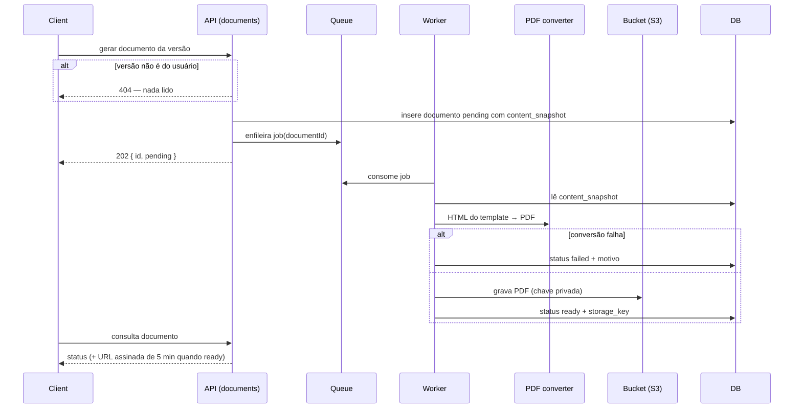

# Application Manager — Fases 0 a 2

> Plan from this document. Each slice below carries its own shape - copy it, do not re-derive it.
> Status: confirmed by o autor do projeto, 2026-11-02

## Situation

- Project: in active construction — nenhum código ainda; só as diretrizes em `docs/`.
- Decision: committed pelo autor do projeto, 2026-11-02, em [docs/project-brief.md](../docs/project-brief.md) — construir é ao mesmo tempo ferramenta e objetivo de estudo.
- In flight: segue como premissa as diretrizes de engenharia e de design já registradas; IA, insights e busca automática (fases 3–5) ficam no [roadmap](../docs/roadmap.md).
- At stake: código barato de reverter no início; **dados pessoais reais em produção e repositório público** tornam caras as decisões de acesso e isolamento de dados.

## Problem

O autor está em busca de recolocação e registra candidaturas numa planilha (ou em lugar nenhum). Adaptar o currículo para uma vaga leva de 30 a 60 minutos, então na prática o currículo quase nunca é adaptado — e um currículo genérico é exatamente o que os filtros ATS descartam primeiro. Sem um registro estruturado das skills pedidas, também não há como saber o que o mercado está cobrando para o nível dele. Número não medido: tempo de adaptação e frequência vêm do relato do autor, não de registro.

## Success

- Worked if: toda candidatura nova sai com um currículo ATS adaptado, produzido em até 10 minutos, e a planilha deixa de ser usada — até um mês após as fases 1–2 entrarem em produção. Do lado do estudo: deploy automático com preview por PR e um restore de backup testado.
- Going wrong: na primeira semana de uso, candidaturas reais continuam sendo anotadas em outro lugar — o cadastro está caro demais.
- Review: um mês após a fase 2 em produção — o autor.

## Boundary

In: fundação (walking skeleton, CI/CD, VPS, backup), acesso por convite, catálogo de skills, vagas e candidaturas com histórico, currículo mestre, versão adaptada por candidatura, PDF ATS imutável.

Out:
- IA (extração de skills, adaptação assistida) — fase 3, depende de dados reais de uso.
- Insights e roadmap de estudo — fase 4, depende de volume de vagas.
- Busca automática de vagas — fase 5.
- Currículo multi-idioma — ideia no roadmap; só o campo `locale` existe agora (padrão `pt-BR`).
- Mais de um template de PDF — ideia no roadmap.
- Cadastro aberto, recuperação de senha por e-mail e envio de e-mails em geral — cadastro é por convite e o link é copiado pelo admin.
- Observabilidade além de logs estruturados e health check — entra como trabalho de infra separado, depois do primeiro deploy.

## Shape

O sistema gira em torno de dois registros que o usuário mantém — **Application** (uma **JobPosting** e o andamento da candidatura) e **MasterResume** — ligados por um catálogo compartilhado de **Skill**. A operação central é a adaptação: a partir das skills da Application, uma **ResumeVersion** é copiada do MasterResume já ordenada por relevância, editada e congelada num **ResumeDocument** (PDF) imutável. A porta é o modelo "copiar e congelar" (Key decisions 5 e 6): revertê-lo depois significa migrar todas as versões existentes.

A alternativa mais pesada — versões como referências aos itens do mestre com sobrescritas por campo — só vence se edições no mestre precisarem se propagar para versões já existentes, e nada na jornada pede isso.

## Key decisions

1. **Todo registro pertence a um usuário e toda leitura é filtrada pelo usuário da sessão; nenhum endpoint aceita `user_id` vindo do cliente.** Vale para todos os módulos desde o primeiro dia — é o que permite abrir para multiusuário sem migração e o que impede vazamento de dados entre contas.
2. **Cada módulo tem o próprio schema no Postgres, sem foreign keys nem joins entre schemas.** Referências entre módulos são ids validados pela API pública do módulo dono. É o pré-requisito para extrair um módulo como serviço depois; o custo aceito é não ter integridade referencial no banco entre módulos.
3. **Autenticação por sessão opaca guardada no servidor, não por JWT, num cookie `httpOnly` compartilhado pelos subdomínios do front e da API; cadastro só por convite.** Sessão revogável e simples de raciocinar com SSR; o token é guardado apenas como hash. Só o papel `admin` convida usuários e promove skills.
4. **Skill tem uma identidade canônica com apelidos, e tanto vagas quanto bullets do currículo referenciam o mesmo catálogo.** Uma skill sem dono é global; uma com dono é privada daquele usuário até ser promovida. A chave normalizada é única por escopo. É isso que torna possível a ordenação de bullets agora e os insights na fase 4.
5. **ResumeVersion é uma cópia do MasterResume feita na criação, nunca uma referência viva.** Editar a versão nunca altera o mestre; editar o mestre nunca altera versões existentes. Recomeçar a partir do mestre é uma ação explícita que descarta as edições da versão.
6. **ResumeDocument é imutável: depois de pronto, o PDF e o conteúdo usado para gerá-lo nunca mudam.** Gerar de novo cria outro documento, e a Application registra qual documento foi de fato enviado. O usuário sempre sabe o que mandou para cada empresa.
7. **A geração do PDF roda fora da requisição, no worker, e o arquivo vai para um bucket privado compatível com S3, servido só por URL assinada de curta duração depois da checagem de dono.** Currículo é dado pessoal: nenhum PDF é público, e a URL expira em minutos.
8. **Mudanças de status da Application são livres, mas toda mudança gera um evento, e o histórico nunca é reescrito.** "Sem retorno" é uma sugestão calculada na leitura (21 dias sem atividade), nunca uma escrita automática.

## Work

| Slice | Delivers | Status |
|---|---|---|
| [WalkingSkeleton](#walkingskeleton) | web + api + Postgres em produção na VPS, com CI, preview por PR e backup | open — 2 defaults taken |
| [Identity](#identity) | login por sessão, convites, papéis | open — 2 defaults taken |
| [Skill](#skill) | catálogo global + skills privadas, apelidos, promoção | open — 1 default taken |
| [Application](#application) | vaga com skills e nível, status, linha do tempo | clear |
| [MasterResume](#masterresume) | currículo mestre com bullets marcados por skill | clear |
| [ResumeVersion](#resumeversion) | cópia ordenada por relevância e editável por candidatura | clear |
| [ResumeDocument](#resumedocument) | PDF ATS imutável, gerado no worker | spike |

Order: WalkingSkeleton → Identity → Skill → Application → MasterResume → ResumeVersion → ResumeDocument. A partir de Identity, as fatias podem andar em paralelo só onde não dependem uma da outra: MasterResume depende apenas de Skill.

Convenções do projeto, decididas uma vez para todas as fatias: chave primária de toda tabela é UUID v7 gerado pelo Postgres (`uuidv7()` nativo, PostgreSQL 18+) como default da coluna — a aplicação pode informar o id quando precisar dele antes do insert; timestamps `timestamptz` em UTC; erros no formato Problem Details (RFC 9457); listas paginadas por cursor; recurso de outro usuário responde `404`, nunca `403` (não revela existência); exclusões são definitivas (dado pessoal, LGPD).

### WalkingSkeleton

**Delivers** o front e a API mínimos rodando em produção, publicados automaticamente a cada merge, com preview por PR e backup do banco testado. **Status: open.** Bloqueado até a contratação da VPS e do domínio (~2026-11-05); tudo antes disso roda local.

| State | What should happen | Caller sees |
|---|---|---|
| API e banco saudáveis | health responde e o front mostra o status | `200` |
| Banco indisponível | health reporta degradado; orquestrador não manda tráfego | `503` |
| Merge na `main` com CI verde | imagens publicadas e deploy em produção | — |
| PR aberto | ambiente de preview próprio com seed fictício | URL do preview no PR |
| PR de fork | CI roda sem segredos; sem preview | — |
| Restore de backup | banco restaurado a partir do bucket em ambiente separado | — |

`GET /health` → `200` `{ status, db }`

1. Preview por PR usa banco efêmero com seed fictício, nunca cópia de produção - default.
2. Backup diário com retenção de 14 dias - default.

### Identity

**Delivers** acesso por convite com sessão no servidor. **Status: open.** Contém a porta da Key decision 3.

| State | What should happen | Caller sees |
|---|---|---|
| Login válido | cria sessão, define o cookie | `204` |
| Credencial errada ou usuário inexistente | nada criado; mesma resposta nos dois casos | `401` |
| Muitas tentativas | bloqueio temporário por e-mail + IP | `429` |
| Sessão expirada ou revogada | requisição recusada; front volta ao login preservando a rota | `401` |
| Admin convida | convite criado; link exibido para copiar | `201` |
| Não admin tenta convidar | recusado | `403` |
| Convite aceito | usuário criado com nome e senha; sessão iniciada | `201` |
| Convite expirado ou já usado | recusado | `410` |
| Logout | sessão revogada | `204` |

`POST /auth/login` `{ email, password }` → `204`
`POST /auth/logout` → `204`
`GET /auth/me` → `200` `{ id, email, name, role }`
`POST /invitations` `{ email }` → `201` `{ inviteUrl, expiresAt }`
`POST /invitations/:token/accept` `{ name, password }` → `201`

Tables `identity.users`, `identity.sessions`, `identity.invitations`.

| Column | Type | Null | References | Note |
|---|---|---|---|---|
| `users.id` | uuid | no | | |
| `users.email` | text | no | | único, normalizado em minúsculas |
| `users.name` | text | no | | |
| `users.password_hash` | text | no | | hash forte com salt |
| `users.role` | enum | no | | `admin`, `member` |
| `sessions.id` | uuid | no | | |
| `sessions.user_id` | uuid | no | `users.id` | |
| `sessions.token_hash` | text | no | | único; o token em si nunca é guardado |
| `sessions.expires_at` | timestamptz | no | | renovada no uso (30 dias deslizantes) |
| `sessions.revoked_at` | timestamptz | yes | | |
| `invitations.id` | uuid | no | | |
| `invitations.email` | text | no | | |
| `invitations.token_hash` | text | no | | único |
| `invitations.invited_by` | uuid | no | `users.id` | |
| `invitations.expires_at` | timestamptz | no | | 7 dias |
| `invitations.accepted_at` | timestamptz | yes | | |

Alternatives considered: biblioteca de auth pronta - vence se login social ou 2FA entrarem no roadmap próximo.

1. O primeiro admin é criado por um comando de linha de comando no servidor, nunca por endpoint - default.
2. Troca de senha esquecida é feita pelo admin com o mesmo comando, até existir envio de e-mail - default.

### Skill

**Delivers** o catálogo de skills com apelidos, skills privadas criadas na hora e promoção pelo admin. **Status: open.** Contém a Key decision 4.

| State | What should happen | Caller sees |
|---|---|---|
| Busca por nome ou apelido | retorna globais + privadas do usuário, nome oficial primeiro | `200` |
| Skill não existe | usuário cria; fica privada | `201` |
| Cria skill que já existe (mesma chave normalizada) no escopo | devolve a existente em vez de duplicar | `200` |
| Admin promove privada | passa a ser global; vínculos existentes continuam válidos | `200` |
| Não admin promove ou edita apelidos | recusado | `403` |

`GET /skills?q=` → `200` `[{ id, name, category, scope }]`
`POST /skills` `{ name, category }` → `201` `{ id, name, category, scope }`
`POST /skills/:id/promote` → `200`
`POST /skills/:id/aliases` `{ alias }` → `201`

Tables `skills.skills`, `skills.skill_aliases`.

| Column | Type | Null | References | Note |
|---|---|---|---|---|
| `skills.id` | uuid | no | | |
| `skills.name` | text | no | | nome oficial ("Node.js") |
| `skills.normalized_key` | text | no | | único por (`owner_user_id`, chave); global quando `owner_user_id` é nulo |
| `skills.category` | enum | no | | `language`, `framework`, `database`, `cloud_devops`, `tool`, `practice`, `soft_skill` |
| `skills.owner_user_id` | uuid | yes | | nulo = global |
| `skill_aliases.skill_id` | uuid | no | `skills.id` | |
| `skill_aliases.normalized_alias` | text | no | | único globalmente |

Seed inicial: ~200 skills globais comuns com apelidos, curadas pelo autor.

1. Promover uma skill cuja chave já existe como global é recusado (`409`); o admin funde manualmente - default.

### Application

**Delivers** o cadastro de uma vaga com skills e nível, o status da candidatura e sua linha do tempo. **Status: clear.** Contém a Key decision 8.

| State | What should happen | Caller sees |
|---|---|---|
| Cadastro de vaga | cria JobPosting e Application juntas, status `saved` (ou o informado) | `201` |
| Vaga sem skills | permitido; skills podem ser adicionadas depois | `201` |
| Lista vazia (primeiro uso) | lista vazia com ação para cadastrar | `200` `[]` |
| Filtro por status, nível ou texto | filtros refletidos na URL | `200` |
| Mudança de status (qualquer direção) | status atualizado + evento `status_changed` | `200` |
| Marcar como `applied` | registra qual ResumeDocument foi enviado (opcional; sugere o mais recente) | `200` |
| Etapa do processo (triagem, RH, técnica, case) ou anotação | evento na linha do tempo com data | `201` |
| 21 dias sem atividade em `applied` ou `interviewing` | sugestão de marcar `ghosted` exibida; nada muda sozinho | `200` com `ghostSuggested: true` |
| Exclusão | remove vaga, candidatura, eventos, versões e documentos (incluindo os arquivos) | `204` |

`POST /applications` `{ jobPosting: { company, title, url?, description?, level, location?, workModel? }, skills: [{ skillId, requirement }], status? }` → `201` `Application`
`GET /applications?status=&level=&q=&cursor=` → `200` `{ items, nextCursor }`
`GET /applications/:id` → `200` `Application` com `events` e `ghostSuggested`
`PATCH /applications/:id/job-posting` `{ ...campos da vaga }` → `200`
`PUT /applications/:id/skills` `[{ skillId, requirement }]` → `200`
`POST /applications/:id/status` `{ status, note?, submittedDocumentId? }` → `200`
`POST /applications/:id/events` `{ kind, stage?, note?, occurredAt }` → `201`
`DELETE /applications/:id` → `204`

Tables `applications.job_postings`, `applications.job_posting_skills`, `applications.applications`, `applications.application_events`.

| Column | Type | Null | References | Note |
|---|---|---|---|---|
| `job_postings.id` | uuid | no | | |
| `job_postings.user_id` | uuid | no | | Key decision 1 |
| `job_postings.company` | text | no | | |
| `job_postings.title` | text | no | | |
| `job_postings.url` | text | yes | | |
| `job_postings.description` | text | yes | | texto colado da vaga; entrada da IA na fase 3 |
| `job_postings.level` | enum | no | | `intern`, `junior`, `mid`, `senior`, `specialist` |
| `job_postings.location` | text | yes | | |
| `job_postings.work_model` | enum | yes | | `remote`, `hybrid`, `onsite` |
| `job_posting_skills.job_posting_id` | uuid | no | `job_postings.id` | PK composta com `skill_id` |
| `job_posting_skills.skill_id` | uuid | no | | id do módulo Skill, sem FK (Key decision 2) |
| `job_posting_skills.requirement` | enum | no | | `required`, `nice_to_have` |
| `applications.id` | uuid | no | | |
| `applications.user_id` | uuid | no | | |
| `applications.job_posting_id` | uuid | no | `job_postings.id` | único: uma candidatura por vaga |
| `applications.status` | enum | no | | `saved`, `applied`, `interviewing`, `offer`, `accepted`, `rejected`, `withdrawn`, `ghosted` |
| `applications.submitted_document_id` | uuid | yes | | ResumeDocument enviado, sem FK (Key decision 2) |
| `applications.last_activity_at` | timestamptz | no | | atualizado por qualquer evento; base da sugestão de `ghosted` |
| `application_events.id` | uuid | no | | |
| `application_events.application_id` | uuid | no | `applications.id` | |
| `application_events.kind` | enum | no | | `status_changed`, `stage`, `note` |
| `application_events.from_status` / `to_status` | enum | yes | | só em `status_changed` |
| `application_events.stage` | enum | yes | | `screening`, `hr`, `technical`, `case`, `other` |
| `application_events.note` | text | yes | | |
| `application_events.occurred_at` | timestamptz | no | | informado pelo usuário; padrão agora |

Alternatives considered: JobPosting independente da Application - vence quando a busca automática (fase 5) trouxer vagas sem candidatura; a separação em tabelas já existe para isso.

### MasterResume

**Delivers** o currículo mestre estruturado, com cada bullet marcado pelas skills que demonstra. **Status: clear.**

| State | What should happen | Caller sees |
|---|---|---|
| Primeiro acesso | currículo vazio criado sob demanda; tela guia o preenchimento por seção | `200` |
| Bullet sem skill | permitido, mas sinalizado: não entra na ordenação por relevância | `200` |
| Skill inexistente ao marcar bullet | criada na hora como privada (fatia Skill) | `201` |
| Reordenar itens | ordem salva por seção | `200` |
| Editar o mestre com versões existentes | versões e documentos não mudam (Key decisions 5 e 6) | `200` |

`GET /resume` → `200` `MasterResume`
`PUT /resume/profile` `{ fullName, headline, email, phone?, location?, links, summary, locale }` → `200`
`POST|PATCH|DELETE /resume/{experiences|projects|educations|certifications|languages}[/:id]` → `201|200|204`
`POST|PATCH|DELETE /resume/{experiences|projects}/:id/bullets[/:bulletId]` `{ text, skillIds }` → `201|200|204`
`PUT /resume/{section}/order` `[id]` → `200`

Tables no schema `resume`: `profiles`, `experiences`, `projects`, `educations`, `certifications`, `languages`, `bullets`.

| Column | Type | Null | References | Note |
|---|---|---|---|---|
| `profiles.user_id` | uuid | no | | único: um mestre por usuário |
| `profiles.full_name`, `headline`, `email`, `phone`, `location`, `summary` | text | `phone`, `location` sim | | |
| `profiles.links` | jsonb | no | | lista de `{ label, url }` |
| `profiles.locale` | text | no | | padrão `pt-BR` |
| `experiences.company`, `role`, `location` | text | `location` sim | | |
| `experiences.start_date` / `end_date` | date | `end_date` sim | | nulo = atual |
| `projects.name`, `url`, `description` | text | `url` sim | | |
| `bullets.experience_id` / `project_id` | uuid | yes | `experiences.id` / `projects.id` | exatamente um dos dois |
| `bullets.text` | text | no | | |
| `bullets.skill_ids` | uuid[] | no | | ids do módulo Skill; pode ser vazio |
| `*.user_id`, `*.position` | uuid / int | no | | em toda tabela: dono e ordem na seção |

Formação, certificações e idiomas seguem o mesmo padrão (campos de texto + datas + `position`).

### ResumeVersion

**Delivers** a versão do currículo para uma candidatura, copiada do mestre já com os bullets relevantes pré-selecionados e ordenados. **Status: clear.** Contém a Key decision 5.

| State | What should happen | Caller sees |
|---|---|---|
| Criar versão para uma candidatura | copia o mestre; pontua cada bullet (2 por skill obrigatória da vaga, 1 por desejável); seleciona os de pontuação > 0, ordenados por pontuação dentro de cada experiência; experiências ficam em ordem cronológica | `201` |
| Vaga sem skills | cópia sem pré-seleção; tudo selecionado na ordem do mestre | `201` |
| Mestre vazio | recusado com orientação para preencher o mestre | `422` |
| Já existe versão para a candidatura | devolve a existente | `200` |
| Editar (incluir, remover, reordenar, reescrever, resumo próprio) | só a versão muda | `200` |
| Recomeçar do mestre | descarta as edições e recopia com a pontuação atual | `200` |

`POST /applications/:id/resume-version` → `201` `ResumeVersion`
`GET /applications/:id/resume-version` → `200` `ResumeVersion`
`PUT /resume-versions/:id/content` `{ content }` → `200`
`POST /resume-versions/:id/reset` → `200`

Table `resume.resume_versions`.

| Column | Type | Null | References | Note |
|---|---|---|---|---|
| `id` | uuid | no | | |
| `user_id` | uuid | no | | |
| `application_id` | uuid | no | | único; id do módulo Applications, sem FK |
| `locale` | text | no | | copiado do mestre |
| `content` | jsonb | no | | currículo completo copiado: seções, itens, bullets com `skillIds`, `score` e `selected` |
| `updated_at` | timestamptz | no | | |

O formato de `content` é um schema de `packages/contracts`, validado na escrita.

### ResumeDocument

**Delivers** o PDF ATS gerado a partir de uma ResumeVersion, imutável e guardado em bucket privado. **Status: spike.** Contém as Key decisions 6 e 7.

| State | What should happen | Caller sees |
|---|---|---|
| Pedido de geração | documento criado como `pending` com cópia do `content` atual; job enfileirado | `202` |
| Geração concluída | PDF no bucket; documento `ready` | `200` com `downloadUrl` |
| Falha na geração | documento `failed` com motivo; pode pedir de novo (novo documento) | `200` com `status: failed` |
| Download | URL assinada válida por 5 minutos, só para o dono | `200` |
| Gerar de novo | novo documento; os anteriores continuam disponíveis | `202` |
| Documento enviado | Application aponta para ele (fatia Application) | — |

`POST /resume-versions/:id/documents` → `202` `{ id, status }`
`GET /resume-documents/:id` → `200` `{ id, status, createdAt, downloadUrl? }`
`GET /applications/:id/resume-documents` → `200` `[{ id, status, createdAt }]`

Table `documents.resume_documents`.

| Column | Type | Null | References | Note |
|---|---|---|---|---|
| `id` | uuid | no | | |
| `user_id` | uuid | no | | |
| `application_id` | uuid | no | | sem FK |
| `resume_version_id` | uuid | no | | sem FK |
| `content_snapshot` | jsonb | no | | conteúdo exato usado na geração |
| `template_version` | text | no | | permite evoluir o template sem afetar documentos antigos |
| `status` | enum | no | | `pending`, `ready`, `failed` |
| `storage_key` | text | yes | | preenchido quando `ready` |
| `failure_reason` | text | yes | | |
| `created_at` | timestamptz | no | | |

Template único ATS: coluna única, títulos de seção padrão, texto selecionável, sem tabelas, ícones ou colunas laterais.

- Spike: o conversor HTML → PDF baseado em Chromium em container separado produz um PDF cujo texto é extraído na ordem certa por um parser comum de ATS, e cabe na memória da VPS ao lado do resto? - Se sim, fica decidido; se o texto sair fora de ordem ou a memória não couber, a alternativa é um gerador por linguagem de composição tipográfica dentro do worker. - Para quando um currículo de exemplo com dados fictícios for gerado pelas duas vias e o texto extraído de cada um for comparado.

## Sources

- [docs/project-brief.md](../docs/project-brief.md) — contexto, problema e decisões de produto
- [docs/engineering-guidelines.md](../docs/engineering-guidelines.md) — monolito modular, portabilidade, segurança, testes
- [docs/design/principles.md](../docs/design/principles.md) — direção visual e arquétipos de página
- [docs/roadmap.md](../docs/roadmap.md) — o que ficou fora deste design e por quê
