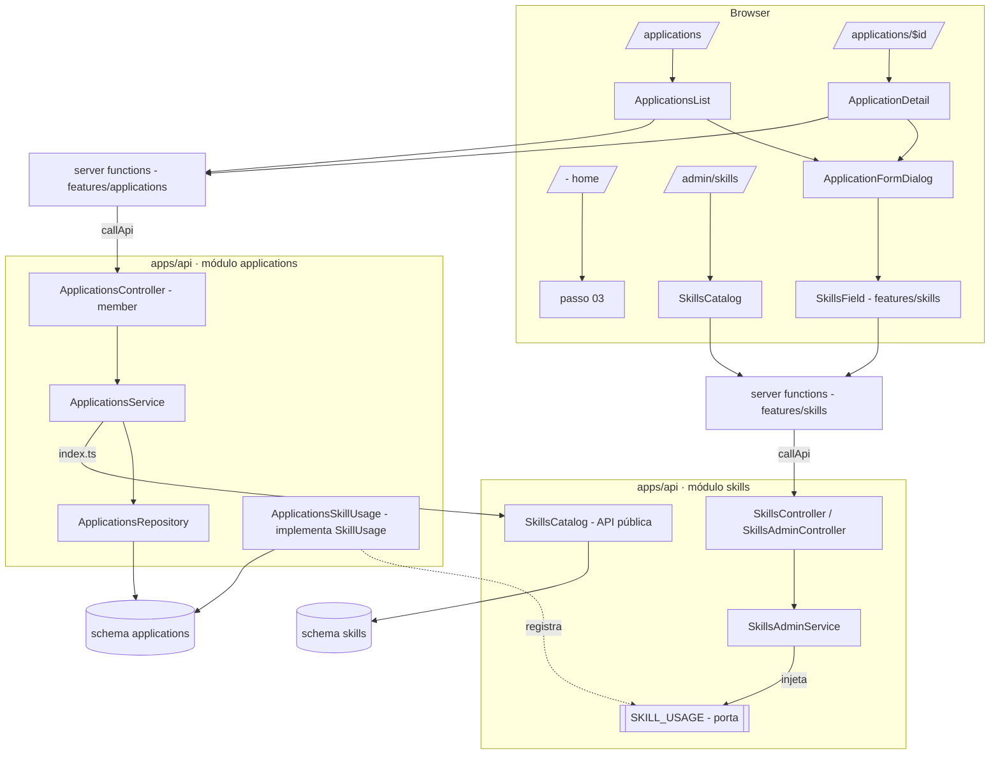
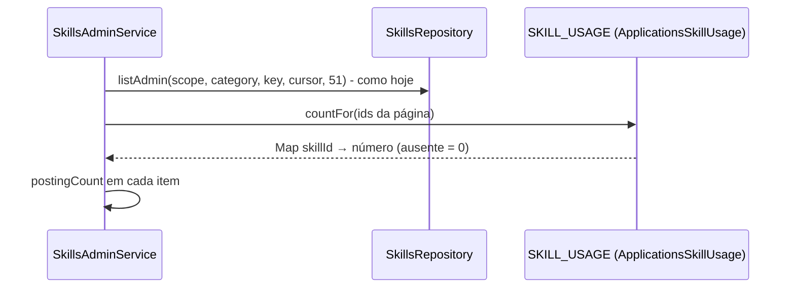

# Application Design

**Spec**: `.specs/features/application/spec.md`
**Status**: Approved - 2026-11-08 - user: "Sim"

---

## Architecture Overview

Um módulo novo do monolito, `apps/api/src/modules/applications`, dono do schema `applications`. Ele depende do módulo `skills` só pela API pública (`SkillsCatalog`) para validar, descrever e buscar skills. O único dado que vai no sentido contrário, a contagem de vagas por skill do catálogo do admin (AD-019), passa por uma **porta invertida**: o `skills` declara a interface `SkillUsage` e o token `SKILL_USAGE` na sua API pública, e um módulo pequeno e global do `applications` a implementa com um `GROUP BY` em `job_posting_skills`. O `skills` nunca importa código do `applications`, e nenhum dos dois lê o schema do outro.

O navegador fala só com o TanStack Start (AD-004), com uma server function por endpoint (AD-007). Toda regra que muda o que a pessoa vê (filtros, busca, ordem, grupos, contadores, sugestão de sem retorno, contagem de vagas) roda em SQL ou no serviço da API, onde os testes de integração a alcançam. O web só agrupa em seções os itens que já chegam ordenados e formata datas e rótulos.



### Por que a porta invertida (decidido com o usuário)

| Abordagem | Custo |
| --- | --- |
| **Porta invertida (escolhida)** | A página continua alfabética e paginada no SQL do `skills`; a porta conta só os 50 ids da página. Contagem sempre exata, duas consultas pequenas por página, nenhum ciclo, nada sincronizado |
| Eventos + coluna no `skills` | A contagem pode divergir se um evento se perder; exige barramento de eventos e reconciliação que o projeto não tem |
| Composição no BFF | Mais uma rota e a junção fora da API, sem ganho sobre a porta |

Ordenar o catálogo por uso foi descartado: exigiria carregar todas as skills ou sincronizar um contador entre módulos (AD-019).

Resposta do usuário: "Sim" à pergunta "Sigo com a porta invertida e escrevo o `design.md`?". Revisão: "não é aceitável a página do admin carregar todas as skill"; "Uma listagem simples, sem carregar primeiro as mais usadas resolve o problema?" → "Sim".

### Criar candidatura

```mermaid
sequenceDiagram
  participant W as Web (BFF)
  participant C as ApplicationsController
  participant S as ApplicationsService
  participant K as SkillsCatalog
  participant DB as Postgres
  W->>C: POST /applications
  C->>C: @Roles('member'), corpo pelo zod (400)
  C->>S: create(userId, body)
  S->>S: skill repetida? (422)
  S->>K: visibleIds(userId, skillIds)
  alt falta alguma
    S-->>W: 422 com invalidSkillIds
  end
  S->>DB: BEGIN; insert job_posting, job_posting_skills (position), application; evento status_changed se status != saved; COMMIT
  S->>K: describe(userId, skillIds)
  S-->>W: 201 Application
```

### Catálogo do admin com contagem



---

## Code Reuse Analysis

### Existing Components to Leverage

| Component | Location | How to Use |
| --- | --- | --- |
| `@Roles`, `@CurrentUser`, guard de sessão | `apps/api/src/modules/identity/index.ts` | `@Roles('member')` em toda rota; o teste de arquitetura de AD-006 cobre as rotas novas (APP-38..APP-40) |
| `zodBody` | `apps/api/src/infra/http/zod-body.pipe.ts` | Corpo e query validados contra o contrato, `400` em Problem Details |
| `ProblemDetailsFilter` | `apps/api/src/infra/http/problem-details.filter.ts` | Erros de domínio saem como `application/problem+json` |
| `CLOCK` | `apps/api/src/infra/clock/clock.ts` | `created_at`, `occurred_at`, sem retorno e adiamento usam o relógio; os testes o movem (APP-32..APP-35) |
| `SkillsCatalog.visibleIds` | `apps/api/src/modules/skills/application/skills-catalog.ts` | Valida as skills do cadastro e do `PUT` (APP-05, APP-08) |
| `normalizeSkillKey` | `packages/contracts/src/skills.ts` | Chave de `q` para a busca por skill (APP-13) |
| Padrão de cursor opaco | `apps/api/src/modules/skills/domain/cursor.ts` | Mesmo formato (base64url de JSON) para o cursor da lista de candidaturas; o do admin não muda |
| Padrão de log de evento | `SkillsAdminService.record` | `{ event, applicationId, actorId }`, sem texto (APP-41) |
| Helpers de teste | `apps/api/test/{accounts,api,clock,database}.ts` | Contas member e admin, relógio controlado, Postgres real |
| `callApi`, `parsed`, `accepted`, `contextOfCurrentRequest` | `apps/web/src/lib/{call-api,bff}.ts` | Uma server function por endpoint (AD-007, AD-016) |
| `useExpiredSessionRedirect`, `memberAreaAccess` | `apps/web/src/features/identity` | Sessão expirada leva ao login |
| `ListPage`, `DetailPage`, `AppShell`, `Combobox`, `DropdownMenu`, `Dialog`, `ConfirmDialog`, `FilterChip`, `SearchInput`, `SkillTag`, `PipelineStatus`, `EmptyState`, `Alert`, `Field`, `Kbd`, `Button` | `packages/ui` | Telas compostas só com a UI do Prumo |
| Testes de feature com API falsa | `apps/web/src/features/skills/testing/*` | Mesmo padrão (`fake-api`, harness) para a feature `applications` |

### Integration Points

| System | Integration Method |
| --- | --- |
| Módulo `skills` | `SkillsCatalog` ganha `describe` e `matchingIds`; `index.ts` passa a exportar `SKILL_USAGE` e o tipo `SkillUsage` |
| Catálogo do admin | `SkillsAdminService` injeta `SKILL_USAGE`; o item do contrato ganha `postingCount` |
| Postgres | Schema novo `applications`, migração `0004` gerada pelo `drizzle-kit`; `infra/database/schema.ts` reexporta as tabelas |
| `AppModule` | Importa `ApplicationsModule` e `ApplicationsSkillUsageModule` |
| Web | Rotas `_member/applications/index.tsx` e `_member/applications/$id.tsx`; sidebar e home em `_member.tsx` e `_member/index.tsx`; linha do catálogo em `features/skills` |

---

## Components

### Contrato (`packages/contracts/src/applications.ts`)

- **Purpose**: Os enums, os corpos e as respostas que a API e o BFF validam com o mesmo zod.
- **Interfaces**:
  - `applicationStatusSchema`, `jobLevelSchema`, `workModelSchema`, `skillRequirementSchema`, `stageSchema`, `eventKindSchema`
  - `ACTIVE_STATUSES`, `CLOSED_STATUSES`, `FUNNEL_ORDER` (APP-11, APP-14)
  - `createApplicationRequestSchema`, `updateJobPostingRequestSchema` (ao menos um campo; `null` limpa os opcionais), `replaceSkillsRequestSchema`, `changeStatusRequestSchema`, `createEventRequestSchema`
  - `listApplicationsQuerySchema` (`tab`, `status`, `level`, `workModel` em listas separadas por vírgula, `q` até 100, `sort`, `cursor`)
  - `applicationSummarySchema`, `applicationsPageSchema`, `applicationDetailSchema`, `applicationEventSchema`, `applicationsCountSchema`
  - `adminSkillSchema` ganha `postingCount: number` (APP-85)
- **Reuses**: `skillTextSchema` como modelo de texto aparado; limites da tabela de assumptions.

### Módulo `applications` da API (`apps/api/src/modules/applications/`)

- **`domain/`**
  - `ghost.ts`: `isGhostSuggested({ status, lastActivityAt, ghostSnoozedUntil }, now): boolean`, função pura (504 h; APP-32, APP-33). `GHOST_AFTER_MS`, `GHOST_SNOOZE_MS`.
  - `funnel.ts`: posição de cada status no funil e a aba de cada um (APP-11, APP-14).
  - `search-text.ts`: `searchTextOf(company, title)` e `searchPatternOf(q)`: NFKD, sem marcas, minúsculas, espaços reduzidos; o padrão escapa `%`, `_` e `\` (APP-13).
  - `cursor.ts`: `{ rank, at, id }` opaco (APP-15).
- **`infra/schema.ts`**: tabelas da seção Data Models.
- **`infra/applications.repository.ts`**: `insert(tx, …)`, `page(userId, filters, cursor, limit)`, `counts(userId, filters)`, `findOwned(userId, id, tx?, { forUpdate })`, `skillsOf(postingIds)`, `eventsOf(applicationId)`, `updatePosting`, `replaceSkills`, `insertEvent` (com `last_activity_at = greatest(...)`), `setStatus`, `snooze`, `deleteOwned`, `transaction`. Toda consulta filtra por `user_id`.
- **`application/applications.service.ts`**: `create`, `list`, `get`, `updatePosting`, `replaceSkills`, `changeStatus` (lê com `FOR UPDATE`, sem evento quando o status é igual; APP-20..APP-22, APP-27), `addEvent` (APP-23..APP-25), `snoozeGhost` (APP-35), `remove` (APP-36), `count`. Monta as respostas com `SkillsCatalog.describe` e `isGhostSuggested(…, clock.now())`. Erros: `ApplicationNotFoundError` (`404`), `InvalidSkillsError(ids)` (`422`).
- **`application/applications-skill-usage.ts`**: `ApplicationsSkillUsage implements SkillUsage`; `countFor(skillIds): Promise<Map<string, number>>` com `select skill_id, count(*) from applications.job_posting_skills where skill_id = any($1) group by skill_id` (APP-85, APP-87).
- **`http/applications.controller.ts`**, `@Controller('applications')`, todas as rotas `@Roles('member')`:

| Rota | Resposta | Critérios |
| --- | --- | --- |
| `POST /applications` | `201` `ApplicationDetail` | APP-01..APP-06 |
| `GET /applications` | `200` `{ items, nextCursor, counts }` | APP-09..APP-17 |
| `GET /applications/count` | `200` `{ total }` | APP-43, APP-84 |
| `GET /applications/:id` | `200` `ApplicationDetail` | APP-18, APP-19 |
| `PATCH /applications/:id/job-posting` | `200` `ApplicationDetail` | APP-28, APP-29, APP-31 |
| `PUT /applications/:id/skills` | `200` `ApplicationDetail` | APP-30, APP-31 |
| `POST /applications/:id/status` | `200` `ApplicationDetail` | APP-20..APP-22, APP-27 |
| `POST /applications/:id/events` | `201` `ApplicationEvent` | APP-23..APP-25 |
| `POST /applications/:id/ghost-snooze` | `200` `ApplicationDetail` | APP-35 (AD-020) |
| `DELETE /applications/:id` | `204` | APP-36, APP-37 |

  `GET /applications/count` é rota acrescentada pelo design: a sidebar e a home precisam do total sem carregar uma página da lista.
- **`applications.module.ts`**: importa `SkillsModule`; providers `ApplicationsRepository`, `ApplicationsService`.
- **`applications-skill-usage.module.ts`**: `@Global()`, providers `ApplicationsSkillUsage` (consulta própria, sem o repositório do módulo) e `{ provide: SKILL_USAGE, useExisting: ApplicationsSkillUsage }`, exporta `SKILL_USAGE`. Não importa `SkillsModule`, então não há ciclo nem no grafo do Nest nem nos imports do TypeScript.
- **`index.ts`**: exporta `ApplicationsModule` e `ApplicationsSkillUsageModule`.

### Mudanças no módulo `skills`

- **`domain/skill-usage.ts`** (novo, exportado por `index.ts`): `interface SkillUsage { countFor(skillIds: readonly string[]): Promise<Map<string, number>> }` e `const SKILL_USAGE = Symbol('SKILL_USAGE')`.
- **`SkillsCatalog`**:
  - `describe(userId, ids): Promise<Map<string, Skill>>`: nome oficial, categoria e escopo das skills visíveis (APP-10, APP-18, APP-88).
  - `matchingIds(userId, key): Promise<string[]>`: ids das skills visíveis cuja chave do nome ou de um apelido contém `key` (APP-13).
- **`SkillsAdminService.list`**: injeta `SKILL_USAGE`; a consulta, a ordem alfabética, o cursor e `counts` não mudam; depois de cortar a página, pede `countFor` dos ids dela e põe `postingCount` em cada item, 0 quando o id não volta (APP-85).

### Feature `applications` do web (`apps/web/src/features/applications/`)

- **`api/server-functions.ts`**: uma função por rota da tabela acima, sobre `callApi` e `parsed` (AD-007, AD-016).
- **`model/`**
  - `labels.ts`: rótulos de status (singular e plural do grupo), nível, modelo e etapa; textos do spec.
  - `filters.ts`: `parseApplicationsSearch` e `searchOf` (URL ↔ filtros; `new=1` abre o diálogo; APP-46, APP-83).
  - `groups.ts`: corta a lista já ordenada em seções por status, com o número de `counts.byStatus` (APP-45).
  - `dates.ts`: `relativeDays(at, now)` ("hoje", "há N d") e `shortDate(at)` ("20 out"), no fuso `America/Sao_Paulo`, com o `now` vindo do loader.
  - `ghost-message.ts`: o texto do Alert por status.
  - `stage-date.ts`: a data escolhida no diálogo de etapa vira `occurredAt` (hoje → agora; outro dia → 12:00 de São Paulo).
- **`components/`**: `ApplicationsList` (topbar, filtros, grupos, "Carregar mais", estados vazio e de erro), `ApplicationRow`, `RowActions` (botão "⋯" e clique direito com o mesmo conteúdo), `ApplicationFormDialog` (criar e editar; APP-57..APP-65, APP-74), `ApplicationDetail`, `PropertiesSidebar` (menus e edição no lugar; APP-68), `SkillsSection` (APP-73), `Timeline` + `NoteComposer` + `StageDialog` (APP-69..APP-72), `GhostAlert` (APP-80..APP-82), `DeleteApplication` (APP-75), `NotFound` (APP-77).
- **`testing/`**: `fake-api.ts` e harness, como em `features/skills`.
- **`index.ts`**: exporta o que as rotas usam.

### Mudanças na feature `skills` do web

- `searchSkills` e `createSkill`: server functions de `GET /skills` e `POST /skills`, anunciadas na feature `skills` para a fatia que as usasse.
- `SkillsField` (exportado por `index.ts`): campo de tags com sugestão por nome ou apelido, "Criar “{texto}” como skill privada" e a escolha da categoria (APP-59..APP-61). Fica em `skills` porque MasterResume vai usá-lo também; `applications` o importa pelo `index.ts`.
- `SkillRow` mostra "0 vagas", "1 vaga" ou "{N} vagas" (APP-85).

### Rotas do web

- `_member.tsx`: o loader pede `GET /applications/count`; a sidebar ganha "Candidaturas" (ícone da carta) com o total, `aria-current` em `/applications` e `/applications/$id` (APP-43).
- `_member/applications/index.tsx`: `validateSearch` com `parseApplicationsSearch`; o loader passa `now` do servidor.
- `_member/applications/$id.tsx`: detalhe; `404` vira `NotFound`.
- `_member/index.tsx`: passo 03 com "Nova candidatura" (`/applications?new=1`) e "Concluído" quando o total é maior que zero (APP-83, APP-84; AD-021).

### Componentes novos e alterados em `packages/ui`

Cada um com story e testes (regra do repositório).

| Componente | O quê | Usado em |
| --- | --- | --- |
| `Dialog.Content` `size="lg"` | 640 px, como a carta do diálogo | APP-57 |
| `DropdownMenu.Sub`, `SubTrigger`, `SubContent`, `RadioGroup`, `RadioItem` | Submenus "Status" e "Nível" com o valor atual marcado | APP-50, APP-68 |
| `ContextMenu` (novo, `@radix-ui/react-context-menu`) | O mesmo menu no clique direito, com o estilo do `DropdownMenu` | APP-50 |
| `ChoiceChips` (novo) | Chips de escolha única com `role="radiogroup"` | Nível, Modelo e tipo de etapa (APP-57, APP-72) |
| `TagField` (novo) | Tags removíveis seguidas de um `Combobox`, numa caixa só | `SkillsField` (APP-59) |
| `Timeline` (novo) | Lista com ícone, linha que liga os itens e data em `mono` | APP-70 |
| `InlineEdit` (novo) | Valor que vira `Field.Control` ao clicar; `Enter` ou sair grava, `Esc` cancela | Local e Vaga (APP-68) |
| `ListPage.Group` | Ganha a prop `action`: o cabeçalho passa a ser um `div` com o `h2` e a ação à direita (o "+"), porque um botão dentro do `h2` entraria no nome do título | APP-45 |

---

## Data Models

Schema `applications` (Drizzle, `apps/api/src/modules/applications/infra/schema.ts`). Ids `uuidv7()`, datas `timestamptz` em UTC. Nenhuma FK sai do schema (APP-07).

```typescript
// enums: application_status, job_level, work_model, skill_requirement, event_kind, stage

job_postings {
  id: uuid pk
  user_id: uuid not null                 // Key decision 1, sem FK
  company: text not null
  title: text not null
  url: text null
  description: text null
  level: job_level not null
  location: text null
  work_model: work_model null
  search_text: text not null             // searchTextOf(company, title); acrescentado pelo design (APP-13)
  created_at: timestamptz not null       // do Clock
}
index (user_id)

job_posting_skills {
  job_posting_id: uuid not null -> job_postings.id on delete cascade
  skill_id: uuid not null                // sem FK (Key decision 2)
  requirement: skill_requirement not null
  position: smallint not null            // ordem enviada; acrescentado pelo design (APP-30, row skills)
  pk (job_posting_id, skill_id)
}
index (skill_id)                          // busca por skill e countFor

applications {
  id: uuid pk
  user_id: uuid not null
  job_posting_id: uuid not null unique -> job_postings.id on delete cascade
  status: application_status not null
  submitted_document_id: uuid null       // fica no schema do .design, sem uso até ResumeDocument (AD-017)
  last_activity_at: timestamptz not null
  ghost_snoozed_until: timestamptz null  // AD-020
  created_at: timestamptz not null
}
index (user_id, status, last_activity_at desc, id)
index (user_id, status, created_at desc, id)

application_events {
  id: uuid pk
  application_id: uuid not null -> applications.id on delete cascade
  kind: event_kind not null              // status_changed | stage | note
  from_status: application_status null
  to_status: application_status null
  stage: stage null
  note: text null
  occurred_at: timestamptz not null
  created_at: timestamptz not null       // desempate da linha do tempo
  check: kind = 'status_changed' => to_status not null
  check: kind = 'stage' => stage not null
  check: kind = 'note' => note not null
}
index (application_id, occurred_at desc, created_at desc)
```

**Relationships**: uma vaga tem uma candidatura (`unique`), N skills e, pela candidatura, N eventos. Excluir a vaga apaga o resto em cascata dentro do schema (APP-36). `skill_id` e `user_id` são ids de outros módulos, validados pela API deles.

**Respostas** (contrato):

```typescript
interface ApplicationSummary {
  id: string; status: ApplicationStatus; company: string; title: string;
  level: JobLevel; workModel: WorkModel | null;
  skills: Array<{ id: string; name: string; scope: 'global' | 'private'; requirement: SkillRequirement }>;
  createdAt: string; lastActivityAt: string; ghostSuggested: boolean;
}
interface ApplicationDetail extends ApplicationSummary {
  url: string | null; location: string | null; description: string | null;
  skills: Array<ApplicationSummary['skills'][number] & { category: SkillCategory }>;
  events: ApplicationEvent[];           // do mais recente ao mais antigo
}
interface ApplicationEvent {
  id: string; kind: 'status_changed' | 'stage' | 'note';
  fromStatus: ApplicationStatus | null; toStatus: ApplicationStatus | null;
  stage: Stage | null; note: string | null; occurredAt: string;
}
interface ApplicationsPage {
  items: ApplicationSummary[]; nextCursor: string | null;
  counts: { active: number; closed: number; byStatus: Record<ApplicationStatus, number> };
}
```

---

## Error Handling Strategy

| Error Scenario | Handling | User Impact |
| --- | --- | --- |
| Corpo, query ou cursor inválidos | `zodBody` → `400` Problem Details com o campo | Diálogo: erro abaixo do campo (validação local antes) ou `Alert` |
| Skill inválida, alheia ou repetida | `InvalidSkillsError` → `422` com `invalidSkillIds` | `Alert` `danger` no diálogo, dados mantidos (APP-64) |
| Candidatura inexistente, alheia ou id que não é uuid | `ApplicationNotFoundError` → `404` | "Candidatura não encontrada." (APP-77) |
| Admin chama `/applications` | Guard → `403` | Admin nunca vê a rota no web (AD-005) |
| Sessão ausente ou expirada | Guard → `401` | Web leva ao login |
| Gravação pelo menu ou no detalhe falha | Web mantém o valor anterior | `Alert` `danger` com a mensagem (APP-55, APP-78) |
| Lista não carrega | Loader devolve a falha | `Alert` "Não foi possível carregar as candidaturas." + "Tentar de novo" (APP-54) |
| Duas mudanças de status simultâneas | `SELECT … FOR UPDATE` na candidatura dentro da transação | Dois eventos encadeados (APP-27) |
| Duplo clique em "Criar candidatura" | Botão desabilitado durante a requisição | Uma vaga só (APP-62) |

---

## Risks & Concerns

| Concern | Location (file:line) | Impact | Mitigation |
| --- | --- | --- | --- |
| `SKILL_USAGE` resolvido de um módulo global que o `SkillsModule` não importa | `apps/api/src/app.module.ts` | Sem o provider, a API não sobe | Os testes de integração já sobem o `AppModule` inteiro (`apps/api/test/api.ts:24`); um teste novo prova as contagens com vagas reais em duas páginas, e um teste de arquitetura prova que `modules/skills` não importa `modules/applications`. Os testes existentes de ordem e cursor seguem iguais |
| Data e "há N d" divergirem entre SSR e cliente | `apps/web/src/features/applications/model/dates.ts` | Erro de hidratação (precedente do AD-011) | Fuso fixo `America/Sao_Paulo` no `Intl` dos dois lados e `now` vindo do loader |
| Busca por skill com `q` curto casa centenas de skills | `ApplicationsService.list` | `skill_id = any($ids)` com lista grande | O índice em `job_posting_skills(skill_id)` cobre; ids limitados às visíveis da pessoa |
| Acento na busca de empresa e título sem `unaccent` | `job_postings.search_text` | Sem coluna normalizada, "Saude" não acha "Saúde" | Coluna `search_text` gravada pela aplicação com a mesma normalização de `q`; sem extensão no Postgres |
| Texto livre de vaga é dado pessoal | logs do módulo | Vazamento em log | Eventos de log só com ids e ação; um teste lê os logs de uma criação com texto marcador (APP-41) |
| Limpar `user_id` dos dados ao excluir a conta | — | Não há exclusão de conta hoje | N/A nesta feature; registrado para quando a exclusão de conta existir |

---

## Tech Decisions (only non-obvious ones)

| Decision | Choice | Rationale |
| --- | --- | --- |
| Contagem de vagas no catálogo | Porta `SKILL_USAGE` declarada no `skills` e implementada num módulo global do `applications` | Sem ciclo e sem ler o schema do outro; escolhida pelo usuário |
| Ordem das skills na vaga | Coluna `job_posting_skills.position` | O spec pede a ordem enviada; acréscimo ao schema do `.design` |
| Busca sem acento | Coluna `search_text` normalizada pela aplicação | Evita depender da extensão `unaccent` em todo Postgres (portabilidade) |
| Total da sidebar | Rota `GET /applications/count` | A sidebar e a home não carregam uma página da lista para ter um número |
| Última atividade | `last_activity_at = greatest(atual, occurred_at)` gravado junto com o evento | Uma etapa com data antiga não puxa a atividade para trás; a ordenação usa índice |
| Datas no web | `Intl` com `America/Sao_Paulo` e `now` do loader | Mesma saída no SSR e no cliente |
| Skills da vaga no front | `SkillsField` vive em `features/skills` e é exportado pelo `index.ts` | MasterResume vai reutilizá-lo sem importar o interior de `applications` |
| Clique direito na linha | `@radix-ui/react-context-menu` | Mesma acessibilidade e foco do `DropdownMenu` já usado |

Nenhuma decisão aqui vira convenção de projeto além do que AD-017 a AD-021 já registram.
