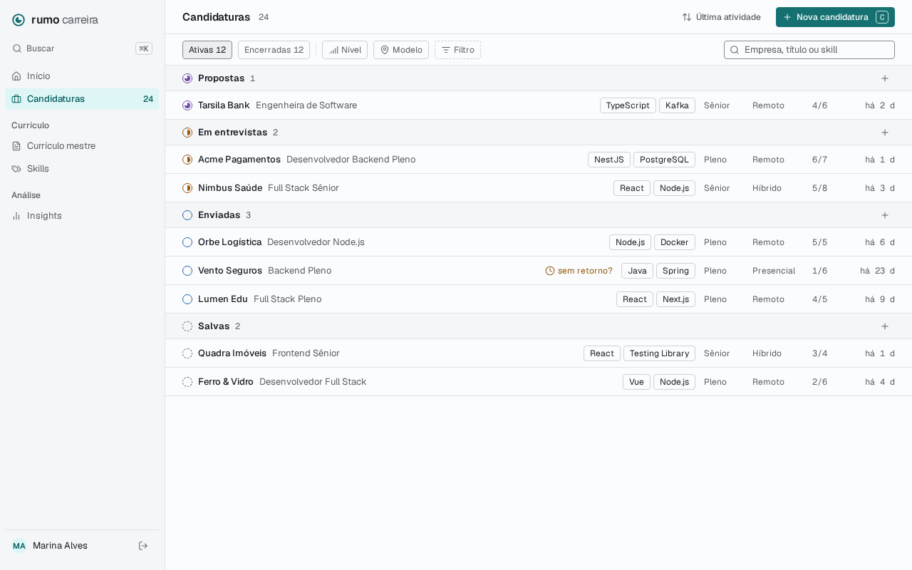
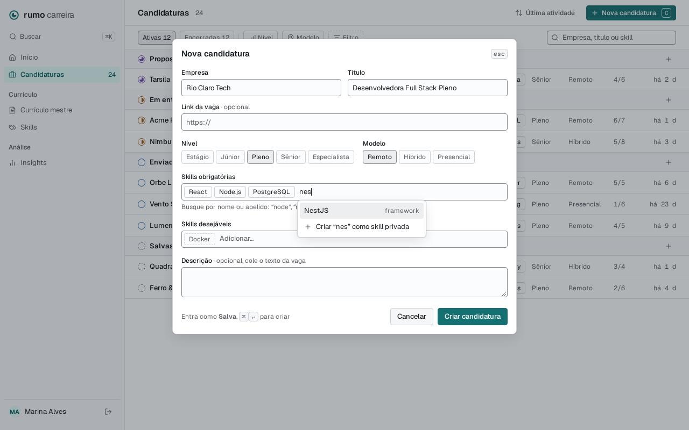
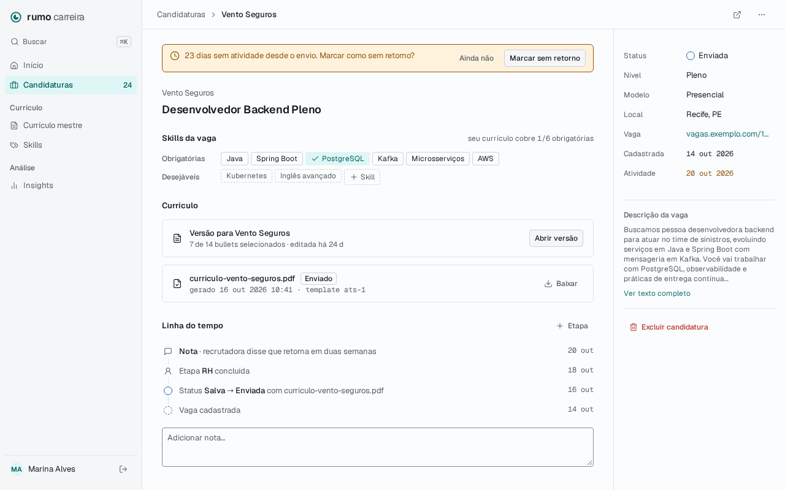
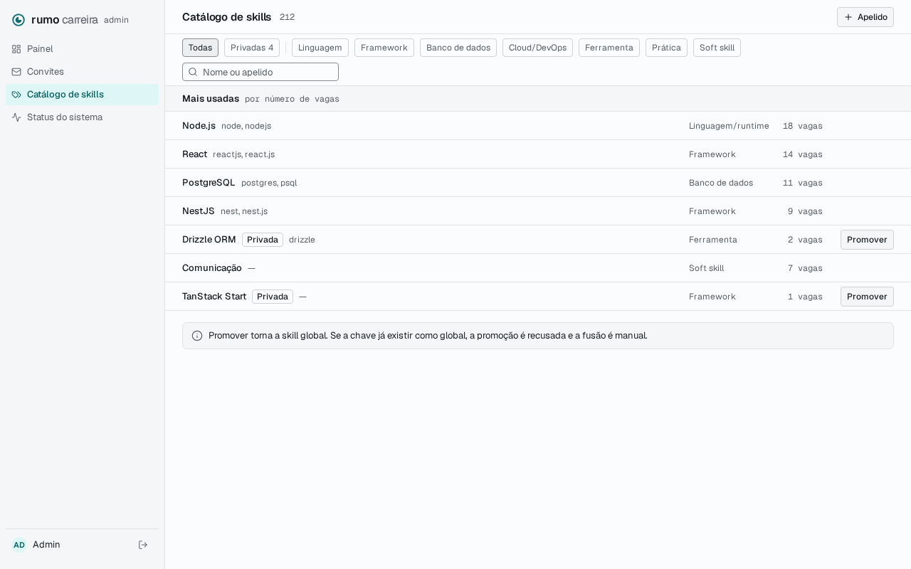

# Application Specification

**Approved**: 2026-11-08 - user: "Sim"

## Problem Statement

O autor registra candidaturas numa planilha ou em lugar nenhum, e não sabe o que mandou, para quem nem quando. Esta feature cria o registro central do produto: uma vaga (JobPosting) com as skills pedidas e o nível, a candidatura (Application) com seu status e a linha do tempo de etapas, notas e mudanças de status. O sinal de fracasso do projeto é o cadastro caro, então cadastrar uma vaga tem de caber em menos de 2 minutos, num diálogo sobre a lista.

## Goals

- [ ] Um member cadastra uma vaga com empresa, título, nível, modelo e skills (criando uma privada na hora quando falta) em um diálogo, e a vê na lista agrupada por status.
- [ ] O member muda status e nível pela lista ou pelo detalhe, registra etapas e notas, e o histórico mostra cada mudança com data, sem nunca ser reescrito.
- [ ] Depois de 21 dias sem atividade em "Enviada" ou "Em entrevistas" o produto sugere "sem retorno", e nada muda sozinho.
- [ ] Nenhuma rota devolve ou altera dado de outro usuário: recurso alheio responde `404`.
- [ ] O catálogo de skills do admin mostra quantas vagas usam cada skill, sem mudar a ordem alfabética nem a paginação.
- [ ] Todos os estados da fatia Application do `.design` têm um teste que falharia se o comportamento mudasse.

## Out of Scope

| Feature | Reason |
| ------- | ------ |
| Cobertura do currículo ("4/6"), skills marcadas como cobertas, seção "Currículo" do detalhe, PDF enviado e `submittedDocumentId` | Dependem de MasterResume, ResumeVersion e ResumeDocument (AD-017) |
| Excluir versões e documentos junto com a candidatura | Não existem ainda; a fatia que os cria amplia a exclusão |
| Editar ou apagar um evento da linha do tempo | Key decision 8: o histórico nunca é reescrito |
| Resultado de uma etapa ("concluída", "reprovada") | O evento de etapa não tem resultado (AD-018) |
| Itens "Currículo mestre", "Skills", "Insights" e "Buscar ⌘K" da sidebar do member | AD-008: entram com a fatia que os cria |
| Painel da home com pipeline e atividade recente (carta `PageHomeDashboard`) | Fase própria; aqui a home só ganha o botão do passo 03 |
| Extrair skills da descrição com IA | Fase 3 |
| Importar candidaturas da planilha | Fora do `.design` |
| Tela de skills do member (buscar, editar, excluir as privadas) | O member só usa skills dentro do diálogo e do detalhe da vaga |
| Detectar vaga duplicada (mesma empresa, título ou link) | Fora do `.design`; nada impede cadastrar duas vezes |
| Lembretes, notificações e e-mail | Sem e-mail no escopo das fases 0 a 2 |
| JobPosting sem candidatura | Fase 5 (busca automática); as tabelas já são separadas |

---

## Assumptions & Open Questions

| Assumption / decision | Chosen default | Rationale | Confirmed? |
| --------------------- | -------------- | --------- | ---------- |
| Partes que dependem do currículo | Omitidas até as fatias de currículo existirem; `POST /applications/:id/status` não aceita `submittedDocumentId` agora (AD-017) | Pergunta: "O que a feature Application faz com elas?"; opção escolhida: "Omitir até existirem" | y |
| "Ainda não" no Alert de sem retorno | Grava `ghost_snoozed_until = agora + 21 dias`; a sugestão some no detalhe e na lista até essa data e volta se ainda não houver atividade; não cria evento nem conta como atividade (AD-020) | Pergunta: "O que 'Ainda não' faz?"; opção escolhida: "Adia 21 dias, salvo" | y |
| Categoria da skill criada no diálogo | "Criar '{texto}' como skill privada" troca o menu pela lista das sete categorias; um clique escolhe e cria | Pergunta: "Como a categoria é escolhida?"; opção escolhida: "Escolher na hora" | y |
| Editar a vaga | O "⋯" da topbar do detalhe tem "Editar vaga" (o diálogo da criação, preenchido, com skills) e "Excluir candidatura"; no detalhe, "+ Skill" e o "×" de cada tag também editam as skills | Pergunta: "Como o usuário edita o resto?"; opção escolhida: "Menu ⋯ → Editar vaga" | y |
| Chip "Filtro" da lista | Filtra por status: abre os status da aba atual (Ativas ou Encerradas) com seleção múltipla; o rótulo da carta, "Filtro", fica | Pergunta: "O que ele vira?"; opção escolhida: "Filtro por status". Restringir aos status da aba evita uma combinação sem resultado | y (seleção na aba: n) |
| Etapa na linha do tempo | "Etapa {tipo}" e, quando houver, "· {nota}"; sem "concluída" (AD-018) | Pergunta: "O que a linha mostra?"; opção escolhida: "'Etapa RH' + nota" | y |
| Ordenação e menu da linha | O botão alterna "Última atividade" e "Cadastro", ambos do mais recente ao mais antigo, com `sort` na URL; cada linha tem o botão "⋯" e o clique direito com os submenus "Status" e "Nível" | Pergunta: "O que entra nesta feature?"; opção escolhida: "Ordenação + menu na linha" | y |
| Pendências de AD-010 e AD-013 | O passo 03 da home ganha "Nova candidatura"; o catálogo do admin ganha "N vagas" (AD-019, AD-021); o grupo "Mais usadas" fica de fora | Pergunta: "Quais entram agora?"; opção escolhida: "Os dois". Revisto no design: "Uma listagem simples, sem carregar primeiro as mais usadas resolve o problema?"; confirmação do usuário: "Sim" | y |
| "N vagas" no catálogo | Conta as vagas de todas as pessoas que têm a skill (obrigatória ou desejável), sem revelar de quem; "0 vagas", "1 vaga", "N vagas"; as linhas continuam em ordem alfabética, 50 por página, e a contagem vem só para as skills da página | Ordenar por uso exigiria carregar o catálogo inteiro ou sincronizar um contador entre módulos; o usuário recusou carregar tudo e confirmou a listagem simples ("Sim"). A contagem agregada não expõe dado pessoal | y |
| Ativas e Encerradas | Ativas: Salva, Enviada, Em entrevistas, Proposta. Encerradas: Aceita, Recusada, Desisti, Sem retorno. A aba padrão é Ativas | Os finais do funil são os quatro com marca própria no `PipelineStatus` | n |
| Grupos da lista | Em ordem do funil, do mais avançado ao menos: Propostas, Em entrevistas, Enviadas, Salvas; e Aceitas, Recusadas, Desisti, Sem retorno. Grupo vazio não aparece. O número do grupo conta o total com os filtros, não só o que foi carregado | README da carta: "do mais avançado ao menos"; os rótulos no plural seguem a carta | n |
| Rótulos de status | `saved` Salva, `applied` Enviada, `interviewing` Em entrevistas, `offer` Proposta, `accepted` Aceita, `rejected` Recusada, `withdrawn` Desisti, `ghosted` Sem retorno | Rótulos da carta `PipelineStatus` | n |
| Rótulos de nível e modelo | Estágio, Júnior, Pleno, Sênior, Especialista; Remoto, Híbrido, Presencial; modelo ausente aparece como "—" | Carta `PageNewApplication` | n |
| Filtros Nível e Modelo | Seleção múltipla; `level`, `workModel`, `status`, `tab`, `sort` e `q` na URL, valores separados por vírgula | Filtros na URL são o padrão do `ListPage` | n |
| Busca | `q` casa por trecho, sem diferença de acento e caixa, com empresa ou título, ou por skill: a chave de `q` contida no nome ou num apelido de uma skill da vaga; até 100 caracteres; atualiza 300 ms depois da última tecla | Placeholder da carta: "Empresa, título ou skill"; mesmo atraso do catálogo de skills | n |
| Paginação | 50 candidaturas por página, ordenadas por grupo e depois pelo `sort`, cursor opaco; "Carregar mais" no fim quando houver próxima página | Convenção de listas por cursor do `.design` | n |
| Resposta da lista | `{ items, nextCursor, counts: { active, closed, byStatus } }`; `counts` respeita nível, modelo e busca, e ignora aba e status | A carta mostra "Ativas 12", "Encerradas 12" e o número de cada grupo | n |
| Skills na linha | As duas primeiras obrigatórias na ordem em que foram adicionadas; sem obrigatórias, as duas primeiras desejáveis | A carta mostra duas por linha | n |
| Última atividade | `last_activity_at` = o maior `occurred_at` entre os eventos e a data de cadastro; editar a vaga, as skills ou adiar a sugestão não conta; mostrada como "hoje", "há N d" | Key decision 8 e coluna do `.design`; um evento com data passada não empurra a atividade para trás | n |
| Sugestão de sem retorno | `ghostSuggested` é verdadeiro quando o status é `applied` ou `interviewing`, passaram 21 dias (504 h) ou mais desde `last_activity_at` e o adiamento não está em vigor | Key decision 8 | n |
| Texto do Alert | Em Enviada: "{N} dias sem atividade desde o envio. Marcar como sem retorno?"; em Em entrevistas: "{N} dias sem atividade. Marcar como sem retorno?" | "desde o envio" só é verdade em Enviada | n |
| Cadastro com status | O diálogo cria como Salva; aberto pelo "+" de um grupo, cria naquele status e o rodapé diz "Entra como {status}". Cadastro em outro status grava um evento `status_changed` sem `from_status` | README: "+ para criar já naquele status"; o evento mantém a data em que entrou no status | n |
| "Vaga cadastrada" | A primeira entrada da linha do tempo sai da data de cadastro, não de um evento | A carta desenha a entrada; o enum de eventos não tem esse tipo | n |
| Ordem da linha do tempo | Do mais recente ao mais antigo por `occurred_at`; empate pela ordem de criação | Carta | n |
| Data de um evento | Etapa: informada no diálogo, padrão hoje, não pode estar no futuro (tolerância de 5 min); nota e status: agora | `.design`: "informado pelo usuário; padrão agora" | n |
| Nota | Campo "Adicionar nota…" ao pé da linha do tempo; o botão "Adicionar nota" aparece com texto e `⌘↵`/`Ctrl+↵` envia | A carta desenha só o campo; um controle precisa de gesto | n |
| Diálogo de etapa | "+ Etapa" abre um diálogo com os tipos Triagem, RH, Técnica, Case, Outra (escolha única), a data e a nota opcional | Enum `stage` do `.design` | n |
| Mudar para o mesmo status | `200` sem evento e sem mudar a atividade | Idempotência | n |
| Depois de criar | O diálogo fecha e a nova linha aparece no seu grupo, sem sair da lista | Cadastrar várias vagas seguidas é o uso comum | n |
| Atalhos | `C` abre o diálogo na lista quando o foco não está num campo; `⌘↵`/`Ctrl+↵` cria ou salva; `Esc` fecha | Carta | n |
| Sidebar do member | "Início" e "Candidaturas" com o total de candidaturas da pessoa em `mono` | Carta; AD-008 | n |
| Rotas | `/applications` e `/applications/$id` | As rotas do web estão em inglês (`/admin/skills`, `/invite/$token`) | n |
| Home | O passo 03 ganha o botão "Nova candidatura", que abre `/applications` com o diálogo aberto, e passa a "Concluído" quando a pessoa tem uma candidatura | Pendência de AD-010 (AD-021) | n |
| Limites | Empresa e título: aparados, 1 a 200 caracteres; local: até 120; link: `http`/`https`, até 2048; descrição: até 20 000; nota: até 2 000; até 50 skills por vaga, cada uma uma só vez | Barra colagem acidental sem cortar uma descrição real de vaga | n |
| Skill inválida | Skill inexistente, privada de outra pessoa, repetida ou id que não é uuid: `422` em Problem Details com os ids recusados, sem gravar nada | A skill é de outro módulo; `404` diria que a candidatura não existe | n |
| Status dos erros | Corpo ou parâmetro inválido `400`; candidatura inexistente, de outra pessoa ou id que não é uuid `404`; tudo em Problem Details | Convenções do `.design` | n |
| Quem chama | Toda rota de `/applications` é só de member; o admin recebe `403` | AD-005 | y (AD-005) |
| Concorrência | Duas mudanças de status simultâneas na mesma candidatura gravam dois eventos em sequência, cada um com o `from_status` que encontrou | O histórico precisa encadear | n |
| Duplo envio | O botão de criar fica desabilitado enquanto a requisição corre | Duas vagas iguais por duplo clique seriam lixo no funil | n |
| Exclusão | `ConfirmDialog` "Excluir candidatura?" com "Excluir" em `danger`; apaga vaga, skills da vaga, candidatura e eventos numa transação; depois volta para `/applications` | Exclusão definitiva (LGPD) | n |
| Logs | Cada escrita registra o id da candidatura e a ação, nunca empresa, título, descrição, link ou nota | Dado pessoal fora dos logs (diretrizes de segurança) | n |
| Larguras de tela | 375 px e 1280 px, sem rolagem horizontal da página; a 375 px a linha mostra status, empresa, título e última atividade, e o detalhe empilha a sidebar abaixo do conteúdo | Capturas a 1280 px; diretriz de acessibilidade | n |
| Limite de taxa | N/A because o cadastro é só por convite e cada rota só alcança os dados da própria pessoa | Mesma decisão das skills | n |
| Dependência externa | N/A because Application só chama o módulo `skills`, no mesmo processo, pela API pública dele | Key decision 2 | n |

**Open questions:** none - all resolved or logged above (required before the spec is confirmed).

---

## User Stories

### P1: Cadastrar vaga e candidatura (API) ⭐ MVP

**User Story**: Como member, quero cadastrar uma vaga com nível, modelo e skills, para ter a candidatura registrada desde o primeiro minuto.

**Why P1**: Sem cadastro não há produto.

**Acceptance Criteria**:

1. WHEN um member envia `POST /applications` válido THEN a API SHALL gravar a vaga, as skills da vaga e a candidatura numa transação e responder `201` com a candidatura, `status` `saved` e `lastActivityAt` igual à data de cadastro. (APP-01)
2. WHEN o corpo traz `status` THEN a API SHALL criar a candidatura nesse status e gravar um evento `status_changed` sem `from_status`, com `to_status` igual ao informado. (APP-02)
3. WHEN o corpo traz `skills` vazio ou não traz `skills` THEN a API SHALL criar a candidatura sem skills e responder `201`. (APP-03)
4. IF empresa ou título estão vazios ou passam de 200 caracteres, o link não é `http`/`https` ou passa de 2048, a descrição passa de 20 000, o local passa de 120, `level`, `workModel`, `status` ou `requirement` estão fora do enum, ou há mais de 50 skills THEN a API SHALL responder `400` em Problem Details com o campo inválido, sem gravar nada. (APP-04)
5. IF uma skill não existe, é privada de outra pessoa, aparece duas vezes ou tem id que não é uuid THEN a API SHALL responder `422` em Problem Details com os ids recusados, sem gravar nada. (APP-05)
6. The API SHALL take the owner only from the session and SHALL ignore any `userId` sent by the client. (APP-06)
7. The `applications` schema SHALL hold no foreign key to any other schema. (APP-07)
8. The applications module SHALL validate and describe skills only through the public API of the skills module. (APP-08)

**Independent Test**: Contra Postgres real, criar uma vaga com duas skills globais e uma privada própria, outra sem skills, outra em `applied`, e tentar uma com a privada de outra conta.

---

### P1: Listar e filtrar (API) ⭐ MVP

**User Story**: Como member, quero listar minhas candidaturas por status, nível, modelo e texto, para achar uma em segundos.

**Why P1**: A lista é a tela principal do produto.

**Acceptance Criteria**:

1. WHEN um member chama `GET /applications` THEN a API SHALL responder `200` com `{ items, nextCursor, counts }`, só com as candidaturas dele, 50 por página. (APP-09)
2. The list item SHALL carry `id`, `status`, `company`, `title`, `level`, `workModel`, the job posting skills with `id`, `name`, `scope` and `requirement`, `createdAt`, `lastActivityAt` and `ghostSuggested`. (APP-10)
3. WHEN `tab=active` ou ausente THEN a lista SHALL trazer só Salva, Enviada, Em entrevistas e Proposta, e WHEN `tab=closed` THEN só Aceita, Recusada, Desisti e Sem retorno. (APP-11)
4. WHEN `status`, `level` ou `workModel` trazem um ou mais valores separados por vírgula THEN a lista SHALL trazer só as candidaturas com um desses valores em cada parâmetro informado. (APP-12)
5. WHEN `q` é informado THEN a lista SHALL trazer só as candidaturas cuja empresa ou título contém `q` sem diferença de acento e caixa, ou que têm uma skill cujo nome ou apelido contém a chave normalizada de `q`. (APP-13)
6. The list SHALL order items by status group in funnel order (`offer`, `interviewing`, `applied`, `saved`, then `accepted`, `rejected`, `withdrawn`, `ghosted`) and inside a group by `lastActivityAt` descending, or by `createdAt` descending WHEN `sort=created`. (APP-14)
7. WHEN há mais itens THEN `nextCursor` SHALL trazer um cursor que, enviado em `cursor`, devolve a página seguinte sem repetir nem pular itens. (APP-15)
8. The `counts` object SHALL hold `active`, `closed` and the count of each status for the user's applications matching `level`, `workModel` and `q`, ignoring `tab`, `status` and the cursor. (APP-16)
9. IF um parâmetro tem valor fora do enum, `q` passa de 100 caracteres ou o cursor é inválido THEN a API SHALL responder `400` em Problem Details. (APP-17)

**Independent Test**: Com duas contas e 60 candidaturas variadas, conferir isolamento, cada filtro, a busca por skill via apelido, a ordem, as duas páginas e os contadores.

---

### P1: Detalhe, status e linha do tempo (API) ⭐ MVP

**User Story**: Como member, quero ver uma candidatura com seu histórico e mudar o status em qualquer direção, para saber o que mandei e em que pé está.

**Why P1**: É a Key decision 8.

**Acceptance Criteria**:

1. WHEN um member chama `GET /applications/:id` de uma candidatura dele THEN a API SHALL responder `200` com a vaga completa, as skills, o status, `createdAt`, `lastActivityAt`, `ghostSuggested` e `events` do mais recente ao mais antigo. (APP-18)
2. IF `:id` não é uuid, não existe ou é de outra pessoa THEN `GET`, `PATCH`, `PUT`, `POST` e `DELETE` em `/applications/:id` e sub-rotas SHALL responder `404` em Problem Details, sem alterar nada. (APP-19)
3. WHEN o member envia `POST /applications/:id/status` com um status diferente do atual THEN a API SHALL mudar o status, gravar um evento `status_changed` com `from_status`, `to_status`, a nota opcional e `occurred_at` agora, atualizar `last_activity_at` e responder `200`. (APP-20)
4. The API SHALL accept a change from any status to any other status. (APP-21)
5. WHEN o status enviado é igual ao atual THEN a API SHALL responder `200` sem gravar evento e sem mudar `last_activity_at`. (APP-22)
6. WHEN o member envia `POST /applications/:id/events` com `kind` `stage` (com `stage`) ou `note` (com `note`) THEN a API SHALL gravar o evento com o `occurredAt` informado ou agora, e responder `201`. (APP-23)
7. WHEN um evento é gravado THEN `last_activity_at` SHALL passar a ser o maior entre o valor anterior e o `occurred_at` do evento. (APP-24)
8. IF `kind` é `status_changed`, `stage` falta ou está fora do enum num evento `stage`, `note` falta num evento `note`, a nota passa de 2 000 caracteres ou `occurredAt` está mais de 5 min no futuro THEN a API SHALL responder `400` em Problem Details, sem gravar nada. (APP-25)
9. The API SHALL offer no route that edits or deletes an event. (APP-26)
10. WHEN duas mudanças de status chegam ao mesmo tempo THEN a API SHALL gravar os dois eventos em sequência, o `from_status` de cada um igual ao status que encontrou. (APP-27)

**Independent Test**: Criar uma candidatura, mudar Salva → Enviada → Salva → Em entrevistas, repetir o mesmo status, registrar etapa com data passada e nota, e conferir eventos, ordem e atividade.

---

### P1: Editar a vaga e as skills (API) ⭐ MVP

**User Story**: Como member, quero corrigir os dados e as skills de uma vaga, para manter o registro certo.

**Why P1**: Erros de digitação no cadastro rápido são certos.

**Acceptance Criteria**:

1. WHEN o member envia `PATCH /applications/:id/job-posting` com um ou mais campos da vaga THEN a API SHALL alterar só esses campos e responder `200` com a candidatura, sem mudar `last_activity_at`. (APP-28)
2. WHEN o PATCH traz `url`, `location`, `description` ou `workModel` como `null` THEN a API SHALL limpar o campo. (APP-29)
3. WHEN o member envia `PUT /applications/:id/skills` THEN a API SHALL substituir todas as skills da vaga pela lista enviada, na ordem enviada, e responder `200`, sem mudar `last_activity_at`. (APP-30)
4. IF o PATCH vem vazio ou com campo inválido, ou o PUT tem skill inválida THEN a API SHALL responder `400` ou `422` com as mesmas regras do cadastro, sem alterar nada. (APP-31)

**Independent Test**: Alterar empresa e limpar o link; trocar três skills por duas; enviar um PATCH vazio.

---

### P1: Sugestão de sem retorno ⭐ MVP

**User Story**: Como member, quero ser lembrado de candidaturas paradas, para encerrá-las sem que nada mude sozinho.

**Why P1**: Key decision 8.

**Acceptance Criteria**:

1. WHILE o status é `applied` ou `interviewing`, passaram 504 horas ou mais desde `last_activity_at` e `ghost_snoozed_until` é nulo ou já passou, a API SHALL devolver `ghostSuggested: true` na lista e no detalhe. (APP-32)
2. WHEN passaram menos de 504 horas, o status é outro ou o adiamento está em vigor THEN a API SHALL devolver `ghostSuggested: false`. (APP-33)
3. The API SHALL never change a status because of time alone. (APP-34)
4. WHEN o member envia `POST /applications/:id/ghost-snooze` THEN a API SHALL gravar `ghost_snoozed_until` igual a agora mais 21 dias, sem evento e sem mudar `last_activity_at`, e responder `200` com `ghostSuggested: false`. (APP-35)

**Independent Test**: Com o relógio da API controlado, mover uma candidatura Enviada para 21 dias menos 1 minuto e 21 dias exatos, adiar, e avançar mais 21 dias.

---

### P1: Excluir candidatura (API) ⭐ MVP

**User Story**: Como member, quero excluir uma candidatura de vez, porque é dado pessoal meu.

**Why P1**: Exclusão definitiva é convenção do projeto (LGPD).

**Acceptance Criteria**:

1. WHEN o member envia `DELETE /applications/:id` THEN a API SHALL apagar vaga, skills da vaga, candidatura e eventos numa transação e responder `204`. (APP-36)
2. WHEN a mesma candidatura é excluída de novo THEN a API SHALL responder `404`. (APP-37)

**Independent Test**: Excluir e conferir que nenhuma linha das quatro tabelas sobrou com aquele id.

---

### P1: Acesso e logs (API) ⭐ MVP

**User Story**: Como autor, quero que só o member dono alcance a candidatura e que os logs não guardem dado pessoal.

**Why P1**: Repositório público e dado pessoal real em produção.

**Acceptance Criteria**:

1. IF a sessão é de um admin THEN toda rota de `/applications` SHALL responder `403` em Problem Details, sem alterar nada. (APP-38)
2. IF não há sessão THEN toda rota de `/applications` SHALL responder `401`. (APP-39)
3. The applications routes SHALL declare their access, so that the route architecture test of AD-006 covers them. (APP-40)
4. WHEN uma escrita de candidatura acontece THEN a API SHALL registrar um log com o id da candidatura e a ação, sem empresa, título, link, local, descrição ou nota. (APP-41)

**Independent Test**: Chamar cada rota sem sessão, com admin e com outro member; ler os logs de uma criação com texto marcador.

---

### P1: Lista de candidaturas (web) ⭐ MVP

**User Story**: Como member, quero ver minhas candidaturas agrupadas por status, filtrar e mudar status e nível sem sair da lista.

**Why P1**: É a tela que substitui a planilha.

**Acceptance Criteria** (fonte binding: `.specs/features/application/captures/PageApplications.png`, com as diferenças da tabela `Differences from the source`; rótulos e frases da carta são copiados, e os dados de exemplo não):

1. WHEN o member abre `/applications` THEN o web SHALL mostrar a tela em `.specs/features/application/captures/PageApplications.png`: o título "Candidaturas" com o total em `mono`, o botão de ordenação, "Nova candidatura" com `C`, os chips "Ativas" e "Encerradas" com seus números, "Nível", "Modelo", "Filtro", a busca "Empresa, título ou skill" e os grupos por status. (APP-42)
2. WHILE o member está em `/applications` ou `/applications/$id` a sidebar SHALL mostrar "Candidaturas" com o total em `mono` e `aria-current="page"`, logo depois de "Início". (APP-43)
3. The row SHALL show the status icon with the status label as its accessible name, the company, the title, "sem retorno?" in `warning` when `ghostSuggested`, two skills, the level label, the work model label or "—", and the last activity as "hoje" or "há N d". (APP-44)
4. The group header SHALL show the status icon, the plural label, the group count and a "+" button named "Nova candidatura em {status}". (APP-45)
5. WHEN o member usa "Ativas", "Encerradas", um item de "Nível", "Modelo" ou "Filtro", ou digita na busca THEN o web SHALL listar só o que casa e gravar `tab`, `level`, `workModel`, `status` e `q` na URL, mantendo-os ao recarregar; a busca SHALL atualizar 300 ms depois da última tecla. (APP-46)
6. WHEN o member abre "Filtro" THEN o web SHALL oferecer só os quatro status da aba atual, com seleção múltipla, e WHEN troca de aba THEN o web SHALL limpar o filtro de status. (APP-47)
7. WHEN o member usa o botão de ordenação THEN o web SHALL alternar entre "Última atividade" e "Cadastro" e gravar `sort` na URL. (APP-48)
8. WHEN o member clica numa linha THEN o web SHALL abrir `/applications/$id`. (APP-49)
9. WHEN o member usa o botão "⋯" de uma linha, com o nome "Ações de {empresa}", ou clica com o botão direito nela THEN o web SHALL abrir um menu com os submenus "Status" (oito status) e "Nível" (cinco níveis), e WHEN escolhe um item THEN o web SHALL gravar a mudança e mostrar a linha no novo grupo ou fora da aba, com os números atualizados. (APP-50)
10. WHEN há próxima página THEN o web SHALL mostrar "Carregar mais", que acrescenta a página seguinte aos grupos. (APP-51)
11. WHEN o member não tem nenhuma candidatura THEN o web SHALL mostrar um `EmptyState` com "Nenhuma candidatura ainda." e o botão "Nova candidatura". (APP-52)
12. WHEN os filtros não casam com nada THEN o web SHALL mostrar "Nenhuma candidatura com esses filtros." e o botão "Limpar filtros", que remove tudo menos a aba. (APP-53)
13. IF a lista não carrega THEN o web SHALL mostrar um `Alert` `danger` "Não foi possível carregar as candidaturas." com "Tentar de novo". (APP-54)
14. IF uma mudança pelo menu falha THEN o web SHALL manter a linha como estava e mostrar um `Alert` `danger` com a mensagem do erro. (APP-55)
15. WHEN a janela tem 375 px THEN a linha SHALL mostrar só status, empresa, título e última atividade, sem rolagem horizontal da página. (APP-56)

**Independent Test**: Com dados fictícios em duas abas, abrir a lista, filtrar, buscar, recarregar, ordenar, mudar status pelo menu e conferir a linha no novo grupo.

---

### P1: Nova candidatura (web) ⭐ MVP

**User Story**: Como member, quero cadastrar uma vaga num diálogo em menos de 2 minutos.

**Why P1**: Cadastro caro é o sinal de fracasso do projeto.

**Acceptance Criteria** (fonte binding: `.specs/features/application/captures/PageNewApplication.png`):

1. WHEN o member usa "Nova candidatura" ou tecla `C` fora de um campo THEN o web SHALL abrir o diálogo em `.specs/features/application/captures/PageNewApplication.png`: "Empresa" e "Título" lado a lado, "Link da vaga · opcional", "Nível" e "Modelo" como chips de escolha única, "Skills obrigatórias", "Skills desejáveis", "Descrição · opcional, cole o texto da vaga", "Entra como Salva." com `⌘↵` "para criar", "Cancelar" e "Criar candidatura". (APP-57)
2. WHEN o member usa o "+" de um grupo THEN o diálogo SHALL abrir com aquele status e o rodapé SHALL dizer "Entra como {status}.". (APP-58)
3. WHEN o member digita num campo de skills THEN o web SHALL mostrar as skills que casam por nome ou apelido, com o nome oficial e a categoria, e o texto "Busque por nome ou apelido: “node”, “nodejs” e “Node.js” são a mesma skill."; WHEN escolhe uma THEN ela SHALL virar uma tag removível com o nome oficial. (APP-59)
4. WHEN o texto digitado não é o nome oficial de nenhuma sugestão THEN o menu SHALL oferecer "Criar “{texto}” como skill privada", e WHEN o member o escolhe THEN o menu SHALL mostrar as sete categorias, e WHEN escolhe uma THEN o web SHALL criar a skill e acrescentá-la como tag com a marca de privada. (APP-60)
5. IF a skill escolhida já está no outro campo de skills THEN o web SHALL movê-la para o campo atual, sem repetir. (APP-61)
6. WHEN o member usa "Criar candidatura" ou `⌘↵`/`Ctrl+↵` com empresa, título e nível preenchidos THEN o web SHALL criar a candidatura, fechar o diálogo e mostrar a nova linha no seu grupo; o botão SHALL ficar desabilitado enquanto a requisição corre. (APP-62)
7. IF empresa, título ou nível faltam, ou o link não começa com `http://` ou `https://` THEN o web SHALL não enviar e SHALL mostrar o erro abaixo do campo. (APP-63)
8. IF a API recusa o cadastro THEN o diálogo SHALL continuar aberto com o que foi digitado e um `Alert` `danger` com a mensagem. (APP-64)
9. WHEN o member usa "Cancelar", `Esc` ou o "esc" do cabeçalho THEN o web SHALL fechar o diálogo sem gravar. (APP-65)

**Independent Test**: Cadastrar uma vaga com duas skills globais, uma achada por apelido e uma privada nova com categoria, só pelo teclado, e conferir a linha.

---

### P1: Detalhe da candidatura (web) ⭐ MVP

**User Story**: Como member, quero ver e editar uma candidatura numa página, com a linha do tempo.

**Why P1**: É onde o andamento é registrado.

**Acceptance Criteria** (fonte binding: `.specs/features/application/captures/PageApplicationDetail.png`):

1. WHEN o member abre `/applications/$id` THEN o web SHALL mostrar a tela em `.specs/features/application/captures/PageApplicationDetail.png`, sem a seção "Currículo": breadcrumb "Candidaturas › {empresa}", empresa e título, "Skills da vaga" com "Obrigatórias" e "Desejáveis", "Linha do tempo" com "+ Etapa" e o campo "Adicionar nota…", e a sidebar com "Status", "Nível", "Modelo", "Local", "Vaga", "Cadastrada", "Atividade", "Descrição da vaga" e "Excluir candidatura". (APP-66)
2. WHEN a vaga tem link THEN a topbar SHALL mostrar o botão "Abrir vaga", que abre o link numa nova aba com `rel="noopener noreferrer"`, e WHEN não tem THEN o botão SHALL não aparecer. (APP-67)
3. WHEN o member usa "Status", "Nível" ou "Modelo" na sidebar THEN o web SHALL abrir um menu com as opções (em Modelo, também "—") e gravar a escolhida; WHEN usa "Local" ou "Vaga" THEN o web SHALL mostrar um campo no lugar que grava com `Enter` ou ao sair e cancela com `Esc`. (APP-68)
4. WHEN o status muda THEN a linha do tempo SHALL mostrar no topo "Status {de} → {para}" com os ícones e a data. (APP-69)
5. The timeline SHALL show each event with its date as "dd mmm": status changes as "Status {de} → {para}" (or "Status → {para}" without `from_status`), stages as "Etapa {tipo}" followed by "· {nota}" when present, notes as "Nota · {nota}", and as the last entry "Vaga cadastrada" on the creation date. (APP-70)
6. WHEN o member digita no campo de nota THEN o web SHALL mostrar "Adicionar nota", e WHEN o usa ou tecla `⌘↵`/`Ctrl+↵` THEN o web SHALL gravar a nota, limpar o campo e mostrá-la no topo da linha do tempo. (APP-71)
7. WHEN o member usa "+ Etapa" THEN o web SHALL abrir um diálogo com os tipos "Triagem", "RH", "Técnica", "Case" e "Outra", a data (padrão hoje, sem datas futuras) e a nota opcional, e WHEN confirma THEN a etapa SHALL aparecer na linha do tempo na posição da sua data. (APP-72)
8. WHEN o member usa "+ Skill" ou o "×" de uma tag THEN o web SHALL acrescentar ou remover a skill com o mesmo seletor do diálogo e gravar a lista. (APP-73)
9. WHEN o member usa "⋯" na topbar THEN o web SHALL mostrar "Editar vaga" e "Excluir candidatura", e WHEN usa "Editar vaga" THEN o web SHALL abrir o diálogo de cadastro preenchido, com o título "Editar vaga", sem a linha "Entra como", e o botão "Salvar". (APP-74)
10. WHEN o member usa "Excluir candidatura" THEN o web SHALL pedir confirmação num `ConfirmDialog` "Excluir candidatura?" com "Excluir" em `danger`, e WHEN confirma THEN o web SHALL excluir e abrir `/applications`. (APP-75)
11. WHEN a descrição passa de seis linhas THEN a sidebar SHALL mostrar as seis primeiras e "Ver texto completo", que mostra o texto todo; WHEN não há descrição THEN a seção SHALL não aparecer. (APP-76)
12. IF a candidatura não existe ou é de outra pessoa THEN o web SHALL mostrar "Candidatura não encontrada." com o link "Voltar para Candidaturas". (APP-77)
13. IF uma gravação no detalhe falha THEN o web SHALL manter o valor anterior e mostrar um `Alert` `danger` com a mensagem. (APP-78)
14. WHEN a janela tem 375 px THEN a sidebar de propriedades SHALL ficar abaixo do conteúdo, sem rolagem horizontal da página. (APP-79)

**Independent Test**: Abrir uma candidatura fictícia, mudar status e local, acrescentar nota e etapa, remover uma skill, editar o título e excluir.

---

### P1: Sugestão de sem retorno (web) ⭐ MVP

**User Story**: Como member, quero ver a sugestão e resolvê-la num clique.

**Why P1**: É o gesto da Key decision 8.

**Acceptance Criteria**:

1. WHILE `ghostSuggested` é verdadeiro o detalhe SHALL mostrar no topo do conteúdo um `Alert` `warning` com o texto da tabela de assumptions, "Ainda não" e "Marcar sem retorno", e a data de "Atividade" em `warning`. (APP-80)
2. WHEN o member usa "Marcar sem retorno" THEN o web SHALL mudar o status para Sem retorno e esconder o `Alert`. (APP-81)
3. WHEN o member usa "Ainda não" THEN o web SHALL adiar a sugestão e esconder o `Alert` e o "sem retorno?" da linha na lista. (APP-82)

**Independent Test**: Com uma candidatura Enviada de 23 dias, usar cada botão e voltar à lista.

---

### P2: Home e catálogo do admin

**User Story**: Como member, quero chegar ao cadastro pela home; como admin, quero ver quantas vagas usam cada skill para decidir o que promover.

**Why P2**: Pendências de AD-010 e AD-013, que dependiam desta fatia.

**Acceptance Criteria** (fonte binding do catálogo: `.specs/features/application/captures/PageSkills.png`):

1. The member home step 03 SHALL show the button "Nova candidatura", and WHEN the member uses it THEN the web SHALL open `/applications` with the new application dialog open. (APP-83)
2. WHEN o member tem ao menos uma candidatura THEN o passo 03 SHALL aparecer como "Concluído". (APP-84)
3. WHEN o admin abre `/admin/skills` THEN cada linha SHALL mostrar "1 vaga" ou "{N} vagas" ("0 vagas" quando nenhuma), o número de vagas de todas as pessoas que têm a skill, e a lista SHALL manter a ordem alfabética, os filtros e a paginação de antes. (APP-85)
4. The admin catalog SHALL never show who owns a job posting or any posting data other than the count. (APP-86)
5. WHEN uma vaga ganha, perde ou é excluída com uma skill THEN a contagem dessa skill SHALL mudar na leitura seguinte do catálogo. (APP-87)

**Independent Test**: Duas contas member com vagas que compartilham skills; abrir o catálogo como admin e conferir as contagens em mais de uma página; excluir uma vaga e recarregar.

---

## Edge Cases

- IF uma skill usada numa vaga é promovida THEN a vaga SHALL continuar com o mesmo id e passar a mostrar a skill como global. (APP-88)
- WHEN `occurredAt` de uma etapa é anterior à atividade atual THEN `last_activity_at` SHALL não mudar e a etapa SHALL aparecer na posição da sua data. (coberto por APP-24 e APP-70)
- WHEN uma candidatura em Sem retorno volta para Enviada THEN a contagem dos 21 dias SHALL recomeçar a partir do evento de status. (coberto por APP-20, APP-24 e APP-32)
- IF a sessão expira com o diálogo aberto THEN o web SHALL levar ao login, como nas demais telas. (comportamento existente de Identity)

---

## Requirement Traceability

| Requirement ID | Story | Phase | Status |
| -------------- | ----- | ----- | ------ |
| APP-01 | P1: Cadastrar vaga e candidatura (API) | Design | Pending |
| APP-02 | P1: Cadastrar vaga e candidatura (API) | Design | Pending |
| APP-03 | P1: Cadastrar vaga e candidatura (API) | Design | Pending |
| APP-04 | P1: Cadastrar vaga e candidatura (API) | Design | Pending |
| APP-05 | P1: Cadastrar vaga e candidatura (API) | Design | Pending |
| APP-06 | P1: Cadastrar vaga e candidatura (API) | Design | Pending |
| APP-07 | P1: Cadastrar vaga e candidatura (API) | Design | Pending |
| APP-08 | P1: Cadastrar vaga e candidatura (API) | Design | Pending |
| APP-09 | P1: Listar e filtrar (API) | Design | Pending |
| APP-10 | P1: Listar e filtrar (API) | Design | Pending |
| APP-11 | P1: Listar e filtrar (API) | Design | Pending |
| APP-12 | P1: Listar e filtrar (API) | Design | Pending |
| APP-13 | P1: Listar e filtrar (API) | Design | Pending |
| APP-14 | P1: Listar e filtrar (API) | Design | Pending |
| APP-15 | P1: Listar e filtrar (API) | Design | Pending |
| APP-16 | P1: Listar e filtrar (API) | Design | Pending |
| APP-17 | P1: Listar e filtrar (API) | Design | Pending |
| APP-18 | P1: Detalhe, status e linha do tempo (API) | Design | Pending |
| APP-19 | P1: Detalhe, status e linha do tempo (API) | Design | Pending |
| APP-20 | P1: Detalhe, status e linha do tempo (API) | Design | Pending |
| APP-21 | P1: Detalhe, status e linha do tempo (API) | Design | Pending |
| APP-22 | P1: Detalhe, status e linha do tempo (API) | Design | Pending |
| APP-23 | P1: Detalhe, status e linha do tempo (API) | Design | Pending |
| APP-24 | P1: Detalhe, status e linha do tempo (API) | Design | Pending |
| APP-25 | P1: Detalhe, status e linha do tempo (API) | Design | Pending |
| APP-26 | P1: Detalhe, status e linha do tempo (API) | Design | Pending |
| APP-27 | P1: Detalhe, status e linha do tempo (API) | Design | Pending |
| APP-28 | P1: Editar a vaga e as skills (API) | Design | Pending |
| APP-29 | P1: Editar a vaga e as skills (API) | Design | Pending |
| APP-30 | P1: Editar a vaga e as skills (API) | Design | Pending |
| APP-31 | P1: Editar a vaga e as skills (API) | Design | Pending |
| APP-32 | P1: Sugestão de sem retorno | Design | Pending |
| APP-33 | P1: Sugestão de sem retorno | Design | Pending |
| APP-34 | P1: Sugestão de sem retorno | Design | Pending |
| APP-35 | P1: Sugestão de sem retorno | Design | Pending |
| APP-36 | P1: Excluir candidatura (API) | Design | Pending |
| APP-37 | P1: Excluir candidatura (API) | Design | Pending |
| APP-38 | P1: Acesso e logs (API) | Design | Pending |
| APP-39 | P1: Acesso e logs (API) | Design | Pending |
| APP-40 | P1: Acesso e logs (API) | Design | Pending |
| APP-41 | P1: Acesso e logs (API) | Design | Pending |
| APP-42 | P1: Lista de candidaturas (web) | Design | Pending |
| APP-43 | P1: Lista de candidaturas (web) | Design | Pending |
| APP-44 | P1: Lista de candidaturas (web) | Design | Pending |
| APP-45 | P1: Lista de candidaturas (web) | Design | Pending |
| APP-46 | P1: Lista de candidaturas (web) | Design | Pending |
| APP-47 | P1: Lista de candidaturas (web) | Design | Pending |
| APP-48 | P1: Lista de candidaturas (web) | Design | Pending |
| APP-49 | P1: Lista de candidaturas (web) | Design | Pending |
| APP-50 | P1: Lista de candidaturas (web) | Design | Pending |
| APP-51 | P1: Lista de candidaturas (web) | Design | Pending |
| APP-52 | P1: Lista de candidaturas (web) | Design | Pending |
| APP-53 | P1: Lista de candidaturas (web) | Design | Pending |
| APP-54 | P1: Lista de candidaturas (web) | Design | Pending |
| APP-55 | P1: Lista de candidaturas (web) | Design | Pending |
| APP-56 | P1: Lista de candidaturas (web) | Design | Pending |
| APP-57 | P1: Nova candidatura (web) | Design | Pending |
| APP-58 | P1: Nova candidatura (web) | Design | Pending |
| APP-59 | P1: Nova candidatura (web) | Design | Pending |
| APP-60 | P1: Nova candidatura (web) | Design | Pending |
| APP-61 | P1: Nova candidatura (web) | Design | Pending |
| APP-62 | P1: Nova candidatura (web) | Design | Pending |
| APP-63 | P1: Nova candidatura (web) | Design | Pending |
| APP-64 | P1: Nova candidatura (web) | Design | Pending |
| APP-65 | P1: Nova candidatura (web) | Design | Pending |
| APP-66 | P1: Detalhe da candidatura (web) | Design | Pending |
| APP-67 | P1: Detalhe da candidatura (web) | Design | Pending |
| APP-68 | P1: Detalhe da candidatura (web) | Design | Pending |
| APP-69 | P1: Detalhe da candidatura (web) | Design | Pending |
| APP-70 | P1: Detalhe da candidatura (web) | Design | Pending |
| APP-71 | P1: Detalhe da candidatura (web) | Design | Pending |
| APP-72 | P1: Detalhe da candidatura (web) | Design | Pending |
| APP-73 | P1: Detalhe da candidatura (web) | Design | Pending |
| APP-74 | P1: Detalhe da candidatura (web) | Design | Pending |
| APP-75 | P1: Detalhe da candidatura (web) | Design | Pending |
| APP-76 | P1: Detalhe da candidatura (web) | Design | Pending |
| APP-77 | P1: Detalhe da candidatura (web) | Design | Pending |
| APP-78 | P1: Detalhe da candidatura (web) | Design | Pending |
| APP-79 | P1: Detalhe da candidatura (web) | Design | Pending |
| APP-80 | P1: Sugestão de sem retorno (web) | Design | Pending |
| APP-81 | P1: Sugestão de sem retorno (web) | Design | Pending |
| APP-82 | P1: Sugestão de sem retorno (web) | Design | Pending |
| APP-83 | P2: Home e catálogo do admin | Design | Pending |
| APP-84 | P2: Home e catálogo do admin | Design | Pending |
| APP-85 | P2: Home e catálogo do admin | Design | Pending |
| APP-86 | P2: Home e catálogo do admin | Design | Pending |
| APP-87 | P2: Home e catálogo do admin | Design | Pending |
| APP-88 | Edge Cases | Design | Pending |

**Coverage:** 88 total, 0 mapped to tasks, 88 unmapped ⚠️ (tasks ainda não escritas)

---

## Differences from the source

Cada diferença entre as cartas e o produto, aprovada pelo usuário.

| Source shows | Product shows | Confirmed |
| ------------ | ------------- | --------- |
| Cobertura "4/6" em cada linha da lista | Sem a coluna | y - [AD-017] |
| "seu currículo cobre 1/6 obrigatórias" e a tag de skill coberta (`match`) no detalhe | Sem a frase; todas as tags no estilo obrigatória ou desejável | y - [AD-017] |
| Seção "Currículo" do detalhe (versão e PDF enviado) e "com curriculo-vento-seguros.pdf" no evento de status | Sem a seção e sem o documento no evento | y - [AD-017] |
| "Etapa RH concluída" | "Etapa RH" e, quando houver, "· {nota}" | y - [AD-018] |
| "Currículo mestre", "Skills", "Insights" e "Buscar ⌘K" na sidebar do member | Só "Início" e "Candidaturas" | y - [AD-008] |
| "18 vagas", "1 vagas" no catálogo do admin | "18 vagas", "1 vaga" | y - [AD-019] |
| Título "Mais usadas · por número de vagas" e as linhas ordenadas por uso | Sem o título; as linhas seguem em ordem alfabética | y - [AD-019] |
| "+ Skill" só na linha "Desejáveis" do detalhe | "+ Skill" em "Obrigatórias" e em "Desejáveis" | y - [AD-022] |

## Sources

- [.design/application-manager.md](../../../.design/application-manager.md) - fatia Application, Key decisions 1, 2 e 8 e as convenções do projeto - contrato, tabelas e estados
-  - binding - lista `/applications` agrupada por status (carta `docs/design/system/components/PageApplications`, 1280 × 800)
-  - binding - diálogo "Nova candidatura" sobre a lista, com a sugestão de skill e a criação de privada (carta `PageNewApplication`)
-  - binding - detalhe `/applications/$id` com o Alert de sem retorno, skills, linha do tempo e sidebar (carta `PageApplicationDetail`)
-  - binding - "N vagas" no catálogo do admin (carta `PageSkills`)
- [components/ListPage, DetailPage, PipelineStatus, SkillTag, ConfirmDialog, EmptyState, Alert, Field, Button, Combobox, AppShell](../../../docs/design/system/components/) - binding - README e prévia de cada componente e arquétipo
- [docs/design/system/prumo.md](../../../docs/design/system/prumo.md) - binding - guia do Prumo
- [.specs/features/skills/spec.md](../skills/spec.md) - SKL-05, SKL-11, SKL-58 e SKL-59: busca, criação de privada e a API pública do catálogo
- [.specs/STATE.md](../../STATE.md) - AD-005, AD-006, AD-007, AD-008, AD-010, AD-013, AD-016 e AD-017 a AD-022

---

## Success Criteria

- [ ] Cadastrar uma vaga com quatro skills, uma delas privada nova, leva menos de 2 minutos pelo diálogo.
- [ ] Nenhuma rota de `/applications` devolve ou altera dado de outra conta nos testes de integração.
- [ ] Todo estado da tabela da fatia Application do `.design` tem um teste que o prova.
