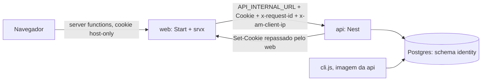
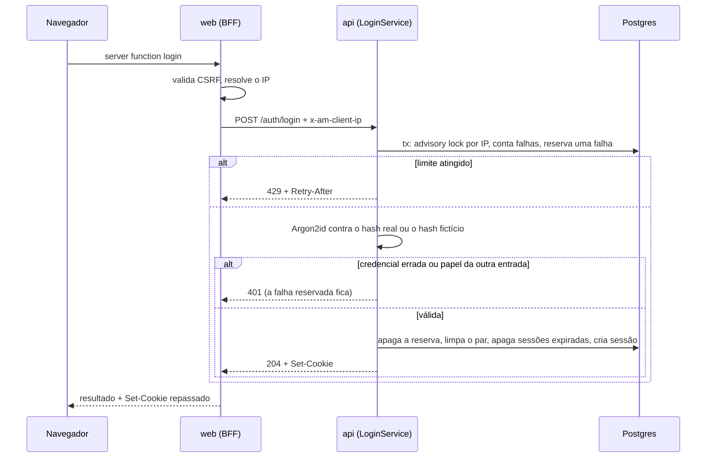
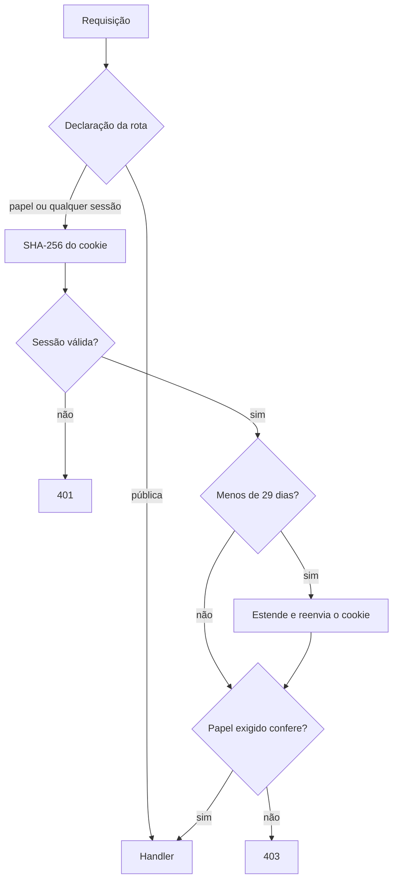

# Identity Design

**Spec**: `.specs/features/identity/spec.md`
**Status**: Approved
**Approved**: 2026-11-03 - user: "Aprovo o design"

---

## Approach

A spec já fixa BFF, sessão opaca e contas separadas. A decisão de arquitetura que sobra é **a forma do BFF**, porque toda fatia seguinte vai copiá-la.

| | A. Uma server function por endpoint (**recomendada**) | B. Rota proxy genérica `/api/$` |
|---|---|---|
| Código | Uma função curta por endpoint, sobre um `callApi` comum | Uma rota só; o client faz `fetch` |
| Superfície exposta | Só o que tem função: lista explícita | Toda a API, incluindo rotas futuras, salvo filtro manual |
| CSRF | Coberto pelo middleware do Start, feito para server functions | O middleware precisa ser estendido à rota |
| SSR | A mesma função roda no loader e no client | O SSR ainda precisa de outro caminho até a API |
| Tipos | Vindos de `packages/contracts` em cada função | Montados à mão no client |
| Custo | Uma função a mais por endpoint em cada fatia | Menos código agora |

Recomendação: **A**. É o padrão de `get-system-status.ts`, segue a diretriz de server functions como BFF e mantém a lista do que o navegador alcança. A lógica continua no Nest: a função só repassa e devolve o resultado.

Sem biblioteca de auth (`.design`: só venceria com login social ou 2FA próximos). Sem CQRS nem eventos: Identity é serviço simples com repositórios, e nenhum outro módulo precisa reagir a ele nesta fatia.

---

## Architecture Overview



### Login



### Requisição autenticada



**Onde as regras rodam.** Bloqueio, pendência de convite, total de pendentes, ordenação e papéis ficam no Nest, com teste de integração. No web ficam só o mapeamento de status para mensagem e a validação da rota preservada, em `model/`, com teste unitário.

---

## Code Reuse Analysis

### Existing Components to Leverage

| Component | Location | How to Use |
| --- | --- | --- |
| Padrão de server function testável | `apps/web/src/features/system-status/api/get-system-status.ts` | Função pura + `createServerFn` fina |
| Propagação do request id | `apps/web/src/lib/request-id.ts` | Usada dentro de `callApi` |
| `StatusPanel`, `getSystemStatus` | `apps/web/src/features/system-status/index.ts` | `/status` e dashboard do admin |
| `DashboardPage`, `StatusBadge`, tokens | `packages/ui` | Home, dashboard; novos tokens seguem os nomes semânticos |
| `DatabaseModule` | `apps/api/src/infra/database/database.module.ts` | Token `DATABASE` nos repositórios |
| Drizzle + migrate | `apps/api/src/infra/database/` | Migration do schema `identity` |
| `startApi`, Testcontainers | `apps/api/test/` | Integração; `startApi` ganha `clock` e env |
| `MissingEnvError` | `apps/api/src/config/env.ts`, `apps/web/src/lib/env.ts` | `WEB_PUBLIC_URL` (EDGE-04) |
| Fixtures de compose | `tests/e2e/fixtures/` | Override com `CLIENT_IP_HEADER` para LOCK-09/10 |

### Integration Points

| System | Integration Method |
| --- | --- |
| Módulos futuros | `modules/identity/index.ts` exporta `IdentityModule`, `Public`, `Roles`, `AnySession`, `CurrentUser`, `AuthenticatedUser` |
| `HealthModule` | Ganha `@Public()` no controller |
| Features futuras | `features/identity/index.ts` exporta `getSession` e os guards de rota |
| Compose | `api`: `WEB_PUBLIC_URL`, `SESSION_COOKIE_SECURE`; `web`: `WEB_PUBLIC_URL`, `CLIENT_IP_HEADER`; healthcheck em `/status` |
| Boundary lint | As regras existentes já cobrem `identity` (EDGE-08); um fixture prova o caso |

---

## Components

### Backend: `apps/api/src/modules/identity/`

| Path | Purpose | Interfaces |
| --- | --- | --- |
| `domain/credentials.ts` | Normaliza e-mail, aplica a regra de senha (constantes vindas de contracts) | `normalizeEmail(raw)`, `isAcceptablePassword(raw)` |
| `domain/tokens.ts` | Gera e faz o hash de tokens | `generateToken()`, `hashToken(token)` |
| `domain/lockout.ts` | Regra pura dos limites | `evaluateLockout({ pairFailures, ipFailures }, now)` → `{ allowed }` ou `{ retryAfterSeconds }` |
| `domain/session-renewal.ts` | Regra pura da renovação | `renewedExpiry(expiresAt, now)` → `Date` ou `null` |
| `application/password-hasher.ts` | Interface + Argon2id em PHC via `node:crypto` | `hash(password)`, `verify(phc, password)`, `verifyDummy(password)` |
| `application/login.service.ts` | AUTH-01..04, LOCK-* | `login({ email, password, ip, entrance })` |
| `application/session.service.ts` | Resolver, renovar, revogar | `resolve(token, now)`, `revoke(token)`, `create(userId, tx?)` |
| `application/invitation.service.ts` | INV-*, ADM-01..03 | `create`, `inspect`, `accept`, `listPending`, `revoke` |
| `application/account-admin.service.ts` | CLI-01..05 | `createAdmin`, `resetPassword` |
| `infra/schema.ts` | Tabelas Drizzle em `pgSchema('identity')`; `infra/database/schema.ts` reexporta para o drizzle-kit | |
| `infra/*.repository.ts` | SQL de usuários, sessões, convites e tentativas | Interface de sessão isolável por cache futuro (AD-006) |
| `http/session.guard.ts` | Guard global via `APP_GUARD` | Lê a declaração com `Reflector`; define `request.user` |
| `http/access.decorators.ts` | Declarações de acesso | `@Public()`, `@Roles('admin' \| 'member')`, `@AnySession()`, `@CurrentUser()`; o JSDoc explica a regra de AD-006 |
| `http/auth.controller.ts`, `http/invitations.controller.ts` | Endpoints; só traduzem HTTP | |
| `http/session-cookie.ts` | Lê e escreve o cookie com o pacote `cookie` | `readSessionToken(req)`, `setSessionCookie(res, token)`, `clearSessionCookie(res)` |
| `http/client-ip.ts` | IP do `x-am-client-ip`, ou do socket sem o header | |
| `cli/run-identity-cli.ts` | Comandos sem depender do container do Nest | `runIdentityCli(argv, { db, stdin, stdout })` → exit code |

`apps/api/src/cli.ts` é o entrypoint (`node dist/cli.js`), importado de `modules/identity/index.ts`.

### Backend transversal

| Path | Purpose |
| --- | --- |
| `apps/api/src/infra/http/problem-details.filter.ts` | `APP_FILTER` global: toda exceção vira `application/problem+json` (AUTH-17, EDGE-02), sem ecoar o corpo |
| `apps/api/src/infra/http/zod-body.pipe.ts` | Valida o corpo com os schemas de contracts |
| `apps/api/src/infra/clock/clock.ts` | `CLOCK` com `now()`; `AppModule.forRoot` aceita relógio de teste. Todo `expires_at` e toda comparação usam ele, não o `now()` do banco |
| `apps/api/src/infra/logging/logging.module.ts` | `redact` de `req.headers.cookie`, `res.headers["set-cookie"]` e `x-am-client-ip`; serializer troca o token da URL por `[token]` (AUTH-18) |
| `apps/api/src/config/env.ts` | `loadEnv` ganha `WEB_PUBLIC_URL` e `SESSION_COOKIE_SECURE`; novo `loadDatabaseEnv` para `migrate` e CLI |

### Teste de arquitetura (AUTH-19)

`apps/api/src/modules/identity/http/route-access.int.test.ts` sobe o `AppModule`, percorre controllers e handlers com `DiscoveryService` e `MetadataScanner` do `@nestjs/core` e falha nomeando a rota sem declaração e as declarações aceitas. Um módulo de fixture sem declaração prova que o teste falha.

Em tempo de execução, rota sem declaração cai no padrão fechado de AUTH-15: exige sessão.

### Web: `apps/web/src/`

| Path | Purpose |
| --- | --- |
| `lib/call-api.ts` | Encaminha `Cookie`, request id e IP; timeout de 3 s; repassa cada `Set-Cookie` com `appendResponseHeader`; devolve `{ ok, status, data }`, `{ ok: false, status, problem, retryAfter }` ou `{ ok: false, status: 503 }`. Sem regra de negócio |
| `lib/client-ip.ts` | Header de `CLIENT_IP_HEADER`, ou `getRequestIP()` sem proxy confiável: o srvx ignora `X-Forwarded-For` por padrão (LOCK-10) |
| `start.ts` | `createCsrfMiddleware` nas server functions, com `origin: WEB_PUBLIC_URL` |
| `server.ts` | Aplica `responseHeadersFor(pathname)`: `no-store` fora de `/status`, e `no-referrer` em `/invite/*` |
| `features/identity/api/*` | Uma server function por endpoint |
| `features/identity/model/*` | `problemMessage(result)`, `safeRedirect(path, fallback)`, `areaOf(role)` |
| `features/identity/components/*` | `LoginForm`, `AcceptInvitationForm`, `InvitationsPanel`, `InvitationSummary`, `SessionMenu` |
| `router.tsx` | `QueryClient` no contexto do router com `@tanstack/react-router-ssr-query` |

Formulários com TanStack Form e listas com TanStack Query, como manda a diretriz; os dois entram agora como dependências novas. A lista de convites usa `useInfiniteQuery`.

### Rotas

| File | URL | Comportamento |
| --- | --- | --- |
| `routes/status.tsx` | `/status` | Página atual, sem sessão |
| `routes/login.tsx` | `/login` | `AuthPage`; `?redirect` validado com Zod |
| `routes/invite.$token.tsx` | `/invite/:token` | `AuthPage`; o loader chama `getInvitation` |
| `routes/_member.tsx` | layout | `beforeLoad`: sem sessão → `/login`; admin → `/admin`; `503` → tela de indisponível |
| `routes/_member/index.tsx` | `/` | `DashboardPage` mínimo |
| `routes/admin/login.tsx` | `/admin/login` | `AuthPage` |
| `routes/admin/_protected.tsx` | layout | Sem sessão → `/admin/login`; member → "Você não tem acesso a esta área."; `503` → tela de indisponível |
| `routes/admin/_protected/index.tsx` | `/admin` | `DashboardPage`: `StatusPanel` + `InvitationSummary` |
| `routes/admin/_protected/invitations.tsx` | `/admin/invitations` | `ListPage`: formulário no topo, lista abaixo |

### `packages/ui`

Tudo novo, com story nos dois temas e sem conhecer API:

| Component | Forma |
| --- | --- |
| `AuthPage` | `Root`, `Header`, `Form`, `Footer`; coluna estreita, sem card nem hero |
| `ListPage` | `Root`, `Header`, `Filters`, `Content` |
| `AppShell` | `Root`, `Sidebar`, `NavItem` (`asChild`), `Main`; em 375 px, a navegação fica acima do conteúdo |
| `Button` | `intent="primary" \| "secondary" \| "danger"`, `asChild` |
| `Field` | `Root`, `Label`, `Control`, `Hint`, `Error`, com ligação `aria-*` |
| `Alert` | `intent="danger" \| "info"`, com `role="alert"` quando for erro |
| `ConfirmDialog` | Sobre `@radix-ui/react-alert-dialog`, reestilizado com tokens |
| `CopyField` | Valor selecionável + ação; recebe `onCopy` e o estado de fora |

Tokens provisórios novos: `accent`, `on-accent`, `danger`, em OKLCH nos dois temas.

---

## Data Models

Schema `identity`, chaves com default `uuidv7()`:

```typescript
users {
  id uuid pk; email text unique; name text;
  password_hash text; role enum('admin', 'member')
}
sessions {
  id uuid pk; user_id uuid fk users on delete cascade;
  token_hash text unique; expires_at timestamptz; revoked_at timestamptz null
}
invitations {
  id uuid pk; email text; token_hash text unique; invited_by uuid fk users;
  expires_at timestamptz; accepted_at timestamptz null; revoked_at timestamptz null
  // único parcial em (email) where accepted_at is null and revoked_at is null
}
login_attempts {
  id uuid pk; email text; ip text; attempted_at timestamptz;
  pair_cleared boolean default false
  // índices (ip, attempted_at) e (email, ip, attempted_at)
}
```

**Bloqueio sem corrida.** Numa transação curta: `pg_advisory_xact_lock` pelo IP, contagem das duas janelas e inserção da falha como reserva. O Argon2 roda fora da transação. Assim, uma rajada simultânea só deixa passar 5 tentativas. O login bem-sucedido apaga a própria reserva e marca `pair_cleared` nas falhas do par: elas deixam de contar para o par e continuam contando para o IP (LOCK-06), de modo que entrar na própria conta não zera o teto por IP.

**Aceite atômico.** O hash é calculado antes da transação. Dentro dela: `UPDATE invitations SET accepted_at ... WHERE pendente RETURNING`; nenhuma linha → `410`. Depois, `INSERT users ON CONFLICT (email) DO NOTHING`; nenhuma linha → rollback e `410` (EDGE-05). Por fim, a sessão. O lock de linha do `UPDATE` serializa aceites simultâneos (INV-09).

**Recriar convite.** Transação que revoga o pendente e insere o novo. Violação do único parcial, com dois admins simultâneos, repete a transação uma vez.

---

## Error Handling Strategy

| Error Scenario | Handling | User Impact |
| --- | --- | --- |
| Corpo inválido | `ZodBodyPipe` → `400` Problem Details sem valores | Mensagem no campo; o front valida com o mesmo schema antes |
| Credencial inválida | `401` único | "E-mail ou senha incorretos." |
| Bloqueio | `429` + `Retry-After` | Minutos arredondados para cima |
| Convite inválido | `410` único | Tela sem formulário |
| Sessão inválida no `beforeLoad` | `redirect` com a rota preservada | Tela de login |
| `401` numa mutação no navegador | O hook da feature redireciona | Login com "Sua sessão expirou. Entre novamente." |
| API fora do ar ou timeout | `callApi` devolve `503`, sem exceção | "Serviço indisponível...", sem ir para o login |
| Erro inesperado na API | Filtro → `500` Problem Details genérico; detalhe só no log | Mesma mensagem de indisponível |
| CSRF | Middleware → `403`, sem chamar a API | Só afeta chamada de outra origem |

---

## Risks & Concerns

| Concern | Location (file:line) | Impact | Mitigation |
| --- | --- | --- | --- |
| Segurança: `pino-http` registra URL e headers por padrão | `apps/api/src/infra/logging/logging.module.ts:18` | Token de convite e cookie nos logs | `redact` + serializer; prova lendo os logs (AUTH-18) |
| Segurança: API publicada em todas as interfaces, e `x-am-client-ip` só é confiável sem acesso direto | `compose.yaml:51` | Quem alcança a porta falsifica o IP e contorna o bloqueio | Publicar em `127.0.0.1`, como o Postgres; `production-deploy` não publica a porta (AD-004) |
| Teste: `migrate` não recebe as variáveis novas | `compose.yaml:33`, `apps/api/src/migrate.ts:7` | Exigir `WEB_PUBLIC_URL` em `loadEnv` derrubaria o migrate | `loadDatabaseEnv` separado, com teste |
| Regressão: E2E e healthcheck consultam `/` | `compose.yaml:78`, `tests/e2e/specs/` | `/` passa a depender da API | Trocar para `/status`, mantendo todas as asserções |
| CSRF atrás de proxy: a origem esperada vem de `request.url` | `createCsrfMiddleware.js` do Start | Atrás do proxy, a origem interna rejeitaria o login legítimo em navegador sem `Sec-Fetch-Site` | Passar `origin: WEB_PUBLIC_URL` |
| Repasse de `Set-Cookie` durante o SSR | `lib/call-api.ts` (novo) | Renovação no SSR pode não chegar ao navegador se os headers já tiverem saído | O guard roda antes do streaming, em `beforeLoad`; uma prova E2E confere a renovação numa navegação SSR, ajustando `expires_at` via SQL |
| Argon2 sob carga: 19 MiB por verificação | `password-hasher.ts` (novo) | Muitos logins pressionam a memória da VPS | Teto por IP antes do hash (LOCK-02, LOCK-05) e assíncrono; reavaliar após medir na VPS |
| `node:crypto.argon2` exige Node 24.7+ | `.nvmrc`, `apps/api/Dockerfile:7` | Falha em Node mais antigo | `engines` e imagem já usam 24; `.nvmrc` diz só `24`, e o shell padrão desta máquina está em 22, então o `nvm use` é necessário |
| Dependências novas e atraso de versão do pnpm | `pnpm-workspace.yaml` | `react-query`, `react-form`, `ssr-query`, `cookie`, `alert-dialog` podem cair na regra de idade mínima | Fixar versões aceitas pela regra na primeira task que as usa |

---

## Tech Decisions

| Decision | Choice | Rationale |
| --- | --- | --- |
| Forma do BFF | Uma server function por endpoint | Ver Approach; vira AD-007 com a aprovação, porque as próximas fatias seguem |
| Argon2 | `node:crypto`, sem dependência | A imagem usa Node 24; a documentação do Node não marca a API como experimental |
| Relógio | `CLOCK` injetado, comparações na aplicação | Expiração e janela testadas sem espera, e sem teste instável |
| Header interno de IP | `x-am-client-ip`, em vez de `trust proxy` do Express | Um único salto conhecido; simples de provar |
| Headers de resposta do web | `server.ts`, por caminho | Função pura, cobre SSR e não depende da rota lembrar |
| Expiração em E2E | `UPDATE` via `psql` no container | A imagem de produção não aceita relógio de teste |
| Cookie | Pacote `cookie` | Parser e serializer mantidos; o Nest sem `cookie-parser` |
| Status do CSRF | `403` padrão do middleware | Nenhum contrato pede outro |
