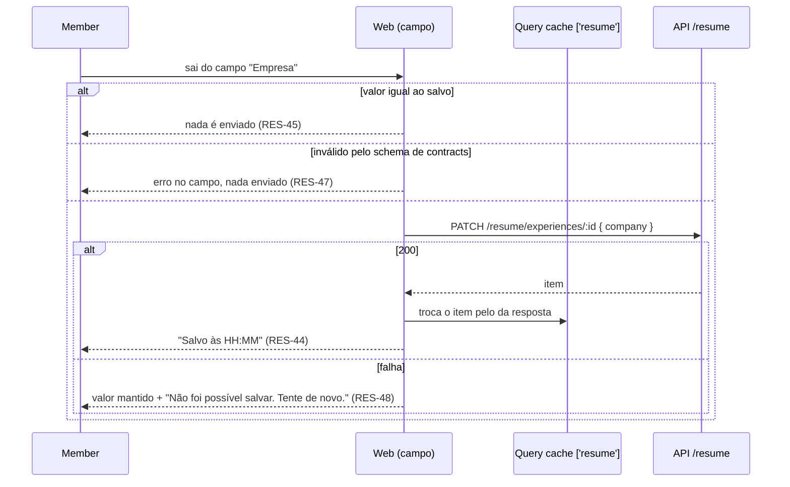

# Master Resume Design

**Spec**: `.specs/features/master-resume/spec.md`
**Status**: Approved - 2026-11-10 - user: "O design está aprovado" (depois ajustado pela AD-028: dicionário de skills e ordem com `{ ids }`)

---

## Approach

Duas formas entregam o mesmo escopo:

| | A. Tabelas por seção (recomendada) | B. Um documento `jsonb` por pessoa |
|---|---|---|
| Modelo | As sete tabelas do `.design` no schema `resume`, com `position` por linha e bullets ligados por FK interna ao schema | `resume.documents (user_id, content jsonb)`; cada rota lê, muda e regrava o documento |
| Validação, limites, `404` | Por linha, com SQL e índices; `404` de item alheio sai de um `where user_id` | Tudo em memória sobre o documento; `404` é "id não está no documento" |
| Concorrência | Cada escrita toca as linhas dela; dois campos salvos ao mesmo tempo não se atropelam | Duas escritas simultâneas regravam o documento inteiro; a segunda apaga a primeira sem bloqueio por linha |
| ResumeVersion | Copia lendo as tabelas para o `content` dela | Copia o `jsonb` direto |
| Custo | Mais tabelas, rotas e consultas | Menos código agora; diverge do `.design` confirmado |

**Recomendação: A.** É o modelo confirmado no `.design`. O salvamento campo a campo (AD da spec: "Inline, salva ao sair do campo") gera muitas escritas pequenas e simultâneas, e a B perderia algumas sem bloqueio. A cópia para ResumeVersion é uma leitura só, feita uma vez por candidatura.

---

## Architecture Overview

```mermaid
flowchart LR
  subgraph Browser
    P[ResumePage<br/>FormPage + Sortable] -->|blur / drop| M[mutations<br/>TanStack Query 'resume']
  end
  M -->|server function por endpoint AD-007| BFF[features/resume/api<br/>callApi]
  BFF -->|rede interna AD-004| C[ResumeController<br/>@Roles member]
  C --> S[ResumeService]
  S -->|visibleIds / describe| K[SkillsCatalog<br/>API pública de skills]
  S --> R[ResumeRepository]
  R --> DB[(schema resume)]
```



Onde as regras rodam:

| Regra | Camada | Teste |
|---|---|---|
| Limites de campo, datas, fim ≥ início, URL, e-mail | `packages/contracts/src/resume.ts` (o mesmo schema na API e no web) | `resume.test.ts` de contracts; integração da API |
| Limites de quantidade (50, 30, 5), skills válidas, ordem exata, `404` | `ResumeService` + repositório | integração contra Postgres (`*.int.test.ts`) |
| Ordem dos itens e bullets | SQL (`order by position, id`) | integração |
| Contagem do índice, bullets sem skill | funções puras em `apps/web/src/features/resume/model/` | Vitest unitário |
| Passo 02 concluído (`ready`) | `ResumeRepository.isReady` (uma consulta com `EXISTS`) via `GET /resume/summary` | integração (RES-86) |
| Formato "mar 2023 — atual" | `model/months.ts` | Vitest unitário |

---

## Data Reads

Cada leitura que a feature cria, e cada resposta de escrita, com o que o consumidor usa (AD-028). Pior caso pelos limites da spec (50 itens por seção, 30 bullets por item, 20 skills por bullet, 5 links), com o texto de um bullet em até ~1 KB de UTF-8 e um uuid em 39 bytes de JSON.

| Consumer | Endpoint | Uses | Returns | Worst case | In the HTML |
|---|---|---|---|---|---|
| Página `/resume` (loader e query `['resume']`) | `GET /resume` | a seção aberta; o índice conta os itens de todas e o Alert conta os bullets sem skill de todas | `MasterResume`: perfil, as cinco seções, bullets com `skillIds`, `skills` em dicionário | típico ~15 KB (6 itens, 20 bullets, 30 skills); teto ~4,3 MB (3 000 bullets × ~1,4 KB + dicionário de ~500 skills distintas) | sim, inteiro: é o currículo que a página edita, do próprio dono |
| API → módulo `skills` | `SkillsCatalog.describe(ids)` | nome e escopo das skills citadas no currículo | `Map` id → skill, só os ids distintos pedidos | ≤ uma entrada por skill distinta citada (~500 num catálogo real) | não |
| Home, passo 02 | `GET /resume/summary` | se o mestre está pronto | `{ ready }` | 1 linha, duas consultas `EXISTS` | só `ready` |
| Campo do perfil | `PUT /resume/profile` | o perfil salvo, para trocar no cache | `Profile` | 1 perfil, ~12 KB (resumo de 2 000 caracteres e 5 links) | não, resposta a uma ação no cliente |
| Campo de um item | `POST` / `PATCH /resume/{section}/:id` | o item salvo | o item, sem os bullets (a escrita não os muda) | 1 item, ~5 KB | não |
| Texto ou skills de um bullet | `POST` / `PATCH …/bullets/:bulletId` | o bullet salvo e as skills dele | `{ bullet, skills }` | 1 bullet e até 20 skills, ~3 KB | não |
| Arrastar | `PUT /resume/{section}/order`, `PUT …/bullets/order` | a confirmação da ordem | `{ ids }` | até 50 ids, ~2 KB | não |

O teto de `GET /resume` só aparece com o próprio dono escrevendo 3 000 bullets; os limites foram mantidos por decisão do usuário ("Manter 50 / 30 / 20"). A busca de skills do `SkillsField` (`GET /skills?q=`) e a contagem da sidebar (`GET /applications/count`) não mudam.

---

## Code Reuse Analysis

### Existing Components to Leverage

| Component | Location | How to Use |
|---|---|---|
| Estrutura de módulo (domain/application/infra/http, `index.ts` público) | `apps/api/src/modules/applications/` | Mesmo formato para `modules/resume` |
| `SkillsCatalog.visibleIds` / `describe` | `apps/api/src/modules/skills/application/skills-catalog.ts` | Validar `skillIds` (RES-20) e descrever skills dos bullets (RES-23, RES-24) |
| `InvalidSkillsProblem` e o mapeamento `answering()` | `packages/contracts/src/applications.ts`, `applications.controller.ts` | Mesmo corpo `422` com `invalidSkillIds` |
| `zodBody`, `ProblemDetailsException`, `problemFor` | `apps/api/src/infra/http/` | Validação `400`; o controller chama `zodBody(schemaFor(section)).transform(body)` quando o schema depende de `:section` |
| `@Roles('member')`, `CurrentUser` | `modules/identity/index.ts` | Toda rota (RES-29, RES-30); o teste de arquitetura de AD-006 já cobre rota sem declaração |
| Padrão `record(event, id, actorId)` com `PinoLogger` | `applications.service.ts` | Logs sem dado pessoal (RES-33) |
| Helpers de teste de integração (`withApplicationsEnv`, `call`, contas, `query`) | `apps/api/test/` | `test/resume.ts` no mesmo formato |
| BFF: `callApi`, `parsed`, `Outcome`, contexto da requisição | `apps/web/src/lib/bff.ts`, `call-api.ts` (AD-016) | `features/resume/api/server-functions.ts` |
| `SkillsField` (busca, criação de privada com categoria) | `apps/web/src/features/skills/components/SkillsField.tsx` | Campo de skills do bullet (RES-66), um campo só, `requirement="required"` |
| `useExpiredSessionRedirect`, `UnavailableScreen`, `problemMessage` | `features/identity` | Sessão expirada e API fora do ar (RES-40) |
| `FormPage`, `AppShell` (`Section`, `NavItem`, `Topbar`), `InlineEdit`, `Field`, `ConfirmDialog`, `DropdownMenu`, `SkillTag`, `Alert`, `Button` | `packages/ui` | Toda a tela |
| Teste da carta por captura e E2E de browser | `tests/e2e/specs/browser/`, `.specs/features/application/captures/*.running.png` | `resume.spec.ts` |

### Integration Points

| System | Integration Method |
|---|---|
| Módulo `skills` | `ResumeModule` importa `SkillsModule` e usa só `SkillsCatalog` (RES-32), como `applications` |
| Postgres | Schema `resume`, migration `0005_resume_schema.sql` gerada por `drizzle-kit generate`; `infra/database/schema.ts` reexporta as tabelas |
| `AppModule` | `ResumeModule` entra em `imports` |
| Web `_member` | Item "Currículo mestre" num `AppShell.Section` "Currículo" (RES-77); a home lê `GET /resume/summary` e recebe só `{ ready }` (RES-79, RES-86) |

---

## Components

### API: `apps/api/src/modules/resume`

**`infra/schema.ts`**
- **Purpose**: As sete tabelas do schema `resume`.
- **Interfaces**: `profiles`, `experiences`, `projects`, `educations`, `certifications`, `languages`, `bullets`, enum `language_level`.
- **Reuses**: `id()` com `uuidv7()` e `instant()` de `applications/infra/schema.ts`.

**`domain/`**
- `sections.ts`: `RESUME_SECTIONS` e qual tabela, colunas e schema de corpo cada seção usa; `BULLET_SECTIONS = ['experiences', 'projects']`.
- `months.ts`: `YYYY-MM` ↔ `date` no dia 1.
- `order.ts`: `isExactOrder(sent, existing)`: mesmo conjunto, sem repetição.
- `ids.ts`: `isUuid`.

**`infra/resume.repository.ts`**
- **Purpose**: Leitura e escrita das tabelas, sempre filtradas por `user_id`.
- **Interfaces**:
  - `transaction<T>(run)`; `lockUser(tx, userId)`: `pg_advisory_xact_lock` pela chave do usuário, para limites e ordem.
  - `readAll(userId)`: perfil, itens de cada seção e bullets, cada lista `order by position, id`.
  - `isReady(userId)`: `exists` de perfil com `full_name <> ''` e `exists` de bullet do usuário com `cardinality(skill_ids) > 0`, numa consulta (RES-86).
  - `upsertProfile(userId, profile)`: `insert … on conflict (user_id) do update`.
  - `insertItem(tx, section, userId, values)`: `position = coalesce(min(position), 1) - 1` (topo, sem renumerar).
  - `updateItem(section, userId, id, values)`, `deleteItem(section, userId, id)`: `boolean` de achou.
  - `countItems(tx, section, userId)`, `itemIds(tx, section, userId)`, `setOrder(tx, section, userId, ids)`.
  - `insertBullet(tx, parent, values)`: `position = coalesce(max(position), -1) + 1` (fim); `updateBullet`, `deleteBullet`, `bulletIds`, `setBulletOrder`, `countBullets`.

**`application/resume.service.ts`**
- **Purpose**: As regras: dono pela sessão, limites, skills válidas, ordem exata, `404`, logs.
- **Interfaces**:
  - `get(userId): Promise<MasterResume>`: perfil vazio quando não há linha (RES-01), sem escrever.
  - `summary(userId): Promise<ResumeSummary>`: `{ ready }`, sem chamar o módulo `skills` (RES-86).
  - `saveProfile(userId, body): Promise<Profile>`.
  - `createItem(userId, section, body)`, `updateItem(userId, section, id, body)`, `deleteItem(userId, section, id)`.
  - `orderItems(userId, section, ids)`.
  - `createBullet(userId, section, itemId, body)`, `updateBullet(...)`, `deleteBullet(...)`, `orderBullets(...)`.
- **Errors**: `ResumeNotFoundError` (`404`), `InvalidSkillsError` (`422`, com ids), `LimitReachedError` (`422`), `OrderMismatchError` (`400`).
- **Dependencies**: `ResumeRepository`, `SkillsCatalog`, `PinoLogger`, `CLOCK` (para `updated_at`).

**`http/resume.controller.ts`**
- **Purpose**: As rotas da spec, todas `@Roles('member')`.
- **Rotas**:
  - `GET /resume`, `GET /resume/summary`, `PUT /resume/profile`
  - `POST /resume/:section`, `PATCH /resume/:section/:id`, `DELETE /resume/:section/:id`, `PUT /resume/:section/order`
  - `POST /resume/:section/:id/bullets`, `PATCH|DELETE /resume/:section/:id/bullets/:bulletId`, `PUT /resume/:section/:id/bullets/order`
- `:section` fora do enum ou de `BULLET_SECTIONS` nas rotas de bullet responde `404`. Corpo validado por `itemRequestSchemas[section]`, ou pela versão parcial no `PATCH`.

### Contracts: `packages/contracts/src/resume.ts`

`resumeSectionSchema`, `monthSchema`, `languageLevelSchema`, `profileSchema` e `saveProfileRequestSchema`, os `create*`/`update*` de cada seção (o `update` é `partial()` com o mesmo refinamento de fim ≥ início quando os dois vêm), `bulletRequestSchema`, `bulletSchema` (`{ id, text, skillIds }`), `skillDictionarySchema` (`Record<id, { name, scope }>`), `bulletResponseSchema` (`{ bullet, skills }`), `masterResumeSchema` (com `skills`), `orderResponseSchema` (`{ ids }`), `resumeSummarySchema` (`{ ready: boolean }`), `orderRequestSchema` e as constantes de limite (`RESUME_ITEMS_MAX = 50`, `BULLETS_PER_ITEM_MAX = 30`, `SKILLS_PER_BULLET_MAX = 20`, `PROFILE_LINKS_MAX = 5`, `BULLET_TEXT_MAX_LENGTH = 500` e as demais da spec). Reaproveita `skillScopeSchema`, `invalidSkillsProblemSchema` e o `noControl` de applications, movido para um helper compartilhado do pacote.

### Web: `apps/web/src/features/resume`

**`api/server-functions.ts`**: uma server function por endpoint (AD-007), 11 no total: `getResume`, `getResumeSummary`, `saveProfile`, `createResumeItem`, `updateResumeItem`, `deleteResumeItem`, `orderResumeItems`, `createBullet`, `updateBullet`, `deleteBullet`, `orderBullets`. Funções puras testadas e o `createServerFn` só com a checagem de entrada, como em applications.

**`model/`** (puro, Vitest):
- `sections.ts`: rótulos do índice, textos de seção vazia, "+ Experiência", "Excluir experiência?", `parseSection(search)` (RES-36).
- `months.ts`: `formatMonth('2023-03')` → "mar 2023"; `formatRange(start, end)` → "mar 2023 — atual" (RES-49, RES-50).
- `counts.ts`: `sectionCounts(resume)`, `bulletsWithoutSkill(resume)`, `missingSkillMessage(n)` (RES-37, RES-38).
- `item-header.ts`: título e subtítulo do cabeçalho por seção (RES-49).
- `messages.ts`: "Não foi possível salvar. Tente de novo." e as demais frases.

**`components/`**:
- `ResumePage`: `FormPage.Root` com a topbar ("Currículo mestre" + `SavedAt`), o `ResumeIndex` e a seção de `section`.
- `ResumeIndex`: `FormPage.IndexLink` por seção, com contagem, e o `Alert` (RES-35, RES-37, RES-38).
- `ProfileSection` + `LinksField` (RES-43 a RES-48, RES-84).
- `ItemsSection<S>`: genérico por seção, com o `+`, o estado vazio, a `Sortable.List` dos itens e o limite (RES-39, RES-51, RES-70, RES-82).
- `ItemCard`: cabeçalho que expande ou recolhe, lápis, `ItemFields` da seção, "Excluir …" com `ConfirmDialog` (RES-54 a RES-58).
- `ItemFields`: um conjunto de campos por seção, com o rascunho local do item novo (RES-52, RES-53, RES-55, RES-59).
- `BulletList` + `BulletRow`: `InlineEdit multiline`, tags, "sem skill", menu "⋯", `SkillsField` (RES-60 a RES-69, RES-71, RES-83).
- `SavedAt`: "Salvo às HH:MM" a partir do último sucesso.

**`hooks/`**:
- `useResume()`: a query `['resume']`, semeada pelo loader da rota.
- `useAutosaveField({ saved, validate, save })`: compara com o salvo (RES-45), valida pelo schema (RES-47), chama `save`, guarda o erro (RES-48) e avisa o `SavedAt`. Um campo não envia uma segunda vez enquanto a primeira está em voo; envia o último valor quando ela volta.
- `useReorder(section, parentId?)`: troca otimista no cache, `PUT …/order` (resposta `{ ids }`), rollback com a mensagem (RES-74) ou nova leitura no `400` (RES-75).
- Uma escrita de bullet funde o `skills` da resposta no dicionário do cache; um item salvo troca os campos do item no cache e mantém os bullets que já estavam lá.
- `SavedAtContext`: hora do último salvamento, no fuso do navegador, só no cliente.

**Rota `apps/web/src/routes/_member/resume.tsx`**: `validateSearch` com `section`, loader `getResume()`, falha com "Tentar de novo" (RES-40), `401` com `useExpiredSessionRedirect`.

**`_member.tsx`**: `AppShell.Section title="Currículo"` com `NavItem` `FileText` "Currículo mestre" (RES-77). **`_member/index.tsx`**: o passo 02 ganha "Abrir currículo"; o loader da home chama `getResumeSummary()` e devolve só `ready`, então o HTML da home não leva dado do currículo (RES-78 a RES-80, RES-86). Uma falha na leitura deixa o passo sem "Concluído", como a contagem da sidebar faz hoje.

### UI: `packages/ui` (cada um com story e testes, sem texto de produto)

- **`Sortable`** (`components/sortable`): `Sortable.List({ ids, onReorder(ids), announcements, label })`, `Sortable.Item({ id })` e `Sortable.Handle({ label })`, sobre `@dnd-kit/core` + `@dnd-kit/sortable` com `PointerSensor` e `KeyboardSensor` (`sortableKeyboardCoordinates`), eixo vertical e `DndContext id` vindo de `useId()` para SSR. Os anúncios em pt-BR vêm do chamador (RES-72, RES-76). Teste de browser (Vitest browser) para arrastar e teclado.
- **`InlineEdit`**: ganha `multiline`, um `textarea` que cresce com o texto. `Enter` confirma e quebra de linha não entra, porque um bullet é uma frase.
- **`FormPage.IndexLink`** (link do índice com `count` em `mono` e `current`) e **`FormPage.Item`** (a caixa `radius-md` do item com área de alça, cabeçalho e corpo), conforme o README do `FormPage`.
- **`Bullet`** (`components/bullet`): texto em `body-lg`, área de tags abaixo, alça e área à direita (menu ou aviso), como `.am-bullet` da carta.

---

## Data Models

```sql
-- schema resume; toda tabela tem id uuid default uuidv7(), user_id uuid not null, sem FK para fora (RES-31)
profiles      (id, user_id unique, full_name, headline, email, phone null, location null,
               links jsonb not null default '[]', summary, locale not null default 'pt-BR', updated_at)
experiences   (id, user_id, role, company, location null, start_date date, end_date date null, position int)
projects      (id, user_id, name, url null, description null, position int)
educations    (id, user_id, course, institution, start_date date, end_date date null, position int)
certifications(id, user_id, name, issuer null, issued_on date null, url null, position int)
languages     (id, user_id, language, level language_level, position int)
bullets       (id, user_id, experience_id null → experiences on delete cascade,
               project_id null → projects on delete cascade, text, skill_ids uuid[] not null default '{}', position int,
               check (num_nonnulls(experience_id, project_id) = 1))
-- índices: (user_id, position) em cada seção; bullets (experience_id, position) e (project_id, position)
```

```typescript
type ResumeSection = 'experiences' | 'projects' | 'educations' | 'certifications' | 'languages';
type Month = `${number}-${number}`; // YYYY-MM

interface Profile { fullName: string; headline: string; email: string; phone: string | null;
  location: string | null; links: { label: string; url: string }[]; summary: string; locale: 'pt-BR' }

interface Bullet { id: string; text: string; skillIds: string[] } // na ordem de marcação
type SkillDictionary = Record<string, { name: string; scope: 'global' | 'private' }>

interface Experience { id: string; role: string; company: string; location: string | null;
  startDate: Month; endDate: Month | null; bullets: Bullet[] }
interface Project { id: string; name: string; url: string | null; description: string | null; bullets: Bullet[] }
interface Education { id: string; course: string; institution: string; startDate: Month; endDate: Month | null }
interface Certification { id: string; name: string; issuer: string | null; issuedOn: Month | null; url: string | null }
interface Language { id: string; language: string; level: 'basic' | 'intermediate' | 'advanced' | 'fluent' | 'native' }

interface MasterResume { profile: Profile; experiences: Experience[]; projects: Project[];
  educations: Education[]; certifications: Certification[]; languages: Language[];
  skills: SkillDictionary } // cada skill citada uma vez (AD-028)

interface BulletResponse { bullet: Bullet; skills: SkillDictionary } // só as skills do bullet
interface OrderResponse { ids: string[] }
interface ResumeSummary { ready: boolean }
// POST/PATCH de experiência ou projeto devolvem o item sem `bullets`
```

**Relationships**: `bullets.skill_ids` são ids do módulo `skills`, sem FK (Key decision 2), e a ordem do array é a ordem de marcação (RES-23). Uma skill que deixou de ser visível sai do dicionário e do `skillIds` da resposta, sem erro. No web, `BulletRow` desenha as tags lendo `skillIds` no dicionário do cache. `user_id` vem só da sessão (RES-28).

---

## Error Handling Strategy

| Error Scenario | Handling | User Impact |
|---|---|---|
| Corpo inválido, `:section` válido | `zodBody` → `400` Problem Details com `path` e `code` | Erro no campo; o web já barra antes pelo mesmo schema |
| `:section` desconhecido, ou seção sem bullets numa rota de bullet | `404` | — (o web nunca monta essa URL) |
| Item ou bullet alheio, inexistente, de outro item, id não uuid | `ResumeNotFoundError` → `404`, nada lido de outra conta | O web lê o currículo de novo |
| Skill inválida | `InvalidSkillsError` → `422` com `invalidSkillIds` | "Não foi possível salvar. Tente de novo." no campo de skills |
| 50 itens, 30 bullets | `LimitReachedError` → `422`, checado depois de `lockUser` | O `+` já está desabilitado (RES-82, RES-83) |
| Ordem com conjunto diferente | `OrderMismatchError` → `400`, checado depois de `lockUser` | O web lê de novo e mostra a ordem salva (RES-75) |
| Falha de rede ou `5xx` num campo | O valor fica no campo e o erro aparece; um novo blur tenta de novo | RES-48 |
| Falha ao salvar a ordem | Rollback do cache | "Não foi possível salvar a nova ordem." (RES-74) |
| Sessão expirada (`401`) | `useExpiredSessionRedirect` | Login com a página preservada |
| API fora do ar no loader | Tela de falha com "Tentar de novo" | RES-40 |

---

## Risks & Concerns

| Concern | Location (file:line) | Impact | Mitigation |
|---|---|---|---|
| `InlineEdit` só tem `input` de uma linha | `packages/ui/src/components/inline-edit/inline-edit.tsx:47` | Um bullet de 500 caracteres ficaria cortado numa linha | Variante `multiline` com testes e story, sem mudar o uso atual |
| Corrida nos limites e na ordem: dois `POST` simultâneos com 49 itens gravariam 51; uma ordem enviada junto com um `POST` passaria a conferência | `resume.service.ts` (novo) | Limite furado; item fora da ordem | `pg_advisory_xact_lock` por usuário nas transações de criação e ordem; teste de integração com duas criações em paralelo |
| Item novo editado enquanto o `POST` está em voo | `ItemFields` (novo) | Um segundo blur faria outro `POST` e duplicaria o item | O rascunho guarda o `POST` em voo; blurs seguintes esperam o id e viram `PATCH`; teste de componente |
| `DndContext` gera ids de ARIA por contador e diverge entre SSR e cliente | `@dnd-kit/core` | Aviso de hidratação e `aria-describedby` quebrado | `id` do `DndContext` vindo de `useId()`; teste de SSR do `Sortable` |
| Arrastar não roda em jsdom | testes do web | Arrastar sem teste | `Sortable` com testes de browser do Vitest em `packages/ui`; E2E Playwright arrastando e reordenando pelo teclado em `/resume` |
| `SkillsField` foi feito para dois campos (`other`) | `features/skills/components/SkillsField.tsx:26` | Comportamento estranho com um campo só | `other` já é opcional (padrão `[]`); teste do `BulletRow` cobre incluir, criar e remover |
| Teto de `GET /resume` em ~4,3 MB, serializado no HTML de `/resume` | `routes/_member/resume.tsx` (novo) | Página pesada só com um currículo de milhares de bullets, escrito pelo próprio dono | Skills em dicionário (AD-028) tiraram ~5 MB de repetição; os limites ficaram por decisão do usuário; se o uso real chegar perto, o caminho é carregar uma seção por vez com as contagens no `GET /resume/summary` |
| Skill usada em bullet não entra em `SKILL_USAGE` | `modules/skills/domain/skill-usage.ts:6` | Uma futura exclusão de skill pelo admin quebraria bullets sem aviso | Fora de escopo (não existe exclusão de skill); a resposta ignora skill invisível em vez de falhar, e `describe` cobre isso |
| A home precisa saber se o mestre está pronto | `routes/_member/index.tsx` | Ler o currículo inteiro pesaria na API e embutiria dado pessoal no HTML da home | `GET /resume/summary` com uma consulta `EXISTS` e só `{ ready }` na resposta (escolha do usuário: "usar recomendacao 2"); a ResumeVersion pode estender o mesmo resumo para o "mestre vazio" |
| Nenhum log de corpo de requisição | `infra/logging` | Vazar texto do currículo em log | Teste de logs como `applications-logging.int.test.ts`, procurando os textos usados numa rodada completa (RES-33) |

---

## Tech Decisions

| Decision | Choice | Rationale |
|---|---|---|
| Lib de arrastar | `@dnd-kit/core` 6.3 + `@dnd-kit/sortable` 10.0 (estáveis), não `@dnd-kit/react` 0.x | Sensor de teclado e anúncios prontos; o 0.x é pré-1.0. Encapsulada no `Sortable` do `packages/ui` (AD-027) |
| Posição de item novo | `min(position) - 1`; bullet novo `max(position) + 1`; `PUT …/order` renumera `0..n-1` | Inserir no topo sem reescrever as outras linhas |
| Rotas genéricas por `:section` | Um controller com `:section` validado e um mapa seção → schema e tabela | 5 seções × 4 operações explícitas seriam 20 handlers iguais; o teste de acesso percorre cada seção mesmo assim |
| Datas | `YYYY-MM` no contrato, `date` no dia 1 no banco | Mês e ano é o que um currículo mostra; `date` ordena e copia para ResumeVersion sem conversão |
| Contagens do índice | Funções puras no `model` do web a partir de `GET /resume` | É o mesmo dado que a tela já tem; testado por Vitest |
| Passo 02 da home | `GET /resume/summary` → `{ ready }`, calculado na API | Uma consulta barata, sem dado do currículo no HTML da home. Pergunta: "Qual prefere?"; opção escolhida: "usar recomendacao 2" |
| Estado na tela | Cache do TanStack Query `['resume']` trocado pela resposta de cada escrita; otimista só na ordem | O servidor é a verdade; a ordem precisa responder ao arrastar sem esperar |
| Concorrência entre abas | A última escrita vale | Assumption da spec |
