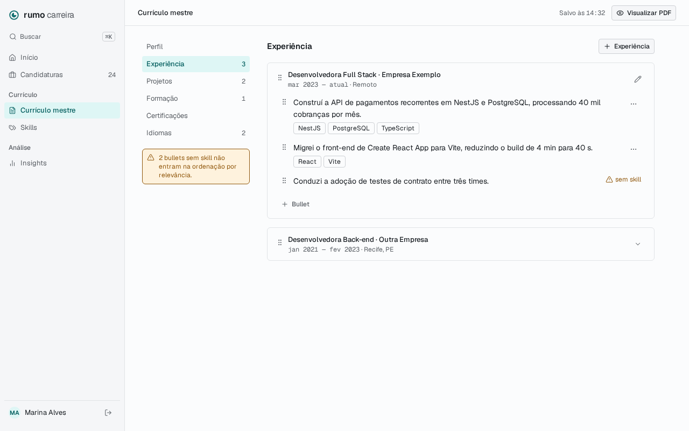

# Master Resume Specification

**Approved**: 2026-11-10 - user: "seguir para o design"
**Amended**: 2026-11-10 - user: "usar recomendacao 2" (RES-86: `GET /resume/summary` para o passo 02 da home)
**Amended**: 2026-11-10 - user: "Dicionário único" e "Só os ids na ordem" (AD-028: RES-15, RES-16, RES-23, RES-25, RES-26); limites mantidos ("Manter 50 / 30 / 20")

## Problem Statement

Adaptar o currículo para uma vaga leva de 30 a 60 minutos, então o autor quase nunca adapta. A adaptação rápida da fase 2 depende de um currículo mestre estruturado, em que cada bullet diz quais skills demonstra: é dessa marcação que a ResumeVersion tira a pontuação por relevância. Esta feature cria o currículo mestre (perfil, experiências, projetos, formação, certificações e idiomas), com bullets marcados pelo mesmo catálogo de skills das vagas, editável na própria página com salvamento automático.

## Goals

- [ ] Um member preenche o currículo mestre inteiro numa página, sem botão de salvar: cada campo salva ao sair dele e a topbar mostra "Salvo às HH:MM".
- [ ] Cada bullet de experiência ou projeto é marcado com skills do catálogo, criando uma privada na hora quando falta, e o bullet sem skill é sinalizado.
- [ ] O member reordena itens e bullets arrastando pela alça ou pelo teclado, e a ordem fica salva.
- [ ] Nenhuma rota de `/resume` devolve ou altera dado de outro usuário: recurso alheio responde `404`.
- [ ] Todos os estados da fatia MasterResume do `.design` que valem antes de ResumeVersion têm um teste que falharia se o comportamento mudasse.

## Out of Scope

| Feature | Reason |
| ------- | ------ |
| Botão "Visualizar PDF" e qualquer prévia do currículo | O PDF chega com ResumeDocument (AD-026) |
| ResumeVersion, pontuação por relevância e "Recomeçar do mestre" | Próxima fatia; aqui só a marcação que ela usa |
| Garantir que editar o mestre não muda versões existentes | Versões ainda não existem; a Key decision 5 é provada na fatia ResumeVersion |
| Mover um bullet de uma experiência ou projeto para outro | Fora do `.design`; reordenar vale dentro do mesmo item |
| Bullets em formação, certificações e idiomas | O `.design` só liga bullets a experiências e projetos |
| Currículo em outro idioma e controle de `locale` na tela | Ideia no roadmap; `locale` existe e vale sempre `pt-BR` |
| Importar currículo (PDF, LinkedIn) ou sugerir bullets com IA | Fase 3 e fora do `.design` |
| Itens "Skills", "Insights" e "Buscar ⌘K" da sidebar do member | AD-008: entram com a fatia que os cria |
| Contar bullets em "N vagas" no catálogo do admin | AD-019 conta vagas; bullets não são vagas |
| Desfazer exclusão e histórico de edições do mestre | Exclusão é definitiva (convenção do `.design`) |
| Edição simultânea em duas abas com aviso de conflito | Uso individual; a última escrita vale |

---

## Assumptions & Open Questions

| Assumption / decision | Chosen default | Rationale | Confirmed? |
| --------------------- | -------------- | --------- | ---------- |
| Reordenar | Arrastar pela alça (`grip-vertical`) e pelo teclado: foco na alça, `Espaço` ou `Enter` pega, setas movem, `Espaço` ou `Enter` solta, `Esc` cancela, com anúncio em região viva. A lib é `@dnd-kit`, encapsulada num componente de `packages/ui` | Pergunta: "Como o usuário reordena?"; opção escolhida: "Arrastar + teclado" | y |
| "Visualizar PDF" | Fora da topbar até ResumeDocument (AD-026) | Pergunta: "O botão 'Visualizar PDF' […] O que fazer agora?"; opção escolhida: "Omitir até existir" | y |
| Modelo de edição | Tudo na página: cada campo salva ao perder o foco (ou, nas escolhas, ao mudar), sem botão de salvar; a topbar mostra "Salvo às HH:MM" do último salvamento bem-sucedido; um item expande para mostrar os bullets e o lápis abre os campos dele; item novo nasce aberto e em edição | Pergunta: "Como o usuário edita perfil, experiências e bullets?"; opção escolhida: "Inline, salva ao sair do campo" | y |
| Passo 02 da home | Ganha o botão "Abrir currículo", que leva a `/resume`; passa a "Concluído" quando o perfil tem nome e existe ao menos um bullet com uma skill | Pergunta: "Quando o passo 02 da home passa a 'Concluído', e que botão ganha?"; opção escolhida: "Perfil + 1 bullet". Pendência de AD-010 e AD-021 | y |
| Como a home sabe do passo 02 | `GET /resume/summary` responde `{ ready }`, calculado na API com uma consulta, sem descrever skills; a home não lê o currículo inteiro e o HTML dela não leva dado do currículo | Pergunta: "Qual prefere?" (ler o currículo inteiro no loader, endpoint de resumo ou devolver o currículo à página); opção escolhida: "usar recomendacao 2" | y |
| Uma seção por vez | O índice troca a seção mostrada, com `section` na URL (`profile`, `experiences`, `projects`, `educations`, `certifications`, `languages`); a seção padrão é Perfil; a seção atual fica marcada no índice | A carta mostra Experiência no topo, marcada no índice, sem o Perfil acima | n |
| Primeiro acesso | `GET /resume` responde `200` com o perfil vazio (`locale` `pt-BR`) e as seções vazias, sem gravar nada; o perfil é gravado no primeiro `PUT /resume/profile` | `.design`: "criado sob demanda"; um `GET` sem escrita evita linhas vazias por visita | n |
| Campos do perfil | Nome completo (até 120), Título profissional (até 160), E-mail (até 254, formato de e-mail quando preenchido), Telefone · opcional (até 40), Local · opcional (até 120), Links (até 5, cada um com rótulo de até 40 e URL `http`/`https` de até 2048), Resumo (até 2 000). Todos podem ficar vazios enquanto o perfil é preenchido; textos são aparados | Salvar campo a campo exige aceitar um perfil incompleto; a completude conta no passo 02 da home | n |
| Campos de experiência | Cargo e Empresa (1 a 160), Local · opcional (até 120), Início (mês e ano), Fim (mês e ano) ou "Trabalho aqui atualmente" (fim nulo); fim não pode ser antes do início | Colunas do `.design`; a carta mostra mês e ano | n |
| Campos de projeto | Nome (1 a 160), URL · opcional (`http`/`https`, até 2048), Descrição · opcional (até 2 000) | Colunas do `.design` | n |
| Campos de formação | Curso e Instituição (1 a 160), Início, Fim ou "Em andamento"; fim não antes do início | `.design`: "campos de texto + datas + position" | n |
| Campos de certificação | Nome (1 a 160), Emissor · opcional (até 160), Emissão · opcional (mês e ano), URL · opcional (`http`/`https`, até 2048) | Mesmo padrão | n |
| Campos de idioma | Idioma (1 a 60) e Nível: Básico, Intermediário, Avançado, Fluente ou Nativo (`basic`, `intermediate`, `advanced`, `fluent`, `native`) | Lista fechada mantém o PDF consistente | n |
| Datas | A API troca `YYYY-MM`; o banco guarda `date` no dia 1; a tela mostra "mar 2023", "jan 2021 — fev 2023" e "mar 2023 — atual" em `mono`; datas futuras são aceitas | Carta; formação em andamento e início combinado podem estar no futuro | n |
| Item novo | "+ Experiência" (e os equivalentes) abre um item vazio no topo da seção, em edição, que só é gravado quando os campos obrigatórios estão preenchidos e válidos; antes disso mostra "Preencha os campos obrigatórios para salvar."; sair da página descarta o rascunho | Um `POST` exige os obrigatórios; o item mais recente costuma ir no topo de um currículo | n |
| Posição de item e bullet novos | Item novo entra no topo da seção; bullet novo entra no fim do item | Currículo em ordem do mais recente; bullets são escritos em sequência | n |
| Bullet novo | "+ Bullet" abre um campo de texto vazio no fim do item; ao sair dele com texto, o bullet é gravado e o campo de skills dele abre; sem texto, nada é gravado | Bullet sem skill fica fora da ordenação, então a marcação vem logo depois | n |
| Texto do bullet | Clicar no texto abre a edição (`InlineEdit`); sai do campo salva; `Esc` desfaz; texto vazio não é aceito e volta ao anterior; 1 a 500 caracteres | Um bullet de currículo é uma frase | n |
| Skills do bullet | O menu "⋯" tem "Editar skills" e "Excluir bullet"; "Editar skills" (e um clique em "sem skill") abre o `SkillsField` das vagas abaixo do texto, com busca e "Criar '{texto}' como skill privada" escolhendo a categoria; cada inclusão ou remoção salva na hora; "Concluir" fecha o campo; até 20 skills por bullet, cada uma uma vez | Mesmo componente e mesmo gesto do cadastro de vaga; a carta não desenha o gesto | n |
| Menu do bullet sem skill | O "⋯" aparece ao passar o mouse ou focar o bullet, também no bullet sem skill, ao lado de "sem skill" | A carta só mostra o estado parado; sem o menu não haveria como excluir esse bullet | n |
| Expandir e editar item | O primeiro item de cada seção com bullets abre expandido; o cabeçalho do item alterna expandido e recolhido (o recolhido mostra o chevron "Expandir"); o lápis "Editar" mostra os campos do item e "Excluir {item}" | Carta: o primeiro expandido com lápis, o segundo recolhido com chevron | n |
| Exclusão | Excluir um item abre `ConfirmDialog` "Excluir {experiência\|projeto\|formação\|certificação\|idioma}?" com "Excluir" em `danger`; uma experiência ou projeto leva os bullets junto, numa transação. Excluir um bullet pelo menu é imediato, sem confirmação | Item leva bullets e campos; um bullet é uma linha que se reescreve em segundos | n |
| Índice | Perfil, Experiência, Projetos, Formação, Certificações, Idiomas; o número de itens em `mono` à direita, omitido quando zero; abaixo, o Alert `warning` "{N} bullets sem skill não entram na ordenação por relevância." (com 1: "1 bullet sem skill não entra na ordenação por relevância."), ausente quando zero | Carta | n |
| Seção vazia | Mostra "Nenhuma experiência ainda." (e "Nenhum projeto ainda.", "Nenhuma formação ainda.", "Nenhuma certificação ainda.", "Nenhum idioma ainda.") e o botão "+" do cabeçalho | A carta não desenha o estado; o botão já existe no cabeçalho | n |
| Falha ao salvar | O campo mantém o valor digitado e mostra "Não foi possível salvar. Tente de novo."; sair do campo de novo tenta outra vez; "Salvo às" não muda. Erro de validação aparece no campo em pt-BR, com a mensagem do web para aquele campo (o web valida pelo mesmo schema antes de enviar); uma recusa da API (`400`/`422`) que escape dessa validação mostra "Não foi possível salvar. Tente de novo.", nunca o `detail` em inglês do Problem Details | Nada que o usuário digitou some por falha de rede; a tela é toda em pt-BR. Corrigido pelo orquestrador na revisão do B3 | n |
| Falha ao reordenar | A lista volta à ordem anterior e mostra "Não foi possível salvar a nova ordem." | A ordem na tela nunca diverge da salva | n |
| Falha ao carregar | `/resume` mostra "Não foi possível carregar o currículo." com "Tentar de novo"; a API fora do ar mostra a tela de indisponível do layout | Mesmo padrão das outras páginas do member | n |
| Ordem por seção | `PUT /resume/{section}/order` e `PUT /resume/{experiences\|projects}/:id/bullets/order` recebem a lista de ids; ela precisa ter exatamente os ids da seção ou do item, sem repetir, senão `400` sem mudar nada | O `.design` não tem a rota da ordem dos bullets; o conjunto exato evita ordem parcial | n |
| Limites de quantidade | Até 50 itens por seção, 30 bullets por item e 5 links; passar responde `422` em Problem Details sem gravar | Barra abuso sem cortar um currículo real | n |
| Skill inválida | Skill inexistente, privada de outra pessoa, repetida ou id que não é uuid: `422` em Problem Details com os ids recusados, sem gravar | Mesma regra de APP-05 | n |
| Skill no bullet | Cada bullet traz só `skillIds`, na ordem em que foram marcadas; a resposta traz `skills`, um dicionário `{ [id]: { name, scope } }` com cada skill citada uma vez, descrito pela API pública do módulo `skills`; uma privada promovida aparece como global | Key decision 2; AD-028. Pergunta: "Como as skills vêm?"; opção escolhida: "Dicionário único" | y |
| Resposta da ordem | `PUT …/order` responde `200` com `{ ids }` na ordem gravada | AD-028: a tela já tem os itens. Pergunta: "O que a ordem devolve?"; opção escolhida: "Só os ids na ordem" | y |
| Limites de quantidade | Mantidos em 50 itens, 30 bullets e 20 skills por bullet | Pergunta: "Reduzir?"; opção escolhida: "Manter 50 / 30 / 20" | y |
| Status dos erros | Corpo ou parâmetro inválido `400`; item ou bullet inexistente, de outra pessoa, de outra seção ou id que não é uuid `404`; tudo em Problem Details | Convenções do `.design` | n |
| Quem chama | Toda rota de `/resume` é só de member; o admin recebe `403` | AD-005, AD-006 | y (AD-005) |
| Concorrência | A última escrita vale; uma ordem enviada depois de um item criado em outra aba responde `400` e a tela recarrega o currículo | Uso individual; o conjunto exato da ordem detecta a corrida | n |
| Logs | Cada escrita registra o id do recurso e a ação, nunca nome, contato, texto de bullet, resumo ou link | Dado pessoal fora dos logs (diretrizes de segurança) | n |
| Sidebar do member | Grupo "Currículo" com o item "Currículo mestre" (ícone `file-text`), marcado em `/resume` | Carta; AD-008 | n |
| Larguras de tela | 375 px e 1280 px, sem rolagem horizontal da página; a 375 px o índice fica acima da seção | Captura a 1280 px; o `FormPage` empilha | n |
| Rota | `/resume` | Rotas do web em inglês | n |
| Limite de taxa | N/A because o cadastro é só por convite e cada rota só alcança os dados da própria pessoa | Mesma decisão de skills e applications | n |
| Dependência externa | N/A because o módulo só chama `skills`, no mesmo processo, pela API pública dele | Key decision 2 | n |
| Ciclo de vida dos dados | Exclusão definitiva; nenhum dado expira | Convenção do `.design` | n |

**Open questions:** none - all resolved or logged above (required before the spec is confirmed).

---

## User Stories

### P1: Ler o currículo e salvar o perfil (API) ⭐ MVP

**User Story**: Como member, quero ler meu currículo mestre e salvar o perfil campo a campo, para preenchê-lo aos poucos.

**Why P1**: Sem leitura e perfil não há currículo.

**Acceptance Criteria**:

1. WHEN um member sem currículo chama `GET /resume` THEN a API SHALL responder `200` com o perfil de campos vazios, links vazios, `locale` `pt-BR` e as cinco seções vazias, sem gravar nenhuma linha. (RES-01)
2. WHEN um member com currículo chama `GET /resume` THEN a API SHALL responder `200` com o perfil, as seções `experiences`, `projects`, `educations`, `certifications` e `languages`, cada uma na ordem salva, os bullets de cada experiência e projeto na ordem salva e o dicionário `skills`. (RES-02)
3. WHEN um member envia `PUT /resume/profile` válido THEN a API SHALL gravar o perfil (criando-o na primeira vez), com os textos aparados, e responder `200` com o perfil salvo. (RES-03)
4. WHEN `PUT /resume/profile` traz nome, título, e-mail, resumo ou local vazios THEN a API SHALL aceitar e responder `200`. (RES-04)
5. IF o perfil traz e-mail preenchido fora do formato, um campo acima do limite, mais de 5 links, link sem rótulo ou com URL que não é `http`/`https`, ou `locale` diferente de `pt-BR` THEN a API SHALL responder `400` em Problem Details com o campo inválido, sem gravar. (RES-05)
6. The API SHALL keep one profile per user. (RES-06)

**Independent Test**: Contra Postgres real, ler o currículo de uma conta nova sem criar linha, salvar o perfil duas vezes e conferir uma linha só, salvar com campos vazios e recusar e-mail inválido.

---

### P1: Itens das seções (API) ⭐ MVP

**User Story**: Como member, quero criar, editar e excluir experiências, projetos, formações, certificações e idiomas, para montar o conteúdo do currículo.

**Why P1**: É o corpo do currículo.

**Acceptance Criteria**:

1. WHEN um member envia `POST /resume/{section}` válido THEN a API SHALL gravar o item no topo da seção e responder `201` com o item. (RES-07)
2. WHEN um member envia `PATCH /resume/{section}/:id` válido THEN a API SHALL gravar só os campos enviados e responder `200` com o item. (RES-08)
3. WHEN um member envia `DELETE /resume/experiences/:id` ou `DELETE /resume/projects/:id` THEN a API SHALL apagar o item e os bullets dele numa transação e responder `204`. (RES-09)
4. WHEN um member envia `DELETE /resume/{educations|certifications|languages}/:id` THEN a API SHALL apagar o item e responder `204`. (RES-10)
5. IF um campo obrigatório está vazio, um campo passa do limite, uma data não é `YYYY-MM`, o fim é anterior ao início, uma URL não é `http`/`https` ou o nível do idioma está fora do enum THEN a API SHALL responder `400` em Problem Details com o campo inválido, sem gravar. (RES-11)
6. WHEN uma experiência ou formação é gravada com `endDate` nulo THEN a API SHALL devolvê-la com `endDate` nulo, que significa atual ou em andamento. (RES-12)
7. IF a seção já tem 50 itens THEN `POST /resume/{section}` SHALL responder `422` em Problem Details, sem gravar. (RES-13)
8. IF o id não existe, é de outra pessoa ou não é uuid THEN `PATCH` e `DELETE` SHALL responder `404` em Problem Details, sem mudar nada. (RES-14)

**Independent Test**: Criar um item de cada seção, editar um campo de cada, recusar fim antes do início, chegar a 50 experiências e recusar a 51ª, excluir uma experiência com bullets e conferir que os bullets sumiram.

---

### P1: Bullets e skills (API) ⭐ MVP

**User Story**: Como member, quero escrever bullets nas experiências e projetos e marcar as skills que cada um demonstra, para que a versão adaptada saiba o que é relevante.

**Why P1**: A marcação por skill é o motivo de o mestre ser estruturado (Key decision 4).

**Acceptance Criteria**:

1. WHEN um member envia `POST /resume/{experiences|projects}/:id/bullets` com `{ text, skillIds }` válido THEN a API SHALL gravar o bullet no fim do item e responder `201` com `{ bullet, skills }`: o bullet com `id`, `text` e `skillIds`, e o dicionário das skills dele. (RES-15)
2. WHEN um member envia `PATCH /resume/{experiences|projects}/:id/bullets/:bulletId` com `text`, `skillIds` ou os dois THEN a API SHALL gravar só o enviado e responder `200` com `{ bullet, skills }`. (RES-16)
3. WHEN um member envia `DELETE /resume/{experiences|projects}/:id/bullets/:bulletId` THEN a API SHALL apagar o bullet e responder `204`. (RES-17)
4. WHEN o bullet é gravado com `skillIds` vazio THEN a API SHALL aceitar e devolvê-lo com a lista de skills vazia. (RES-18)
5. IF o texto está vazio depois de aparado ou passa de 500 caracteres, ou há mais de 20 skills THEN a API SHALL responder `400` em Problem Details, sem gravar. (RES-19)
6. IF uma skill não existe, é privada de outra pessoa, aparece duas vezes ou tem id que não é uuid THEN a API SHALL responder `422` em Problem Details com os ids recusados, sem gravar. (RES-20)
7. IF o item já tem 30 bullets THEN o `POST` SHALL responder `422` em Problem Details, sem gravar. (RES-21)
8. IF o item ou o bullet não existe, é de outra pessoa, o bullet é de outro item ou um id não é uuid THEN a API SHALL responder `404` em Problem Details, sem mudar nada. (RES-22)
9. The bullet in every response SHALL carry `skillIds` in the order they were marked, and the response SHALL carry each cited skill once in `skills`, keyed by id with `name` and `scope`, described only through the public API of the skills module. (RES-23)
10. WHEN uma skill privada marcada num bullet é promovida THEN `GET /resume` SHALL trazê-la no dicionário `skills` com o mesmo id e `scope` `global`. (RES-24)

**Independent Test**: Contra Postgres real, criar bullets com uma skill global, uma privada própria e nenhuma; recusar a privada de outra conta; promover a privada pelo admin e ler de novo.

---

### P1: Ordem dos itens e dos bullets (API) ⭐ MVP

**User Story**: Como member, quero salvar a ordem das seções e dos bullets, para que o currículo saia na ordem que escolhi.

**Why P1**: `.design`: "Reordenar itens — ordem salva por seção".

**Acceptance Criteria**:

1. WHEN um member envia `PUT /resume/{section}/order` com todos os ids da seção, cada um uma vez THEN a API SHALL gravar essa ordem e responder `200` com `{ ids }` nela. (RES-25)
2. WHEN um member envia `PUT /resume/{experiences|projects}/:id/bullets/order` com todos os ids dos bullets do item, cada um uma vez THEN a API SHALL gravar essa ordem e responder `200` com `{ ids }` nela. (RES-26)
3. IF a lista falta um id, traz um id repetido, de outra seção, de outro item, de outra pessoa ou que não é uuid THEN a API SHALL responder `400` em Problem Details, sem mudar a ordem. (RES-27)

**Independent Test**: Com três experiências e três bullets, inverter as duas ordens e ler de novo; recusar uma lista com um id a menos e outra com um id de outra conta.

---

### P1: Acesso, isolamento e logs (API) ⭐ MVP

**User Story**: Como dono do sistema, quero que o currículo de cada pessoa só seja visto e mudado por ela, sem dado pessoal nos logs.

**Why P1**: Currículo é dado pessoal num repositório público com produção real.

**Acceptance Criteria**:

1. The API SHALL take the owner only from the session and SHALL ignore any `userId` sent by the client. (RES-28)
2. IF quem chama uma rota de `/resume` não tem sessão THEN a API SHALL responder `401`. (RES-29)
3. IF quem chama uma rota de `/resume` é admin THEN a API SHALL responder `403`. (RES-30)
4. The `resume` schema SHALL hold no foreign key to any other schema. (RES-31)
5. The resume module SHALL validate and describe skills only through the public API of the skills module. (RES-32)
6. WHEN uma escrita de `/resume` acontece THEN a API SHALL registrar o id do recurso e a ação, e SHALL NOT registrar nome, e-mail, telefone, local, links, resumo, texto de bullet, descrição ou URL. (RES-33)

**Independent Test**: Com duas contas, cada rota de leitura e escrita da conta B com ids da conta A responde `404` e não muda nada; o admin recebe `403`; os logs de uma rodada completa não contêm os textos usados.

---

### P1: Página do currículo e índice (web) ⭐ MVP

**User Story**: Como member, quero uma página com o índice das seções e uma seção por vez, para preencher o currículo sem me perder.

**Why P1**: É a tela da feature.

**Acceptance Criteria** (fonte binding: `.specs/features/master-resume/captures/PageMasterResume.png`, com as diferenças da tabela `Differences from the source`; rótulos e frases da carta são copiados, e os dados de exemplo não):

1. WHEN o member abre `/resume?section=experiences` THEN o web SHALL mostrar a tela em `.specs/features/master-resume/captures/PageMasterResume.png`: a topbar "Currículo mestre", o índice Perfil, Experiência, Projetos, Formação, Certificações e Idiomas com o número de itens, o Alert de bullets sem skill e a seção Experiência com "+ Experiência", o primeiro item expandido com seus bullets e "+ Bullet", e os demais recolhidos. (RES-34)
2. WHEN o member usa um item do índice THEN o web SHALL mostrar a seção dele, marcá-la no índice e pôr `section` na URL. (RES-35)
3. WHEN o member abre `/resume` sem `section` ou com valor desconhecido THEN o web SHALL mostrar a seção Perfil. (RES-36)
4. The index SHALL show the number of items of each section in `mono`, and SHALL omit the number of a section with no item. (RES-37)
5. WHEN há bullets sem skill THEN o índice SHALL mostrar o Alert `warning` "{N} bullets sem skill não entram na ordenação por relevância.", ou "1 bullet sem skill não entra na ordenação por relevância." com um, e WHEN não há THEN SHALL omiti-lo. (RES-38)
6. WHEN uma seção não tem itens THEN o web SHALL mostrar "Nenhuma experiência ainda.", "Nenhum projeto ainda.", "Nenhuma formação ainda.", "Nenhuma certificação ainda." ou "Nenhum idioma ainda." e o botão "+" do cabeçalho. (RES-39)
7. IF a leitura do currículo falha THEN o web SHALL mostrar "Não foi possível carregar o currículo." com "Tentar de novo", que lê de novo. (RES-40)
8. The page SHALL not show "Visualizar PDF". (RES-41)
9. WHILE a largura da janela é 375 px ou 1280 px a página SHALL caber sem rolagem horizontal, com o índice acima da seção a 375 px. (RES-42)

**Independent Test**: Com um currículo semeado de três experiências, uma com um bullet sem skill, abrir `/resume?section=experiences` a 1280 × 800 e comparar com a captura; trocar de seção pelo índice; abrir a 375 px.

---

### P1: Editar o perfil e salvar automaticamente (web) ⭐ MVP

**User Story**: Como member, quero preencher o perfil e ver que foi salvo, sem procurar um botão.

**Why P1**: É o modelo de edição escolhido para toda a página.

**Acceptance Criteria**:

1. WHEN o member abre a seção Perfil THEN o web SHALL mostrar "Nome completo", "Título profissional", "E-mail", "Telefone · opcional", "Local · opcional", "Links" com "+ Link" e "Resumo", preenchidos com o perfil salvo. (RES-43)
2. WHEN o member muda um campo do perfil e sai dele THEN o web SHALL salvar o perfil e a topbar SHALL mostrar "Salvo às HH:MM" com a hora do salvamento. (RES-44)
3. WHEN o member sai de um campo sem mudar o valor THEN o web SHALL não enviar nada. (RES-45)
4. WHEN o member usa "+ Link" THEN o web SHALL acrescentar uma linha com "Rótulo" e "URL", que salva ao sair dos dois preenchidos, e o "×" da linha SHALL remover o link e salvar. (RES-46)
5. IF o valor é inválido (e-mail fora do formato, URL que não é `http`/`https`, acima do limite) THEN o web SHALL mostrar o erro no campo e não enviar. (RES-47)
6. IF o salvamento falha THEN o campo SHALL manter o valor digitado e mostrar "Não foi possível salvar. Tente de novo.", e "Salvo às" SHALL não mudar. (RES-48)

**Independent Test**: Preencher o nome, sair do campo, ver "Salvo às" e recarregar a página com o nome lá; com a API recusando, ver o erro e o valor mantido.

---

### P1: Editar itens das seções (web) ⭐ MVP

**User Story**: Como member, quero adicionar, editar e excluir experiências, projetos, formações, certificações e idiomas na própria página.

**Why P1**: É o corpo do currículo.

**Acceptance Criteria**:

1. The item SHALL show, in its header, "{Cargo} · {Empresa}" with "{início} — {fim}" in `mono` and the location for an experience; "{Nome}" and the URL for a project; "{Curso} · {Instituição}" with the dates for an education; "{Nome} · {Emissor}" with the issue month for a certification; and "{Idioma} · {Nível}" for a language. (RES-49)
2. WHEN a experiência ou formação não tem fim THEN o cabeçalho SHALL mostrar "{início} — atual". (RES-50)
3. WHEN o member usa "+ Experiência", "+ Projeto", "+ Formação", "+ Certificação" ou "+ Idioma" THEN o web SHALL abrir um item vazio no topo da seção, com os campos em edição e o foco no primeiro. (RES-51)
4. WHILE um item novo não tem os campos obrigatórios válidos o web SHALL mostrar "Preencha os campos obrigatórios para salvar." e não enviar nada. (RES-52)
5. WHEN o member sai de um campo e o item novo tem os obrigatórios válidos THEN o web SHALL criar o item e mostrar "Salvo às HH:MM". (RES-53)
6. WHEN o member usa o lápis "Editar" de um item THEN o web SHALL mostrar os campos dele, que salvam ao sair de cada um, e o botão "Excluir {experiência|projeto|formação|certificação|idioma}". (RES-54)
7. WHEN o member marca "Trabalho aqui atualmente" ou "Em andamento" THEN o web SHALL esconder o campo de fim e salvar o item sem fim. (RES-55)
8. WHEN o member usa o cabeçalho de um item com bullets THEN o web SHALL alternar entre expandido, com os bullets e "+ Bullet", e recolhido, com o chevron "Expandir". (RES-56)
9. WHEN o member usa "Excluir {item}" THEN o web SHALL abrir o `ConfirmDialog` "Excluir {item}?" com "Excluir" em `danger` e "Cancelar". (RES-57)
10. WHEN o member confirma a exclusão THEN o web SHALL tirar o item da seção e atualizar o número do índice e o Alert de bullets sem skill. (RES-58)
11. IF o fim fica antes do início THEN o web SHALL mostrar "O fim não pode ser antes do início." no campo de fim e não enviar. (RES-59)

**Independent Test**: Criar uma experiência atual, editar a empresa, recolher e expandir, excluir com confirmação; repetir criação e exclusão em cada seção.

---

### P1: Bullets e skills (web) ⭐ MVP

**User Story**: Como member, quero escrever bullets e marcar as skills de cada um, vendo quais ainda estão sem skill.

**Why P1**: A marcação alimenta a versão adaptada.

**Acceptance Criteria**:

1. The bullet SHALL show its text in `body-lg` with its skills as `SkillTag` below, and a bullet with no skill SHALL show "sem skill" in `warning`. (RES-60)
2. WHEN o member usa "+ Bullet" THEN o web SHALL abrir um campo de texto vazio no fim do item, com o foco nele. (RES-61)
3. WHEN o member sai do campo de um bullet novo com texto THEN o web SHALL criar o bullet e abrir o campo de skills dele. (RES-62)
4. WHEN o member sai do campo de um bullet novo sem texto THEN o web SHALL descartar o campo sem enviar nada. (RES-63)
5. WHEN o member clica no texto de um bullet THEN o web SHALL abrir a edição, que salva ao sair do campo, e `Esc` SHALL desfazer a edição. (RES-64)
6. IF o texto editado fica vazio THEN o web SHALL voltar ao texto anterior sem enviar. (RES-65)
7. WHEN o member usa "Editar skills" no menu "⋯" do bullet ou clica em "sem skill" THEN o web SHALL abrir o campo de skills abaixo do texto, com busca no catálogo e "Criar '{texto}' como skill privada" com a escolha da categoria, como no cadastro de vaga. (RES-66)
8. WHEN o member inclui ou remove uma skill no campo THEN o web SHALL salvar o bullet na hora, e "Concluir" SHALL fechar o campo. (RES-67)
9. WHEN o member usa "Excluir bullet" no menu "⋯" THEN o web SHALL apagar o bullet sem confirmação e atualizar o Alert de bullets sem skill. (RES-68)
10. WHEN o member passa o mouse ou foca um bullet THEN o web SHALL mostrar o menu "⋯" dele, inclusive no bullet sem skill. (RES-69)

**Independent Test**: Escrever um bullet, marcar uma skill existente e criar uma privada nova, ver "sem skill" sumir e o Alert diminuir; editar o texto e desfazer com `Esc`; excluir pelo menu.

---

### P1: Reordenar (web) ⭐ MVP

**User Story**: Como member, quero arrastar itens e bullets para a ordem que quero, também pelo teclado.

**Why P1**: A carta desenha as alças; a ordem do mestre é a do PDF.

**Acceptance Criteria**:

1. WHEN o member arrasta um item pela alça e solta noutra posição da seção THEN o web SHALL mostrar a nova ordem e salvá-la. (RES-70)
2. WHEN o member arrasta um bullet pela alça e solta noutra posição do mesmo item THEN o web SHALL mostrar a nova ordem e salvá-la. (RES-71)
3. WHEN o member foca uma alça, pega com `Espaço` ou `Enter`, move com as setas e solta com `Espaço` ou `Enter` THEN o web SHALL mover o item ou bullet e salvar a ordem, anunciando cada passo numa região viva. (RES-72)
4. WHEN o member aperta `Esc` com um item pego pelo teclado THEN o web SHALL devolvê-lo à posição de antes sem enviar nada. (RES-73)
5. IF o salvamento da ordem falha THEN o web SHALL voltar à ordem anterior e mostrar "Não foi possível salvar a nova ordem.". (RES-74)
6. IF a API recusa a ordem com `400` THEN o web SHALL ler o currículo de novo e mostrar a ordem salva. (RES-75)
7. The sortable list SHALL live in `packages/ui`, with a story, and SHALL ship no product copy: the announcements come from the caller. (RES-76)

**Independent Test**: No navegador, arrastar a terceira experiência para o topo, recarregar e ver a ordem; repetir pelo teclado; com a API recusando, ver a ordem voltar.

---

### P2: Sidebar e home

**User Story**: Como member, quero chegar ao currículo pela sidebar e pela home, e ver o passo 02 concluído quando o mestre estiver pronto para gerar versões.

**Why P2**: A página funciona pela URL; a navegação completa a fatia.

**Acceptance Criteria**:

1. The member sidebar SHALL show the group "Currículo" with the item "Currículo mestre", marked as current on `/resume`. (RES-77)
2. WHEN o member usa "Abrir currículo" no passo 02 da home THEN o web SHALL abrir `/resume`. (RES-78)
3. WHEN o perfil tem nome e existe ao menos um bullet com uma skill THEN o passo 02 da home SHALL aparecer como "Concluído". (RES-79)
4. WHILE o perfil não tem nome ou nenhum bullet tem skill o passo 02 SHALL aparecer sem "Concluído". (RES-80)
5. WHEN um member chama `GET /resume/summary` THEN a API SHALL responder `200` com `{ ready: true }` se o perfil dele tem nome e ao menos um bullet dele tem uma skill, e `{ ready: false }` caso contrário, sem gravar nada. (RES-86)

**Independent Test**: Contra Postgres real, `GET /resume/summary` de uma conta nova, só com nome, só com bullet com skill e com os dois; no web, com uma conta nova, ver o passo 02 aberto, usar "Abrir currículo", preencher o nome e um bullet com skill, voltar à home e ver "Concluído".

---

## Edge Cases

- IF o member abre `/resume` com uma sessão de admin THEN o web SHALL levá-lo a `/admin`, como as outras rotas do member (AD-005). (RES-81)
- WHEN o currículo tem 50 itens numa seção THEN o web SHALL desabilitar o "+" do cabeçalho dela. (RES-82)
- WHEN o item tem 30 bullets THEN o web SHALL desabilitar "+ Bullet" dele. (RES-83)
- WHEN o perfil tem 5 links THEN o web SHALL desabilitar "+ Link". (RES-84)
- IF um texto colado passa do limite do campo THEN o web SHALL mostrar o limite no campo e não enviar. (RES-85)

---

## Requirement Traceability

| Requirement ID | Story | Phase | Status |
| -------------- | ----- | ----- | ------ |
| RES-01 | P1: Ler o currículo e salvar o perfil (API) | - | Pending |
| RES-02 | P1: Ler o currículo e salvar o perfil (API) | - | Pending |
| RES-03 | P1: Ler o currículo e salvar o perfil (API) | - | Pending |
| RES-04 | P1: Ler o currículo e salvar o perfil (API) | - | Pending |
| RES-05 | P1: Ler o currículo e salvar o perfil (API) | - | Pending |
| RES-06 | P1: Ler o currículo e salvar o perfil (API) | - | Pending |
| RES-07 | P1: Itens das seções (API) | - | Pending |
| RES-08 | P1: Itens das seções (API) | - | Pending |
| RES-09 | P1: Itens das seções (API) | - | Pending |
| RES-10 | P1: Itens das seções (API) | - | Pending |
| RES-11 | P1: Itens das seções (API) | - | Pending |
| RES-12 | P1: Itens das seções (API) | - | Pending |
| RES-13 | P1: Itens das seções (API) | - | Pending |
| RES-14 | P1: Itens das seções (API) | - | Pending |
| RES-15 | P1: Bullets e skills (API) | - | Pending |
| RES-16 | P1: Bullets e skills (API) | - | Pending |
| RES-17 | P1: Bullets e skills (API) | - | Pending |
| RES-18 | P1: Bullets e skills (API) | - | Pending |
| RES-19 | P1: Bullets e skills (API) | - | Pending |
| RES-20 | P1: Bullets e skills (API) | - | Pending |
| RES-21 | P1: Bullets e skills (API) | - | Pending |
| RES-22 | P1: Bullets e skills (API) | - | Pending |
| RES-23 | P1: Bullets e skills (API) | - | Pending |
| RES-24 | P1: Bullets e skills (API) | - | Pending |
| RES-25 | P1: Ordem dos itens e dos bullets (API) | - | Pending |
| RES-26 | P1: Ordem dos itens e dos bullets (API) | - | Pending |
| RES-27 | P1: Ordem dos itens e dos bullets (API) | - | Pending |
| RES-28 | P1: Acesso, isolamento e logs (API) | - | Pending |
| RES-29 | P1: Acesso, isolamento e logs (API) | - | Pending |
| RES-30 | P1: Acesso, isolamento e logs (API) | - | Pending |
| RES-31 | P1: Acesso, isolamento e logs (API) | - | Pending |
| RES-32 | P1: Acesso, isolamento e logs (API) | - | Pending |
| RES-33 | P1: Acesso, isolamento e logs (API) | - | Pending |
| RES-34 | P1: Página do currículo e índice (web) | - | Pending |
| RES-35 | P1: Página do currículo e índice (web) | - | Pending |
| RES-36 | P1: Página do currículo e índice (web) | - | Pending |
| RES-37 | P1: Página do currículo e índice (web) | - | Pending |
| RES-38 | P1: Página do currículo e índice (web) | - | Pending |
| RES-39 | P1: Página do currículo e índice (web) | - | Pending |
| RES-40 | P1: Página do currículo e índice (web) | - | Pending |
| RES-41 | P1: Página do currículo e índice (web) | - | Pending |
| RES-42 | P1: Página do currículo e índice (web) | - | Pending |
| RES-43 | P1: Editar o perfil e salvar automaticamente (web) | - | Pending |
| RES-44 | P1: Editar o perfil e salvar automaticamente (web) | - | Pending |
| RES-45 | P1: Editar o perfil e salvar automaticamente (web) | - | Pending |
| RES-46 | P1: Editar o perfil e salvar automaticamente (web) | - | Pending |
| RES-47 | P1: Editar o perfil e salvar automaticamente (web) | - | Pending |
| RES-48 | P1: Editar o perfil e salvar automaticamente (web) | - | Pending |
| RES-49 | P1: Editar itens das seções (web) | - | Pending |
| RES-50 | P1: Editar itens das seções (web) | - | Pending |
| RES-51 | P1: Editar itens das seções (web) | - | Pending |
| RES-52 | P1: Editar itens das seções (web) | - | Pending |
| RES-53 | P1: Editar itens das seções (web) | - | Pending |
| RES-54 | P1: Editar itens das seções (web) | - | Pending |
| RES-55 | P1: Editar itens das seções (web) | - | Pending |
| RES-56 | P1: Editar itens das seções (web) | - | Pending |
| RES-57 | P1: Editar itens das seções (web) | - | Pending |
| RES-58 | P1: Editar itens das seções (web) | - | Pending |
| RES-59 | P1: Editar itens das seções (web) | - | Pending |
| RES-60 | P1: Bullets e skills (web) | - | Pending |
| RES-61 | P1: Bullets e skills (web) | - | Pending |
| RES-62 | P1: Bullets e skills (web) | - | Pending |
| RES-63 | P1: Bullets e skills (web) | - | Pending |
| RES-64 | P1: Bullets e skills (web) | - | Pending |
| RES-65 | P1: Bullets e skills (web) | - | Pending |
| RES-66 | P1: Bullets e skills (web) | - | Pending |
| RES-67 | P1: Bullets e skills (web) | - | Pending |
| RES-68 | P1: Bullets e skills (web) | - | Pending |
| RES-69 | P1: Bullets e skills (web) | - | Pending |
| RES-70 | P1: Reordenar (web) | - | Pending |
| RES-71 | P1: Reordenar (web) | - | Pending |
| RES-72 | P1: Reordenar (web) | - | Pending |
| RES-73 | P1: Reordenar (web) | - | Pending |
| RES-74 | P1: Reordenar (web) | - | Pending |
| RES-75 | P1: Reordenar (web) | - | Pending |
| RES-76 | P1: Reordenar (web) | - | Pending |
| RES-77 | P2: Sidebar e home | - | Pending |
| RES-78 | P2: Sidebar e home | - | Pending |
| RES-79 | P2: Sidebar e home | - | Pending |
| RES-80 | P2: Sidebar e home | - | Pending |
| RES-81 | Edge Cases | - | Pending |
| RES-82 | Edge Cases | - | Pending |
| RES-83 | Edge Cases | - | Pending |
| RES-84 | Edge Cases | - | Pending |
| RES-85 | Edge Cases | - | Pending |
| RES-86 | P2: Sidebar e home | - | Pending |

**Coverage:** 86 total, 0 mapped to tasks, 86 unmapped ⚠️ (tasks ainda não escritas)

---

## Differences from the source

Cada diferença entre a carta e o produto, aprovada pelo usuário.

| Source shows | Product shows | Confirmed |
| ------------ | ------------- | --------- |
| "Visualizar PDF" na topbar | Sem o botão até ResumeDocument | y - [AD-026] |
| "Skills", "Insights" e "Buscar ⌘K" na sidebar do member | Só "Início", "Candidaturas" e "Currículo mestre" | y - [AD-008] |

## Sources

- [.design/application-manager.md](../../../.design/application-manager.md) - fatia MasterResume, Key decisions 1, 2, 4 e 5 e as convenções do projeto - contrato, tabelas e estados
-  - binding - `/resume` na seção Experiência: índice com contagens e Alert de bullets sem skill, item expandido com bullets, `SkillTag`, "sem skill" e "+ Bullet", item recolhido, "Salvo às" (carta `docs/design/system/components/PageMasterResume`, 1280 × 800)
- [components/FormPage, SkillTag, Alert, ConfirmDialog, Field, Button, InlineEdit, AppShell, DashboardPage](../../../docs/design/system/components/) - binding - README e prévia de cada componente e arquétipo
- [docs/design/system/prumo.md](../../../docs/design/system/prumo.md) - binding - guia do Prumo
- [.specs/features/skills/spec.md](../skills/spec.md) e [.specs/features/application/spec.md](../application/spec.md) - `SkillsCatalog` (`visibleIds`, `describe`), criação de privada no `SkillsField` e APP-05
- [.specs/STATE.md](../../STATE.md) - AD-005, AD-006, AD-007, AD-008, AD-010, AD-016, AD-021 e AD-026

---

## Success Criteria

- [ ] O autor preenche perfil, duas experiências com seis bullets marcados por skill e a formação em menos de 20 minutos, sem procurar um botão de salvar.
- [ ] Nenhuma rota de `/resume` devolve ou altera dado de outra conta nos testes de integração.
- [ ] Todo estado da fatia MasterResume do `.design` que vale antes de ResumeVersion tem um teste que o prova.
