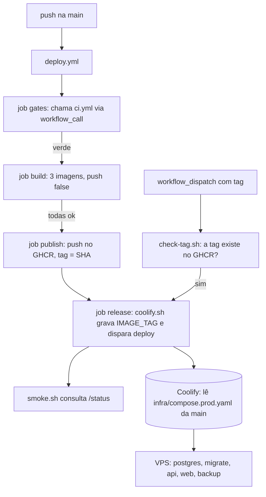
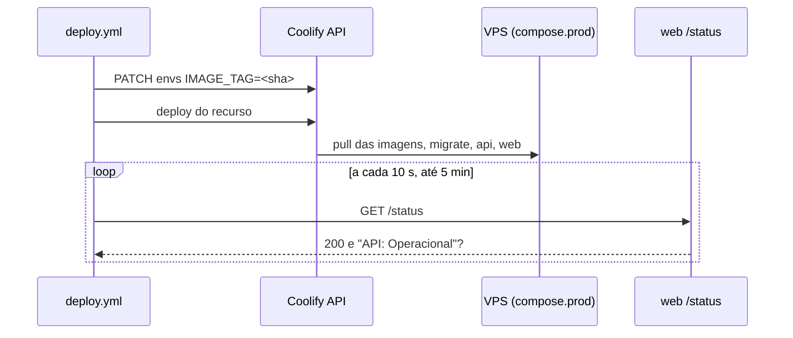

# Production Deploy Design

**Spec**: `.specs/features/production-deploy/spec.md`
**Status**: Approved

Decisões de projeto lidas (`.specs/STATE.md`): AD-001 (imagens por `turbo prune`, usuário `node`, sem `.env`) e AD-004 (API sem domínio nem porta publicada) valem e são respeitadas; nenhuma é substituída.

---

## Architecture Overview

Três coisas novas, todas em arquivos versionados: um workflow (`deploy.yml`), uma pasta `infra/` (compose de produção, scripts de deploy, backup e provisionamento) e um runbook. Nenhum código de `apps/*` muda.

**Por que `workflow_call` e não `workflow_run`:** o `deploy.yml` chama o `ci.yml` como job reutilizável, então os gates rodam dentro do deploy e o spec (DEPLOY-01, que diz que o workflow os executa antes de construir) vale ao pé da letra. O custo é rodar os gates duas vezes num push na `main` (o `ci.yml` continua disparando por `push`); num repositório público isso não custa minutos.

**Por que três imagens:** o serviço `backup` precisa de `pg_dump` e de um cliente S3, que nenhuma das duas imagens existentes tem; publicá-lo como imagem própria mantém "a VPS só baixa e roda".

**Por que build e publish são jobs separados:** DEPLOY-42 exige que, se uma imagem falha, nenhuma seja publicada. O job `build` constrói as três com `push: false` e grava o cache; só se todas passam o job `publish` as envia (reconstrução vinda do cache).

**Onde os testes vivem (AD-003):** em `tooling/guardrails/src/deploy/`. Os que só leem arquivos ou falam com um servidor HTTP falso entram no `pnpm test`; os que precisam de Docker (`*.infra.test.ts`) ficam fora dele, no script `test:infra`, e rodam no job `integration` do CI, para respeitar o orçamento de 30 s do commit.

---

## Code Reuse Analysis

### Existing Components to Leverage

| Component | Location | How to Use |
| --- | --- | --- |
| Dockerfiles `web` e `api` | `apps/web/Dockerfile`, `apps/api/Dockerfile` | Construídos como estão pelo workflow |
| Compose local | `compose.yaml` | Modelo do compose de produção (migrate antes da api, healthchecks, `:?` nas variáveis) |
| `migrate` como entrypoint da imagem da api | `compose.yaml:29`, `apps/api/src/migrate.ts` | Mesmo comando no compose de produção |
| CLI `create-admin` | `apps/api/src/cli.ts` (`node dist/cli.js create-admin --password-stdin`) | Runbook |
| Página `/status` | `apps/web` | Alvo do smoke test e do healthcheck |
| Padrão de teste de workflow | `tooling/guardrails/src/ci-workflow.test.ts` (lê YAML com `yaml`) | Base do `deploy-workflow.test.ts` |
| Actions já fixadas por SHA | `.github/workflows/ci.yml` | checkout, setup-node |
| Pino/log estruturado | API | O backup escreve JSON por linha no mesmo formato de campos (`level`, `msg`) |

### Integration Points

| System | Integration Method |
| --- | --- |
| GHCR | `docker/login-action` com `GITHUB_TOKEN` (`packages: write`) só no job `publish`; imagens públicas |
| Coolify | API REST com `Authorization: Bearer`; ver Risco 1 |
| Cloudflare | Sem API: runbook (DNS, Full strict, origin certificate) e as faixas de IP lidas em `https://www.cloudflare.com/ips-v4` e `ips-v6` pelo hardening |
| R2 | API S3 genérica; `BACKUP_S3_ENDPOINT` |

---

## Components

### deploy.yml

- **Purpose**: Do push na `main` ao smoke test; também o rollback manual.
- **Location**: `.github/workflows/deploy.yml`
- **Interfaces**: triggers `push` (`main`) e `workflow_dispatch` (input `tag`, opcional). Jobs: `gates` (`uses: ./.github/workflows/ci.yml`), `build` (matrix `api`, `web`, `backup`), `publish`, `release`. Com `tag` preenchida, `gates`, `build` e `publish` são pulados e `release` roda depois de `check-tag.sh`. `concurrency: { group: deploy, cancel-in-progress: false }`.
- **Dependencies**: `ci.yml` com `on.workflow_call`; secrets `COOLIFY_URL`, `COOLIFY_TOKEN`, `COOLIFY_RESOURCE_UUID`; variável de repositório `WEB_PUBLIC_URL`.
- **Reuses**: actions do `ci.yml`; `docker/login-action`, `docker/setup-buildx-action`, `docker/build-push-action` fixadas por SHA (abaixo).

Actions novas, resolvidas em 2026-11-09 pela API do GitHub: `docker/login-action` v4.8.0 `8aa5831fb8d48d8f76594c7ddde61ae58019f550`; `docker/setup-buildx-action` v4.4.1 `f87e5991a6d7451dcb8d9637bfbc97413f497069`; `docker/build-push-action` v7.4.0 `c3c9e263c25d99ce0380d002d59b67737d91b0dc`.

### infra/deploy/coolify.sh

- **Purpose**: Gravar `IMAGE_TAG` no recurso do Coolify e disparar o deploy.
- **Interfaces**: `coolify.sh <tag>`; lê `COOLIFY_URL`, `COOLIFY_TOKEN`, `COOLIFY_RESOURCE_UUID`, `COOLIFY_RESOURCE_KIND` (`applications` por padrão, ou `services`). Sai 2 nomeando o primeiro secret ausente (sem imprimir valores); sai 1 com o status HTTP quando o Coolify recusa; nunca roda o deploy se a gravação da variável falhou.
- **Dependencies**: `curl`, `jq`.

### infra/deploy/check-tag.sh

- **Purpose**: Confirmar que `<tag>` existe no GHCR para as três imagens antes do rollback.
- **Interfaces**: `check-tag.sh <tag>`; lê `IMAGE_REPOSITORY` e `REGISTRY_URL` (padrão `https://ghcr.io`); consulta `/v2/<repo>-<nome>/manifests/<tag>` anônimo, já que as imagens são públicas; sai 1 listando as imagens sem a tag.

### infra/deploy/smoke.sh

- **Purpose**: Esperar a stack nova responder.
- **Interfaces**: `smoke.sh <url>`; `SMOKE_INTERVAL` (10), `SMOKE_TIMEOUT` (300). Sucesso: HTTP 200 e o corpo contém a linha "API" com "Operacional". Falha: imprime o último status HTTP e sai 1.

### infra/compose.prod.yaml

- **Purpose**: Fonte de verdade do ambiente de produção, sem Coolify.
- **Interfaces**: variáveis `IMAGE_REPOSITORY`, `IMAGE_TAG`, `POSTGRES_USER/PASSWORD/DB`, `WEB_PUBLIC_URL`, `BACKUP_*`; todas obrigatórias com `:?`, exceto as com padrão documentado. `web` só com `expose: 3000` (o proxy do Coolify alcança pela rede do compose); `postgres` e `api` sem `ports`; `restart: unless-stopped`; `postgres-data` volume nomeado; `migrate` como no compose local.
- **Reuses**: `compose.yaml`.

### infra/backup/ (Dockerfile, backup.sh, restore.sh, verify-restore.sh)

- **Purpose**: Backup diário, restore e prova de restore.
- **Interfaces**: imagem `postgres:18-alpine` (mesmo digest do compose) + `aws-cli` e `jq` do Alpine. `backup.sh [--once]`: sem `--once` dorme até `BACKUP_SCHEDULE_UTC_HOUR` e repete; um ciclo é `pg_dump -Fc` → `aws s3 cp` → listar o prefixo e apagar o que passa de `BACKUP_RETENTION_DAYS`, nessa ordem e só se o envio deu certo. `restore.sh <chave|--latest> [--force]` restaura num banco `TARGET_DATABASE_URL` vazio e imprime `migrations=<n>` lido de `drizzle.__drizzle_migrations`. `verify-restore.sh` cria um banco descartável, restaura o último backup, compara com a contagem de entradas de `apps/api/drizzle/meta/_journal.json` (montado em `MIGRATIONS_JOURNAL`) e remove o banco.
- **Dependencies**: `BACKUP_S3_ENDPOINT`, `BACKUP_S3_ACCESS_KEY_ID`, `BACKUP_S3_SECRET_ACCESS_KEY`, `BACKUP_BUCKET`, `BACKUP_PREFIX`, `DATABASE_URL` montado do compose. Logs: uma linha JSON por evento, sem credencial (a chave S3 vai por variável de ambiente do `aws`, nunca na linha de comando ou no log).

### infra/provision/harden.sh

- **Purpose**: Endurecer um Ubuntu/Debian de forma idempotente.
- **Interfaces**: variáveis `ADMIN_USER`, `ADMIN_SSH_PUBLIC_KEY`, `SSH_PORT` (22), `EXTRA_ALLOW_TCP` (lista separada por vírgula); flags `--dry-run`. Passos em ordem, cada um imprime `changed` ou `unchanged`: validar entradas → usuário → chave → sshd drop-in com `sshd -t` e rollback → `unattended-upgrades` → `fail2ban` → `ufw` e `DOCKER-USER` (faixas da Cloudflare baixadas na hora, com cópia local de reserva `HARDEN_CF_IPS_FILE` para o teste). `HARDEN_SKIP_SERVICES=1` pula `systemctl`/`ufw enable` quando não há systemd (ensaio em container).
- **Reuses**: nada; é um script POSIX/bash novo.

### docs/runbooks/production-deploy.md

- **Purpose**: Os passos que só o autor executa.
- **Interfaces**: seções na ordem do spec (DEPLOY-19), tabela de variáveis (DEPLOY-20) e blocos de comando.

---

## Data Models

Nenhuma tabela nova. Objetos de backup: `<BACKUP_PREFIX>/<YYYY-MM-DDTHH:MM:SSZ>.dump`. O timestamp ISO em UTC ordena lexicograficamente, e `--latest` do restore é o último da listagem.

---

## Error Handling Strategy

| Error Scenario | Handling | User Impact |
| --- | --- | --- |
| Gate do CI falha | `build` e seguintes não rodam (`needs`) | Workflow vermelho, nada publicado |
| Uma imagem não builda | `publish` não roda | Workflow vermelho, nenhuma imagem nova |
| Secret ausente | `coolify.sh` sai 2 nomeando-o | Mensagem no log, sem valor |
| Coolify recusa (4xx/5xx) | Sai 1 com o status HTTP, sem smoke | Workflow vermelho |
| Migration falha | `migrate` sai ≠ 0, `api` não sobe, `web` mostra "Indisponível" | Smoke não vê "Operacional" em 5 min e falha o workflow |
| Tag de rollback inexistente | `check-tag.sh` sai 1 antes do Coolify | Workflow vermelho |
| Backup falha | `backup.sh` sai ≠ 0 e loga o erro, sem apagar antigos; o ciclo seguinte tenta de novo | Linha de erro no log do container |
| Hardening sem chave SSH | Aborta antes de tocar em qualquer coisa | Mensagem, servidor intocado |
| `sshd -t` falha | Remove o drop-in novo, mantém o anterior | Acesso preservado |

---

## Tech Decisions

| Decision | Choice | Rationale |
| --- | --- | --- |
| Linguagem dos scripts | bash (`set -euo pipefail`) | Rodam na VPS, no container do backup e no runner sem instalar nada |
| Testes dos scripts | Vitest em `tooling/guardrails`, servidor HTTP falso em Node para Coolify, registry e `/status`; Testcontainers (Postgres 18, MinIO) e `docker run` para o resto | AD-003; Testcontainers já é usado na API |
| Cliente S3 | `aws-cli` | API S3 genérica (`--endpoint-url`); funciona com R2 e MinIO |
| Imagem do backup | Própria, publicada no GHCR com a mesma tag | A VPS não builda |

---

## Risks & Concerns

| # | Concern | Mitigation |
| --- | --- | --- |
| 1 | **Coolify API não confirmada.** A busca na web mostra rotas `PATCH /applications/{uuid}/envs` e `PATCH /services/{uuid}/envs`, e o deploy como `GET /api/v1/deploy?uuid=` ou `POST`; as fontes divergem e não li a documentação oficial da sua versão. Não sei qual o seu recurso compose usa | `COOLIFY_RESOURCE_KIND` escolhe a família de rotas, e o runbook manda conferir no painel da sua instância (Keys & Tokens, API) antes do primeiro deploy. Os testes provam o contrato que o script assume (corpo e ordem das chamadas), não o Coolify real. Se a rota for outra, muda uma função de `coolify.sh` |
| 2 | Docker contorna o `ufw` nas portas publicadas pelo Traefik do Coolify | Regras também em `DOCKER-USER` (DEPLOY-27); prova real: `curl` de fora ao IP:443 deve falhar, passo do runbook |
| 3 | Fechar o painel do Coolify e o SSH no mesmo passo pode trancar o autor para fora | Entradas validadas antes de qualquer mudança, `sshd -t` com rollback, sessão SSH antiga mantida aberta (DEPLOY-32) |
| 4 | O Coolify lê o compose da `main` no momento do deploy, e a tag vem do SHA do push; um segundo push entre os dois mudaria o compose sem mudar a tag | `concurrency` sem cancelar serializa os deploys; o compose só carrega variáveis, então a divergência é de uma versão para a próxima |
| 5 | `GITHUB_TOKEN` com `packages: write` publica as imagens; o pacote nasce privado na primeira vez e a VPS não consegue baixar | Runbook: tornar os três pacotes públicos no GitHub depois do primeiro publish, antes do primeiro deploy |
| 6 | Gates rodam duas vezes por push (CI e deploy) | Aceito; sem custo em repositório público |
| 7 | Imagem do backup baixa `aws-cli` do Alpine no build, sem pin de versão do pacote | Imagem base fixada por digest; o `apk add` fixa a versão do pacote (`aws-cli=<versão>`) na task |
| 8 | Sem E2E nem build de imagem no PR (`CI_FULL`) | Os testes `test:infra` constroem as imagens localmente e sobem o compose de produção no job `integration` |
