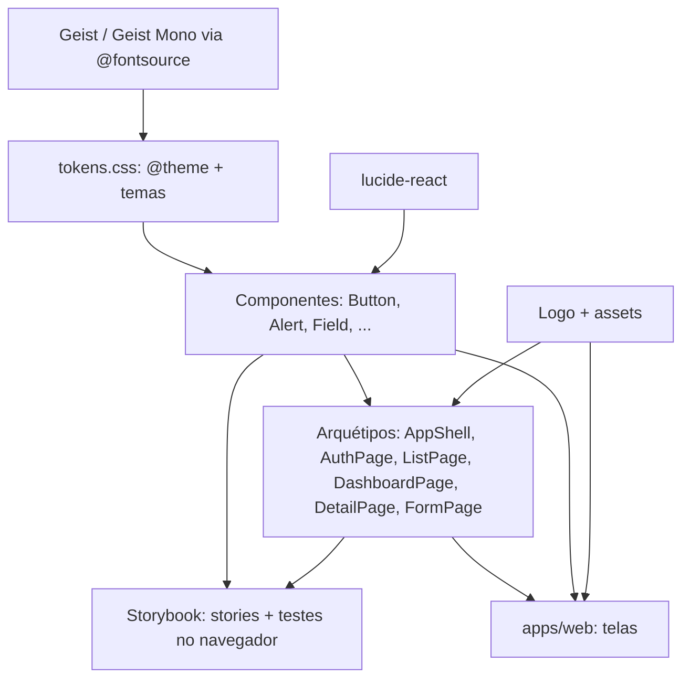

# Prumo Design System Design

**Spec**: `.specs/features/prumo-design-system/spec.md`
**Status**: Approved

---

## Architecture Overview

A feature só de UI. Os tokens vivem num único arquivo CSS em `packages/ui`; os componentes e arquétipos os consomem por classes Tailwind (sem valores arbitrários, que o lint barra); `apps/web` só compõe. Nenhuma regra de negócio, contrato ou rota da API muda. A única mudança de dados é do lado do web: `SystemStatus` ganha o instante da leitura (AD-009).



### Approaches considered (tokens e tamanhos)

| Approach | Como | Trade-off |
| -------- | ---- | --------- |
| **A. `@theme static` com os nomes semânticos atuais, mais os novos; tamanhos pelo namespace `--spacing-*` (Recomendada)** | `--color-*` para cor, `--text-*` com `--line-height` para a escala, `--spacing-sidebar`, `--spacing-row`, `--spacing-control-md` etc. geram `w-sidebar`, `h-row`, `h-control-md`; larguras de coluna por `--container-auth`, `--container-form`, `--container-content` (`max-w-auth`) | Fica no padrão atual do `tokens.css`, nenhuma classe arbitrária, e o lint continua barrando valor cru. O nome do utilitário (`h-row`) difere do nome do token do Prumo (`--row-height`); o mapa fica documentado em `tokens.css`. |
| B. Variáveis CSS puras e classes arbitrárias `h-(--row-height)` | Nomes idênticos aos de `tokens.json` | O lint do projeto barra a forma `(--x)` e `[…]`; exigiria afrouxar a regra. Rejeitada. |
| C. Plugin de utilitários próprio | Um plugin CSS declara `.h-row` etc. | Mais uma peça para manter sem ganho sobre A. Rejeitada. |

A escala de 4 px do Tailwind (`h-4.5` = 18 px, `h-5.5` = 22 px, `h-7.5` = 30 px, `h-9` = 36 px, `h-12` = 48 px) cobre os tamanhos de `Kbd`, `SkillTag`, `NavItem`, cabeçalho de grupo e topbar sem token novo; só os tamanhos nomeados pelo Prumo (`control-sm`, `control-md`, `row-height`, `sidebar-width`, `properties-width`, `content-max`, `form-max`, `auth-max`) viram token.

---

## Code Reuse Analysis

### Existing Components to Leverage

| Component | Location | How to Use |
| --------- | -------- | ---------- |
| `contrastRatio`, `pageBackground`, `settle` | `packages/ui/src/testing/contrast.ts` | Base dos testes de contraste nas stories; ganha um helper de teste de par texto/fundo |
| Padrão de story tema claro/escuro e foco | `packages/ui/src/components/button/Button.stories.tsx` | Replicar em cada componente tocado |
| Check de story por diretório | `packages/ui/src/stories.test.ts` | Já cobre `components/` e `layouts/`; os diretórios novos entram sozinhos |
| `Field` com ids em contexto | `packages/ui/src/components/field/field.tsx` | `PasswordControl` e `Textarea` reusam `useField` |
| `Slot`, `cva`, Radix AlertDialog | `button.tsx`, `confirm-dialog.tsx` | Mesmo padrão nos componentes novos |
| Regras de lint do design system | `packages/config/eslint/design-system.js`, `tooling/guardrails/src/design-system-lint.test.ts` | Barram cor crua e valor arbitrário; o código novo passa por elas |
| `MESSAGES`, `problemMessage` | `apps/web/src/features/identity/model/messages.ts` | Troca só as frases que as cartas redizem |
| `toSystemStatus`, `loadSystemStatus` | `apps/web/src/features/system-status/` | Ganham `checkedAt` |

### Integration Points

| System | Integration Method |
| ------ | ------------------ |
| `apps/web` raiz | `routes/__root.tsx` ganha título "Rumo Carreira", `<link>` do favicon e do ícone de app (servidos de `apps/web/public/`) e continua carregando `@am/ui/styles/tokens.css` |
| Storybook | `.storybook/preview.ts` continua importando `tokens.css` (que importa as fontes) e alternando `data-theme` |
| E2E | `tests/e2e/specs/browser/identity.spec.ts` assertam frases que mudam (sem acesso); atualizadas na task final |

---

## Components

Todos em `packages/ui/src/components/<nome>/` ou `layouts/<nome>/` (arquivo, teste, story, `index.ts`), exportados por `src/index.ts`. Nenhum traz texto de produto.

### Tokens (`src/styles/tokens.css`)

- **Purpose**: Fonte única de cor, tipo, espaço, raio, sombra e tamanho.
- **Interfaces**: `--color-*` (os 13 nomes atuais mais `surface-hover`, `surface-overlay`, `backdrop`, `border-strong`, `border-control`, `accent-hover`, `accent-subtle`, `accent-text`, `danger-hover`, `danger-subtle`, `warning`, `warning-subtle`, `info-subtle`, `status-{saved,applied,interviewing,offer,accepted,rejected,withdrawn,ghosted}`, `paper`, `paper-ink`, `paper-rule`); `--text-{caption,label,body,body-lg,heading-sm,heading-md,heading-lg,heading-xl}` com `--line-height`; `--font-sans`, `--font-mono`; `--radius-{sm,md,lg,full}`; `--shadow-overlay`; `--spacing-{control-sm,control-md,row,sidebar,properties}`; `--container-{auth,form,content}`.
- **Temas**: claro por padrão; escuro em `@media (prefers-color-scheme: dark) :root:not([data-theme='light'])` e em `:root[data-theme='dark']` (o padrão atual). Os valores são os de `docs/design/system/tokens.css`.
- **Base**: `body` em `font-sans`, 13/20, cor `text`, fundo `surface`; `*:focus-visible` com o anel de `focus`; `@media (prefers-reduced-motion: reduce)` zera transição e animação; `font-variant-numeric: tabular-nums` na classe `font-mono`.
- **Fontes**: `@import '@fontsource-variable/geist'` e `'@fontsource-variable/geist-mono'` no próprio `tokens.css`; o Vite empacota os `.woff2` (nenhuma chamada a terceiro).
- **Reuses**: o arquivo atual.

### Button, Alert, Field, StatusBadge, CopyField, ConfirmDialog

- **Interfaces** (só o que muda):
  - `Button`: `intent: 'primary' | 'secondary' | 'ghost' | 'danger'`; `size: 'default' | 'sm'` (`h-control-md` / `h-control-sm`).
  - `Alert`: `intent: 'danger' | 'info' | 'warning'`; ícone por intent (`CircleAlert`, `Info`, `Clock`); `action?: ReactNode` à direita.
  - `Field.Textarea`; `Field.PasswordControl` (props de `input` exceto `type`; `toggleLabel: string`); `Field.Error` ganha o ícone.
  - `StatusBadge`: ponto antes do texto, fundo transparente.
  - `CopyField`: ícone `Check` quando `copied`.
  - `ConfirmDialog`: superfície `surface-overlay`, véu `backdrop`, `radius-lg`, `shadow-overlay`, `max-w-110` (440 px).
- **Reuses**: os arquivos atuais; nenhum nome de prop ou parte existente muda (AC 19).

### Field.PasswordControl

- **Purpose**: Campo de senha com ação de mostrar e ocultar.
- **Interfaces**: `<Field.PasswordControl toggleLabel="Mostrar senha" … />`. Estado interno `visible` (começa `false`); renderiza o `input` (tipo `password`/`text`, ids e `aria-*` do contexto) e um `button type="button"` com `aria-pressed={visible}`, `aria-label` = `toggleLabel`, fixo nos dois estados (padrão de botão de alternância do WAI-ARIA: o rótulo não muda quando o `aria-pressed` muda; decidido em 2026-11-08, user: "Rótulo fixo"), ícone `Eye`/`EyeOff`. Trocar o tipo mantém o `value` e a posição do cursor (o React reaproveita o mesmo nó `input`).
- **Dependencies**: `useField`, `Button` `ghost` `sm`, `lucide-react`.
- **Reuses**: `FieldControl` (extrai o `className` do controle).

### Logo

- **Purpose**: A marca: anel de 3/4 com o quarto aberto.
- **Interfaces**: `<Logo variant="mark" | "wordmark" size?: number title?: string tone?: 'accent' | 'text' | 'surface' />`. `mark` é SVG inline em `currentColor`; `wordmark` junta `mark`, "rumo" (`font-semibold`, `text-text`) e "carreira" (`font-normal`, `text-text-muted`), minúsculas, `tracking-tight`; `tone` ≠ `accent` pinta tudo da mesma cor. `aria-hidden` salvo se `title` vier. A geometria do anel é a de `docs/design/system/assets/logos/rumo-mark.svg`.
- **Reuses**: o SVG dos assets.

### Archetypes

- **AppShell**: `Root`, `Sidebar` (`aria-label` obrigatório; `w-sidebar`, `bg-surface-raised`, borda direita) e as partes novas `AppShell.Brand` (logo + tag opcional), `AppShell.Section` (título `caption` + itens), `AppShell.NavItem` (`current`, `asChild`, `icon`, `count`), `AppShell.User` (iniciais, nome, ação como filho), `AppShell.Main` (`asChild`) e `AppShell.Topbar` (48 px, título à esquerda, ações à direita). Abaixo de `md` a sidebar vira barra superior com a mesma marcação.
- **AuthPage**: `Root` (`main`, coluna `max-w-auth` acima do centro), `Header` (`Logo mark` 20 px, `h1` via filho; props `title`/`lead` não existem: o chamador compõe), `Form`, `Footer`.
- **ListPage**: `Root`, `Header` (topbar: título, contagem `font-mono`, ação), `Filters`, `Content`, `Group` (cabeçalho de 36 px com `heading-sm` e contagem), `Row` (≥ `h-row`, hover, `selected`), `RowText`, `RowMeta` (coluna fixa à direita).
- **DashboardPage**: `Root` (`main` sem padding; a `AppShell.Topbar` entra como primeiro filho, de ponta a ponta), `Content` (padding `space-6`, `max-w-content`; decidido em 2026-11-08, user: "Topbar como na carta"), `Header`, `Grid` (12 colunas), `Widget` (`span: 3|4|5|6|7|8|12`, `Widget.Header`, `Widget.Title`, `Widget.Action`).
- **Reuses**: os arquivos atuais; `Root`, `Header`, `Filters`, `Content`, `Row`, `RowText`, `Grid`, `NavItem` e `Main` mantêm nome e props.

### Componentes e arquétipos das fases futuras

- `Kbd` (`<kbd>`), `EmptyState` (`Root` + `Action` como filho), `PipelineStatus` (`status`, `label`, `iconOnly`; oito ícones SVG próprios de 14 px em `status-*`), `SkillTag` (`variant: 'required' | 'nice' | 'private' | 'match'`, `onRemove?`, `removeLabel`), `DetailPage` (`Root`, `Main`, `Sidebar` com `aria-label` obrigatório, `Property` com `name`/valor), `FormPage` (`Root`, `Index` nav, `Section`, `Actions`).
- Nenhum é usado por `apps/web` nesta feature, exceto `Kbd` e `EmptyState`.

### Telas em `apps/web` (composição, sem regra nova)

| Tela | Arquivos | Mudança |
| ---- | -------- | ------- |
| Raiz | `routes/__root.tsx`, `public/` | título, favicon, ícone de app |
| Login | `LoginForm.tsx` | `AuthPage` novo, `PasswordControl`, rodapé, `Alert` |
| Convite | `AcceptInvitationForm.tsx` | e-mail somente leitura, dica, data de `expiresAt`, `PasswordControl` |
| Acesso | `AccessScreens.tsx`, `model/messages.ts` | três telas com o texto das cartas |
| Shell | `routes/_member.tsx`, `routes/admin/_protected.tsx`, `SessionMenu.tsx` | `Brand`, seções, `User`, iniciais |
| Home member | `routes/_member/index.tsx` | passos e `EmptyState` |
| Admin | `routes/admin/_protected/index.tsx`, `InvitationSummary.tsx`, `StatusPanel.tsx` | widgets |
| Convites | `InvitationsPanel.tsx` | faixa do link, linhas com expiração, vazio |
| Status | `routes/status.tsx`, `StatusPanel.tsx`, `model/system-status.ts` | fora do shell, `checkedAt`, veredito |

---

## Data Models

```typescript
// apps/web/src/features/system-status/model/system-status.ts
export type SystemStatus = {
  api: ServiceState;
  database: ServiceState;
  /** ISO instant at which the web read GET /health (AD-009). */
  checkedAt: string;
};
```

`loadSystemStatus` recebe um relógio injetável (`now: () => Date`) para o teste fixar o instante. A formatação de data e hora vive no web (`Intl.DateTimeFormat('pt-BR', { timeZone })`, fuso `America/Sao_Paulo` fixo, igual no SSR e no cliente), e o "expira em {n} d" é calculado a partir de `expiresAt` e de um relógio injetável (`Math.ceil` dos dias restantes; ≤ 2 em `warning`). Esse cálculo é regra que o usuário vê, então fica em função pura testada (`model/`), não em JSX.

---

## Error Handling Strategy

| Error Scenario | Handling | User Impact |
| -------------- | -------- | ----------- |
| Fonte não carrega | `font-sans`/`font-mono` com pilha de fallback do sistema | texto na fonte do sistema |
| API fora do ar num guard | `UnavailableScreen` (carta "Indisponível"), URL mantida | mensagem + "Tentar novamente" |
| API fora do ar no painel ou no status | `StatusBadge unavailable` e `Alert danger` onde já existe | igual a hoje, com o novo visual |
| `expiresAt` inválido | mostra a linha sem a expiração | sem texto de expiração |
| Nome ausente na sessão | saudação "Olá" e avatar sem iniciais | sem quebra |

---

## Risks & Concerns

| Concern | Location (file:line) | Impact | Mitigation |
| ------- | -------------------- | ------ | ---------- |
| Frases dos testes de identity (e2e e Vitest) mudam: sessão expirada, convite inválido, sem acesso, indisponível | `apps/web/src/features/identity/model/messages.ts`, `tests/e2e/specs/browser/identity.spec.ts:272` | Testes falham pela frase | Task própria troca só a frase nos testes e em `MESSAGES`; o spec declara a exceção (critério 26) |
| `tokens.css` é carregado no web por `?url`; o `@import` das fontes precisa sair processado | `apps/web/src/routes/__root.tsx` | Fonte não servida em produção | Task de fontes inclui teste do build: o CSS emitido referencia `.woff2` do próprio host e o arquivo existe em `dist` |
| `lucide-react` pesa no bundle se importado inteiro | novos componentes | Bundle maior | Importar cada ícone nomeado (`import { Eye } from 'lucide-react'`); o tree-shaking do ESM resolve |
| Tamanho de nomes: `h-row` ≠ `--row-height` | `tokens.css` | Confusão | Comentário com o mapa token do Prumo → utilitário; teste de cobertura confere todos os nomes do `tokens.json` |
| `Field.Control` já é usado em formulários do web; trocar a altura/borda pode mudar quebras de linha | `LoginForm`, `AcceptInvitationForm`, `InvitationsPanel` | Regressão visual | Stories dos arquétipos e passagem a 360 px no walk |
| O texto "rumo carreira" do logotipo é fonte ao vivo, não curvas | `Logo` | Troca de fonte no fallback muda a marca | Pendência registrada no design e fora de escopo; o `mark` não depende de fonte |
| Hidratação: data e hora no SSR e no cliente | tela de status e convites | Divergência de texto | Fuso fixo e relógio injetável; texto igual nos dois lados |
| E2E fora do CI | `docs/workflow.md` | Regressão de jornada passa no CI | Task final roda `pnpm test:e2e` localmente |

---

## Tech Decisions (only non-obvious ones)

| Decision | Choice | Rationale |
| -------- | ------ | --------- |
| Tamanhos como tokens | Namespace `--spacing-*` e `--container-*` | Gera utilitários sem classe arbitrária |
| Contraste dos tokens | Teste unitário que converte OKLCH em sRGB (sem navegador) lendo `tokens.css`, além das stories | Rápido e roda no gate de commit; as stories provam o que o navegador pinta |
| Cobertura dos tokens | Teste unitário compara os nomes de `docs/design/system/tokens.json` com `tokens.css` | Falha se um token do Prumo faltar |
| Ícones | Importação nomeada de `lucide-react`, `strokeWidth` 1.75 num wrapper fino `Icon` interno | Um ponto controla traço e tamanho |
| Fuso das datas | `America/Sao_Paulo` fixo no web | App em pt-BR de uma pessoa; evita divergência SSR/cliente |
| Mostrar senha | Estado local do `PasswordControl`, sem persistir | Não guarda nada sensível |
| `AppShell` por partes | `Brand`, `Section`, `NavItem`, `User`, `Topbar` | Composition pattern do projeto; o web monta a sidebar |

> **Project-level decisions:** AD-012 (fontes e ícones) já registrada. Nenhuma outra convenção nova.
