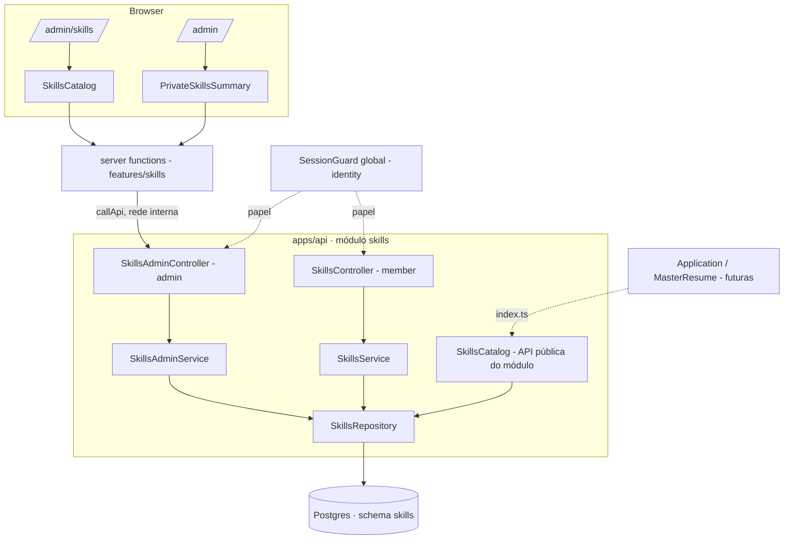
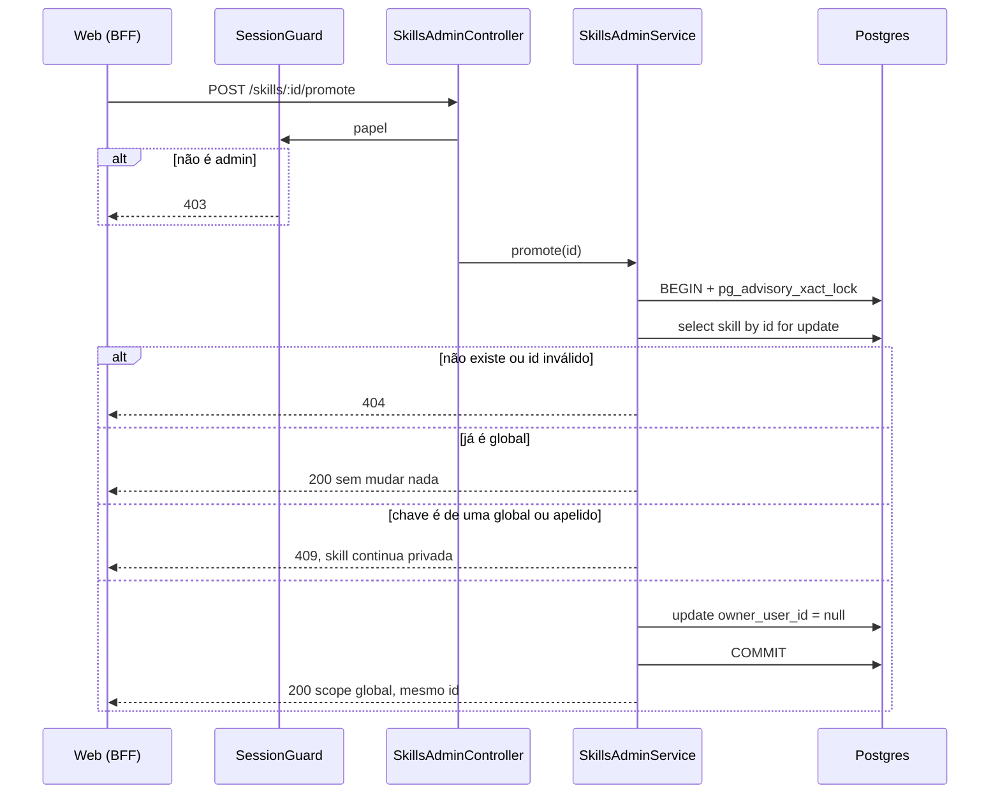

# Skills Design

**Spec**: `.specs/features/skills/spec.md`
**Status**: Approved - 2026-11-08 - user: "Sim"

---

## Architecture Overview

Um módulo novo do monolito, `apps/api/src/modules/skills`, dono do schema `skills`. O navegador fala só com o TanStack Start (AD-004), que tem uma server function por endpoint do **admin** (AD-007); `GET /skills` e `POST /skills` existem só na API e ganham função de BFF com a fatia que os usa. Toda regra que muda o que a pessoa vê (busca, ordem, filtro, contagem, conflito de nome) roda em SQL e no serviço da API, onde os testes de integração a alcançam; o web não filtra nem conta nada.



### Abordagens para o invariante "nenhuma chave global repete outra chave global nem um apelido" (SKL-32)

O invariante cruza duas tabelas (`skills` e `skill_aliases`), então um índice único não o cobre sozinho.

| Abordagem | Como | Custo |
| --- | --- | --- |
| **A. Lock consultivo (recomendada)** | Toda escrita que cria ou muda um nome global (promover, renomear, criar ou editar apelido) roda numa transação que começa com `pg_advisory_xact_lock`. Dentro do lock o serviço confere os conflitos e grava. Os índices únicos de cada tabela ficam como rede de segurança | Escritas do admin ficam em fila (raras, e ninguém é afetado: criar privada e buscar não pegam o lock). O banco não impede um `INSERT` manual que quebre o invariante |
| B. Tabela de nomes globais | Uma tabela `global_names(normalized_key PK, skill_id)` recebe toda chave global e todo apelido; a PK impede a colisão no banco | Dado duplicado, toda escrita mantém duas tabelas, e o seed e as consultas ficam mais complicados; o schema se afasta das tabelas do `.design` |
| C. Uma tabela só de nomes | `skill_names` com o nome oficial e os apelidos como linhas do mesmo tipo | Reescreve o modelo do `.design` e a Key decision 4 |

Escolha: **A**. É a mais simples, mantém as tabelas do `.design` e a prova é um teste com requisições concorrentes (SKL-24, SKL-32).

### Fluxo de promoção (a escrita mais sensível)



---

## Code Reuse Analysis

### Existing Components to Leverage

| Component | Location | How to Use |
| --- | --- | --- |
| `Roles`, `CurrentUser`, `AuthenticatedUser` | `modules/identity/index.ts` | Importados pela API pública; o guard global já fecha as rotas novas (AUTH-15), e o teste de arquitetura de rotas (AUTH-19) passa a cobri-las |
| `ProblemDetailsException`, `problemFor`, `zodBody` | `infra/http/` | Erros em Problem Details e validação por schema do contrato; `zodBody` também valida a query (`@Query(zodBody(schema))`). `titles` ganha o `422` |
| `DATABASE`, `Database` | `infra/database/database.module.ts` | Injeção do Drizzle; o alias `DatabaseExecutor` é repetido no repositório (3 linhas) porque o do `identity` é interior de outro módulo |
| Padrão repositório + serviço + controller + teste `*.int.test.ts` | `modules/identity/*` | Mesma estrutura de pastas (`domain`, `application`, `infra`, `http`) |
| `startApi`, `createMigratedDatabase`, `query`, `argon2idPasswordHasher` em teste | `apps/api/test/*`, `identity/*.int.test.ts` | Testes de integração contra Postgres real com duas contas member e um admin |
| `nestjs-pino` (`PinoLogger`) | `infra/logging` | Eventos estruturados de SKL-60 e SKL-61 |
| `callApi`, `apiContextOf`, `Outcome`, `parsed`, `accepted` | `features/identity/api/server-functions.ts` e `lib/call-api.ts` | Extraídos para `lib/bff.ts` (ver Risks) e usados pelas duas features |
| `InvitationsPanel` | `features/identity/components` | Molde do catálogo: `useInfiniteQuery`, "Carregar mais", `ConfirmDialog` por linha, foco após mudar a lista, `onExpired` |
| `ListPage`, `AppShell`, `DashboardPage.Widget`, `Alert`, `EmptyState`, `Field`, `Button`, `SkillTag`, `ConfirmDialog` | `packages/ui` | Composição da tela e do widget, sem CSS próprio |
| Esquema de testes: Vitest + msw no web, `*.browser.test.tsx` + axe no ui, Playwright no E2E | `apps/web`, `packages/ui`, `tests/e2e` | Mesmos moldes |

### Integration Points

| System | Integration Method |
| --- | --- |
| Postgres | Schema `skills` próprio, sem chave estrangeira para outro schema (SKL-04); `owner_user_id` é um uuid sem FK |
| Identity | Só pelo `index.ts` do módulo: papel e usuário da sessão |
| Application, MasterResume (futuras) | Só por `SkillsCatalog.visibleIds(userId, ids)` exportado em `modules/skills/index.ts` (SKL-58, SKL-59) |
| Migrações | Duas migrações novas em `apps/api/drizzle`: `0002_skills_schema` (gerada pelo `drizzle-kit`) e `0003_skills_seed` (gerada por script a partir do JSON do seed) |
| E2E | A API já publica `127.0.0.1:3333` no compose; o spec cria as privadas do member por ali, porque o member não tem tela |

---

## Components

### Normalização e contrato (`packages/contracts/src/skills.ts`)

- **Purpose**: Uma só definição da chave normalizada, dos limites e dos formatos, usada pela API, pelo web e pelo gerador do seed.
- **Interfaces**:
  - `normalizeSkillKey(text: string): string` - NFKD, sem marcas combinantes, minúsculas, mantém `\p{L}`, `\p{N}`, `+` e `#` (SKL-01).
  - `skillTextSchema` - aparar, reduzir espaços internos a um, 1 a 60 caracteres, chave não vazia (SKL-15, SKL-31, SKL-66).
  - `skillCategorySchema` (as sete categorias), `skillScopeSchema` (`global` | `private`), `skillSchema` `{ id, name, category, scope }`.
  - `createSkillRequestSchema`, `updateSkillRequestSchema` (`name?`, `category?`, ao menos um), `aliasRequestSchema`, `aliasSchema` `{ id, alias }`.
  - `searchSkillsQuerySchema` `{ q? }` (`q` até 60 caracteres, sem aparar nem exigir chave).
  - `adminSkillsQuerySchema` `{ scope: 'all' | 'global' | 'private' = 'all', category?, q?, cursor? }`, `adminSkillSchema` (skill + `aliases: Alias[]`), `adminSkillsPageSchema` `{ items, nextCursor, counts: { total, private } }`.
- **Dependencies**: `zod`.
- **Reuses**: o estilo de `identity.ts` (constantes de limite exportadas, schemas com tipo inferido). Corpo com campos a mais (`ownerUserId`, `scope`) é aparado pelo `z.object`, o que cumpre SKL-16.

### Módulo `skills` da API (`apps/api/src/modules/skills/`)

- **Purpose**: Catálogo compartilhado com as regras de visibilidade, duplicata, promoção, edição e apelidos.
- **Location e interfaces**:

| Arquivo | Responsabilidade |
| --- | --- |
| `domain/cursor.ts` | `encodeCursor({ key, id })`, `decodeCursor(text)`: base64url de JSON; texto que não decodifica para `{ key: string, id: uuid }` é `400` (SKL-37) |
| `domain/ids.ts` | `isUuid(value)`: mesma regra do `identity`, repetida porque o interior do outro módulo não é importável |
| `infra/schema.ts` | `pgSchema('skills')`, enum `skill_category`, tabelas `skills` e `skill_aliases`; reexportado em `infra/database/schema.ts` |
| `infra/skills.repository.ts` | Todo o SQL; não decide regra. `search(userId, key)`, `findVisibleMatch(userId, key)`, `insertPrivate(...)` com `ON CONFLICT` pelo índice parcial `(owner_user_id, normalized_key) WHERE owner_user_id IS NOT NULL`, `listAdmin(filters)`, `counts()`, `aliasesOf(ids)`, `findById(id, forUpdate)`, `globalKeyTaken(key, exceptId?)`, `aliasKeyOwner(key)`, `setOwnerNull(id)`, `updateSkill(id, patch)`, `insertAlias`, `updateAlias`, `deleteAlias`, `visibleIds(userId, ids)`, `lockGlobalNames(tx)` |
| `application/skills.service.ts` | Member: `search(userId, q)` e `create(userId, { name, category })` devolvendo `{ skill, created }`; trata a corrida de criação relendo a privada quando o `ON CONFLICT` não devolve linha (SKL-13) |
| `application/skills-admin.service.ts` | Admin: `list`, `promote`, `update`, `addAlias`, `updateAlias`, `removeAlias`. Cada escrita que muda nome global abre transação, toma o lock, confere e grava; erros de regra são classes (`SkillNotFoundError`, `SkillConflictError`, `SkillNotGlobalError`) que o controller traduz |
| `application/skills-catalog.ts` | `SkillsCatalog.visibleIds(userId, ids): Promise<string[]>`; descarta ids que não são uuid antes da consulta (SKL-58, SKL-59) |
| `http/skills.controller.ts` | `@Roles('member')`: `GET /skills`, `POST /skills` (`201` ou `200` conforme `created`) |
| `http/skills-admin.controller.ts` | `@Roles('admin')`: `GET /admin/skills`, `POST /skills/:id/promote`, `PATCH /skills/:id`, `POST /skills/:id/aliases`, `PATCH` e `DELETE /skills/:id/aliases/:aliasId`. Id que não é uuid vira `404` |
| `skills.module.ts` e `index.ts` | `SkillsModule` (importado em `AppModule`) e a API pública: `SkillsModule`, `SkillsCatalog` |

- **Dependencies**: `DATABASE`, `PinoLogger`, `identity` pelo `index.ts`.
- **Reuses**: o desenho de `invitations.repository.ts` (paginação por cursor com uma linha a mais, `transaction`).

**Regras de SQL que valem registrar**

- Busca do member: `normalized_key LIKE '%' || key || '%'` no nome, ou existência de apelido com `normalized_alias LIKE` igual; as chaves só têm letras, dígitos, `+` e `#`, então o texto não carrega curinga do `LIKE`. Ordem: `(not casa_pelo_nome)`, `normalized_key`, `id`; `LIMIT 20` (SKL-05 a SKL-07).
- Visibilidade do member: `owner_user_id IS NULL OR owner_user_id = $sessão` em toda consulta (SKL-08, Key decision 1). O admin lê sem esse filtro, e a resposta nunca inclui o dono (SKL-33).
- Lista do admin: filtros combinados em um `WHERE`; página por **keyset** `(normalized_key, id) > (cursor.key, cursor.id)`, `LIMIT 51`; apelidos buscados em uma segunda consulta por `skill_id = ANY($ids)` ordenados pela chave; `counts` em uma terceira (`count(*)` e `count(*) FILTER (WHERE owner_user_id IS NOT NULL)`), sem os filtros (SKL-34 a SKL-36).
- Promoção, renomeação e apelidos: lock `pg_advisory_xact_lock(hashtextextended('skills.global-names', 0))`, depois leitura e escrita na mesma transação.

**Mapa de erros** (Problem Details): corpo, query ou cursor inválido `400`; `:id` ou apelido inexistente `404`; colisão de nome `409`; apelido ou edição em privada `422`; papel errado `403` (guard). Violação de índice único que escapar do lock também vira `409`.

**Eventos de log** (`PinoLogger`, nível `info`): `{ event: 'skill.created' | 'skill.updated' | 'skill.promoted' | 'skill.alias_created' | 'skill.alias_updated' | 'skill.alias_removed', skillId, actorId }`. Nunca o nome, o e-mail, o cookie nem o token (SKL-60, SKL-61).

### Seed (`apps/api/src/modules/skills/seed/`)

- **Purpose**: ~200 globais com apelidos, revisáveis como dado, entregues por migração.
- **Interfaces**:
  - `global-skills.json` - `[{ "name", "category", "aliases": [] }]`, a fonte que o autor revisa no PR.
  - `generate-seed-sql.ts` - lê o JSON, calcula as chaves com `normalizeSkillKey` e escreve `drizzle/0003_skills_seed.sql` com `INSERT ... ON CONFLICT DO NOTHING` nas duas tabelas; script `pnpm --filter @am/api seed:generate`.
  - Teste de unidade: invariantes do JSON (SKL-03) e **deriva**: o SQL gerado em memória é igual ao arquivo commitado. Teste de integração: o banco migrado tem pelo menos 200 globais e toda `normalized_key` é a normalização do `name` (SKL-02).
- **Reuses**: o fluxo de migração por SQL do Drizzle (`migrations.ts`), que já roda na subida da API, no CI, no E2E e no preview.

### Feature `skills` do web (`apps/web/src/features/skills/`)

- **Purpose**: Catálogo do admin e widget do painel.
- **Interfaces**:

| Arquivo | Responsabilidade |
| --- | --- |
| `api/server-functions.ts` | Funções puras sobre `callApi` + uma `createServerFn` por endpoint do admin: `listAdminSkills`, `promoteSkill`, `updateSkill`, `addSkillAlias`, `updateSkillAlias`, `removeSkillAlias`. Exporta `ADMIN_SKILLS_ENDPOINTS` (método + caminho de cada função), que o teste compara com a lista esperada e com a ausência de `GET /skills` e `POST /skills` (SKL-54) |
| `model/categories.ts` | Rótulo de cada categoria (AD-015) e a ordem dos chips |
| `model/filters.ts` | `parseCatalogSearch(raw)` (valida `scope`, `category`, `q`; valor inválido cai no padrão) e `searchOf(filters)` (omite o padrão da URL) |
| `model/messages.ts` | Textos do catálogo (erros de campo, `409` da promoção etc.) |
| `components/SkillsCatalog.tsx` | A tela: `useInfiniteQuery` por filtros, "Carregar mais", `EmptyState`, `Alert`, menu e diálogos; recebe `api`, `filters`, `onFiltersChange`, `onExpired`, como o `InvitationsPanel` |
| `components/SkillRow.tsx` | Linha: nome, selo, apelidos, categoria, `Promover` ou menu "⋯" |
| `components/EditSkillDialog.tsx`, `AliasesDialog.tsx`, `AddAliasDialog.tsx` | Diálogos de formulário (TanStack Form + `skillTextSchema` do contrato) |
| `components/PrivateSkillsSummary.tsx` | Widget `span=12` do painel; recebe o `Outcome` da primeira página `scope=private` e o link |
| `index.ts` | API pública da feature (rotas importam só daqui) |

- **Dependencies**: `@am/contracts`, `@am/ui`, `identity` (`index.ts`: `MESSAGES`, `problemMessage`) e `lib/bff.ts`.

**Rotas**: `routes/admin/_protected/skills.tsx` (`validateSearch` com `parseCatalogSearch`; o componente liga `navigate({ search })` ao `onFiltersChange` e a busca espera 300 ms depois da última tecla antes de mudar `q`) e o item "Catálogo de skills" (`Tags`) na sidebar, entre "Convites" e "Status do sistema". O loader de `routes/admin/_protected/index.tsx` ganha `listAdminSkills({ scope: 'private' })` no mesmo `Promise.all`; como é um `Outcome`, uma falha vira o `Alert` do widget sem derrubar os outros (SKL-57).

### Componentes novos e alterados em `packages/ui`

Cada um com story nos dois temas e testes (regra do projeto); os que têm comportamento de teclado ou foco ganham teste de navegador e axe.

| Componente | Mudança | Notas |
| --- | --- | --- |
| `FilterChip` | novo | Botão com `aria-pressed`, contagem opcional em `font-mono`; visual do `am-chip` da carta |
| `SearchInput` | novo | `input type="search"` com o ícone `search`; o rótulo acessível vem de quem usa |
| `Dialog` | novo, sobre `@radix-ui/react-dialog` | `Root`/`Trigger`/`Content`/`Title`/`Description`/`Footer`, mesma superfície do `ConfirmDialog`; foco preso, Esc fecha, foco volta ao gatilho |
| `DropdownMenu` | novo, sobre `@radix-ui/react-dropdown-menu` | `Root`/`Trigger`/`Content`/`Item`; Enter abre, setas movem, Esc fecha |
| `Combobox` | novo, escrito à mão (WAI-ARIA 1.2: `role="combobox"`, `aria-expanded`, `aria-controls`, `aria-activedescendant`, `listbox`) | Controlado: `query`, `options`, `onQueryChange`, `onSelect`, `selected`; não busca nada sozinho |
| `ConfirmDialog` | alterado, compatível | `confirmIntent?: 'danger' \| 'primary'` (padrão `danger`) e `onConfirm` que pode devolver uma promessa: nesse caso o diálogo fica aberto com os dois botões desabilitados e `aria-busy` no de confirmar, até a promessa terminar (SKL-50). `onConfirm` síncrono se comporta como hoje |

---

## Data Models

```typescript
// apps/api/src/modules/skills/infra/schema.ts (Drizzle)
export const skills = pgSchema('skills');
export const skillCategory = skills.enum('skill_category',
  ['language', 'framework', 'database', 'cloud_devops', 'tool', 'practice', 'soft_skill']);

// skills.skills
interface SkillRow {
  id: string;               // uuid, default uuidv7()
  name: string;             // nome oficial, já aparado e com espaços reduzidos
  normalizedKey: string;    // normalizeSkillKey(name)
  category: SkillCategory;
  ownerUserId: string | null; // nulo = global; sem FK (Key decision 2)
}
// índices: unique (normalized_key) WHERE owner_user_id IS NULL
//          unique (owner_user_id, normalized_key) WHERE owner_user_id IS NOT NULL
//          index (owner_user_id)  -- visibilidade do member

// skills.skill_aliases
interface SkillAliasRow {
  id: string;               // uuid, default uuidv7()
  skillId: string;          // FK skills.id (mesmo schema), ON DELETE cascade
  alias: string;            // texto como o admin digitou (aparado)
  normalizedAlias: string;  // unique globalmente
}
```

O `.design` não lista `alias` nem `skill_aliases.id`: o primeiro mostra o apelido como digitado (SKL-26), o segundo endereça o apelido em `PATCH` e `DELETE` (SKL-67 a SKL-70). O invariante entre as tabelas (SKL-32) vive no lock consultivo, não em constraint.

**Contratos HTTP acrescentados ao `.design`**

| Rota | Papel | Corpo / resposta |
| --- | --- | --- |
| `GET /admin/skills?scope=&category=&q=&cursor=` | admin | `200` `{ items: [{ id, name, category, scope, aliases: [{ id, alias }] }], nextCursor, counts: { total, private } }` |
| `PATCH /skills/:id` | admin | `{ name?, category? }` → `200` `{ id, name, category, scope }` |
| `POST /skills/:id/aliases` | admin | `{ alias }` → `201` (ou `200` se repetido) `{ id, alias }` |
| `PATCH /skills/:id/aliases/:aliasId` | admin | `{ alias }` → `200` `{ id, alias }` |
| `DELETE /skills/:id/aliases/:aliasId` | admin | `204` |

`GET /skills`, `POST /skills` (member) e `POST /skills/:id/promote` (admin) seguem o `.design`. A seção Skill de `.design/application-manager.md` é atualizada com estas rotas e passa de `open` a feita no fechamento.

---

## Error Handling Strategy

| Error Scenario | Handling | User Impact |
| --- | --- | --- |
| Corpo, query ou cursor inválido | `zodBody` → `400` com `errors[{ path, code }]` | O diálogo mostra o erro no campo (SKL-49, SKL-73) |
| Nome ou apelido em conflito | `SkillConflictError` → `409` | Mensagem no campo "Nome" ou "Apelido"; na promoção, `Alert` (SKL-47) |
| Apelido ou edição em privada | `SkillNotGlobalError` → `422` | A UI não oferece o gesto; só chamada direta vê o `422` |
| Skill ou apelido que sumiu | `SkillNotFoundError` → `404` | A tela atualiza a lista e some a linha, como o `InvitationsPanel` faz com `404` |
| Corrida na criação de privada | `ON CONFLICT DO NOTHING` + releitura | Uma resposta `201` e outra `200`, uma só linha (SKL-13) |
| Duas escritas de nome global ao mesmo tempo | Fila pelo lock; a segunda vê o resultado da primeira e responde `409` se colide | Sem estado inconsistente (SKL-24, SKL-32) |
| API fora do ar ou resposta fora do contrato | `Outcome` com `503` (já existe) | `Alert` `danger` com `MESSAGES.unavailable`; no painel só o widget cai (SKL-51, SKL-57) |
| Sessão expirada | `401` → `onExpired` redireciona ao login do admin | Como nas telas protegidas de hoje |
| Banco indisponível | Infraestrutura existente (`503`) | Igual ao resto da API |

---

## Risks & Concerns

| Concern | Location (file:line) | Impact | Mitigation |
| --- | --- | --- | --- |
| Os helpers do BFF (`Outcome`, `parsed`, `accepted`, `failed`, `contextOfCurrentRequest`, `responseOptionsOfCurrentRequest`) moram no `server-functions.ts` do `identity`, e a feature `skills` não pode importar o interior | `apps/web/src/features/identity/api/server-functions.ts:28-141` | Copiá-los criaria dois pontos de verdade para cookies e IP do cliente | Task própria: mover para `apps/web/src/lib/bff.ts`, o `identity` passa a importar de lá e reexporta `Outcome`/`ApiFailure`; os testes do `identity` não mudam |
| `ApiMethod` só aceita `GET`, `POST` e `DELETE` | `apps/web/src/lib/call-api.ts:12` | O `PATCH` das edições não passa | Acrescentar `PATCH` e um caso em `call-api.test.ts` |
| `titles` de `problem-details.ts` não tem o `422` | `apps/api/src/infra/http/problem-details.ts:5-15` | Título genérico "Error" no `422` | Acrescentar `422: 'Unprocessable Content'` e cobrir em `problem-details.test.ts` |
| O invariante global-versus-apelido é garantido por lock, não por constraint | `skills-admin.service.ts` (novo) | Um `INSERT` manual no banco pode quebrá-lo | Comentário no serviço, teste com requisições concorrentes (SKL-32) e nota no runbook de operação; trigger de constraint só se surgir escrita fora da API |
| `ConfirmDialog` é usado pelas revogações de convite | `packages/ui/src/components/confirm-dialog/confirm-dialog.tsx` | A mudança de `onConfirm` e de intenção pode alterar o diálogo atual | Parâmetros novos opcionais e padrões iguais ao comportamento de hoje; os testes e a story do componente atual continuam verdes sem edição |
| Busca com `LIKE '%x%'` não usa índice | `skills.repository.ts` (novo) | Varredura da tabela a cada tecla do seletor | Aceito: centenas a poucos milhares de linhas por catálogo; índice `pg_trgm` entra se a medição mostrar custo |
| Duas pessoas com a mesma privada: promover só uma deixa o duplicado (id diferente) na outra | spec, Assumptions | Pontuação do ResumeVersion não casa os dois ids | Default do `.design` já aceito; o `409` marca o caso e a fusão fica para depois de Application |
| Admin lê privadas de todas as pessoas | `skills-admin.service.ts` (novo) | Exceção à Key decision 1 | Só rotas `@Roles('admin')`; a resposta não leva `owner_user_id`; teste confere que nenhum campo identifica o dono (Success Criteria) |
| Os testes de integração criam um banco por teste e a migração do seed passa a inserir ~200 linhas em todos | `apps/api/test/database.ts` | Alguns milissegundos a mais por teste; um teste que cria uma skill "nova" com nome do seed recebe `200` em vez de `201` | Os testes de skills usam nomes fictícios que não estão no seed ("Skill Fictícia Alfa") e o teste de arquitetura garante que nenhum nome de fixture colide com o seed |
| Lista de seed pública | `global-skills.json` | Nenhum dado pessoal, só nomes de tecnologias | Revisão do autor no PR (decidido na spec) |
| Radix `dialog` e `dropdown-menu` são dependências novas do `packages/ui` | `packages/ui/package.json` | Peso no bundle e superfície de manutenção | Mesma família e mantenedor das já usadas (`alert-dialog`, `slot`); instalar com o catálogo do pnpm |

---

## Tech Decisions (only non-obvious ones)

| Decision | Choice | Rationale |
| --- | --- | --- |
| Onde mora `normalizeSkillKey` | `packages/contracts` | API, web (validação de formulário), gerador do seed e testes usam a mesma função |
| Rota da lista do admin | `GET /admin/skills`, separada de `GET /skills` | O admin não usa rotas do produto (AD-005) e a resposta tem forma diferente (apelidos, contagens, todas as privadas) |
| Cursor da lista | base64url de `{ key, id }`, keyset por `(normalized_key, id)` | Ordem alfabética estável sem `OFFSET`; o cursor do `identity` é só um id porque ordena por id |
| Seed | JSON revisável + SQL gerado e commitado + teste de deriva | Revisão legível no PR e migração determinística; o SQL não é editado à mão |
| Chave do lock | `hashtextextended('skills.global-names', 0)` | Um lock por catálogo global; nenhum outro código usa a mesma chave |
| Combobox | Escrito à mão, sem biblioteca | Um único uso, o padrão ARIA é curto e evita uma dependência de busca/seleção |
| Busca e filtro | 100% em SQL | Regras de busca, ordem e contagem rodam onde os testes da API as alcançam |
| Foco após promover | O foco vai para a linha atualizada (`tabIndex=-1`), como o `InvitationsPanel` faz ao revogar | O botão que o tinha deixa de existir; sem isso o foco cai no `body` |

> **Project-level decisions:** a extração dos helpers do BFF para `apps/web/src/lib/bff.ts` (cada feature só tem as suas server functions e importa o resto de `lib`) é uma convenção que as fatias seguintes devem seguir. Registrada em `.specs/STATE.md` como AD-016.
