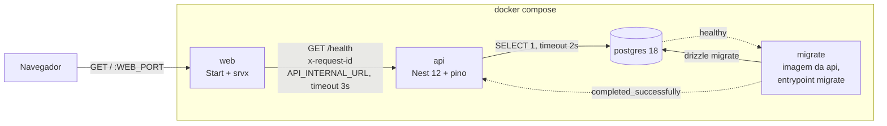

# Walking Skeleton Design

**Spec**: `.specs/features/walking-skeleton/spec.md`
**Status**: Approved
**Approved**: 2026-11-02 - user: "Aprovo o design"

---

## Approach

Toda a forma da solução já vem da spec e das diretrizes: monorepo pnpm + Turborepo, Start como BFF, Nest com Drizzle, compose como fonte de verdade. A decisão de arquitetura que sobra é **como o `web` roda em produção e como as duas imagens são montadas**, porque é ela que garante IMG-01 a IMG-04 e define o padrão de Dockerfile que toda feature vai herdar.

| | A. srvx + `pnpm deploy` nas duas apps (**recomendada**) | B. Nitro no `web`, `pnpm deploy` na `api` | C. Imagem única de workspace |
|---|---|---|---|
| Runtime do `web` | `vite build` gera `dist/client` + `dist/server`; o `srvx` 1.x (estável) serve o handler `fetch` e os estáticos | Plugin `nitro()` gera `.output/` autocontido, `node .output/server/index.mjs` | Igual a A ou B |
| Montagem da imagem | Mesmo Dockerfile nas duas apps: `turbo prune` → install → build → `pnpm deploy --prod` → runtime enxuto | Duas receitas diferentes | Uma imagem com o workspace inteiro |
| Dependência instável | nenhuma | Nitro 3 ainda é RC, com release diário (`3.0.261102-rc`) | — |
| IMG-01/02 | `node_modules` só com as deps de produção da app | `web` sem `node_modules`; `api` como A | **Falha**: as duas imagens carregam tudo |

Recomendação: **A**. Um padrão só para as duas apps, sem dependência em RC, e as provas de IMG-01/02 inspecionam o mesmo tipo de `node_modules` nas duas imagens. O custo é a imagem do `web` levar `node_modules` (React, Router), maior que o `.output` do Nitro. B vira opção quando o Nitro 3 sair do RC; trocar é mudar o plugin e o `CMD`.

---

## Architecture Overview



```mermaid
sequenceDiagram
  participant B as Navegador
  participant W as web (SSR)
  participant A as api
  participant DB as postgres
  B->>W: GET /
  W->>W: requestId = x-request-id recebido ou UUID novo; log
  W->>A: GET /health (x-request-id, abort em 3s)
  A->>DB: SELECT 1 (abort em 2s)
  alt banco responde
    A-->>W: 200 {"status":"ok","db":"up"}
  else banco não responde em 2s
    A-->>W: 503 {"status":"degraded","db":"down"}
  end
  alt API não responde, timeout ou corpo inválido
    W->>W: status = API Indisponível, Banco Indisponível
  end
  W-->>B: 200 HTML com "API" e "Banco de dados"
```

Onde as regras rodam: o mapeamento resposta → "Operacional"/"Indisponível" é uma função pura em `features/system-status/model` (unit), chamada pela server function (integração com MSW) e exercida ponta a ponta pelo Playwright. Nenhuma regra fica no componente.

---

## Repository Layout

```
.nvmrc                         24
package.json                   scripts únicos, packageManager pnpm@11.x, engines.node ^24
pnpm-workspace.yaml            packages, catalog, allowBuilds, injectWorkspacePackages
turbo.json                     build, lint, typecheck, test, test:integration, storybook:build
lefthook.yml                   pre-commit: gitleaks nos arquivos em stage
.dependency-cruiser.cjs        fronteiras entre apps, features e módulos
eslint.config.js               flat config da raiz (importa @am/config)
compose.yaml                   postgres, migrate, api, web
.env.example                   todas as variáveis, só placeholders
.dockerignore                  node_modules, .env*, .git, saídas de build
.github/workflows/ci.yml
scripts/gitleaks-staged.sh     usado pelo lefthook
apps/
  api/                         @am/api   Nest 12, ESM, Drizzle
  web/                         @am/web   TanStack Start, Tailwind 4
packages/
  config/                      @am/config     tsconfig base, eslint base, prettier
  contracts/                   @am/contracts  schemas Zod da API
  ui/                          @am/ui         tokens, StatusBadge, DashboardPage, Storybook
tooling/
  guardrails/                  @am/guardrails testes das regras de lint, hooks, CI e .env.example
tests/
  e2e/                         @am/e2e        Playwright contra o compose
```

---

## Code Reuse Analysis

### Existing Components to Leverage

| Component | Location | How to Use |
| --- | --- | --- |
| Script de worktree | `scripts/worktree.sh` | Já escreve `WEB_PORT`, `API_PORT`, `POSTGRES_PORT` e `COMPOSE_PROJECT_NAME` no `.env`; o compose e o Playwright leem essas variáveis (SKEL-13). O `.env.example` precisa ter essas chaves para o `init` partir dele. |
| `.gitignore` | raiz | Já ignora `.env*` (menos `.env.example`), `dist/`, `.output/`, `.turbo/`, `coverage/`. Falta `storybook-static/`, `playwright-report/`, `test-results/`. |

Não existe código. Todo o resto é novo.

### Integration Points

| System | Integration Method |
| --- | --- |
| Docker (local e CI) | `docker compose` para a stack; Testcontainers para integração; `docker run` nas provas das imagens |
| Git | lefthook instala `pre-commit` via `postinstall` do pacote `lefthook` (liberado em `allowBuilds`) |
| GitHub Actions | `ci.yml`; só roda após o primeiro push |

---

## Components

### Root tooling

- **Purpose**: Comandos únicos e orquestração do monorepo.
- **Location**: raiz
- **Interfaces** (scripts do `package.json`):
  - `lint` → `turbo run lint && pnpm lint:boundaries` (ESLint por workspace, depois `depcruise apps packages --config .dependency-cruiser.cjs --output-type err`)
  - `typecheck` → `turbo run typecheck` (`tsc --noEmit` por workspace)
  - `test` → `turbo run test` (Vitest por workspace; no `@am/ui` inclui as stories em browser mode)
  - `test:integration` → `turbo run test:integration` (só `@am/api` define)
  - `test:e2e` → `pnpm --filter @am/e2e test`
  - `storybook:build` → `turbo run storybook:build --filter @am/ui`
- **Dependencies**: pnpm 11 via corepack, Turborepo 2.11, Node 24
- **Notes**: `pnpm-workspace.yaml` usa `catalog:` para versões compartilhadas (React, Zod, Vitest, TypeScript) e `allowBuilds` para `lefthook`, `@swc/core`, `esbuild`. O `minimumReleaseAge` padrão do pnpm 11 (1 dia) fica ligado.

### packages/config (`@am/config`)

- **Purpose**: Configuração compartilhada: `tsconfig.base.json` (strict, ES2023), `tsconfig.react.json`, `tsconfig.node.json`, preset ESLint (typescript-eslint, react-hooks, better-tailwindcss) e Prettier.
- **Interfaces**: `eslint/base.js`, `eslint/react.js` exportando arrays de flat config; tsconfigs via `extends`.
- **Notes**: As regras de design system ficam aqui:
  - `no-restricted-imports` para `@radix-ui/*` e `radix-ui` em todo arquivo fora de `packages/ui/**` (GUARD-09).
  - As regras de Tailwind abaixo valem para `apps/web/**` e `packages/ui/**` (GUARD-10).
  - `better-tailwindcss/no-restricted-classes` com dois padrões: paleta crua (`^(.*:)?[a-z-]+-(slate|gray|…|rose)-\d{2,3}(/\d+)?$` e `-(black|white)$`) e valor arbitrário (`\[[^\]]*\]`), cada um com mensagem que repete a classe (GUARD-10).
  - `better-tailwindcss/no-unknown-classes` com `entryPoint` no CSS de tokens do `@am/ui`. Como o tema zera a paleta padrão (`--color-*: initial`), uma cor crua também deixa de existir para o Tailwind.

### packages/contracts (`@am/contracts`)

- **Purpose**: Schema do corpo de `/health`, usado pela API para tipar a resposta e pelo `web` para validar o que recebe.
- **Interfaces**:
  - `healthResponseSchema: z.ZodType<HealthResponse>`
  - `type HealthResponse = { status: 'ok'; db: 'up' } | { status: 'degraded'; db: 'down' }`
- **Dependencies**: zod 4 (catalog)

### packages/ui (`@am/ui`)

- **Purpose**: Tokens, primeiro componente e primeiro arquétipo; Storybook como referência viva.
- **Location**: `packages/ui/src/`
- **Interfaces**:
  - `styles/tokens.css`: `@import "tailwindcss"`; `@theme` com `--color-*: initial` e tokens semânticos (`--color-surface`, `--color-text`, `--color-border`, `--color-status-operational`, `--color-status-unavailable`...). Valores em OKLCH, provisórios. Tema claro em `:root`; escuro em `@media (prefers-color-scheme: dark)` e em `[data-theme="dark"]` (o atributo existe para o Storybook alternar; a app não o define).
  - `StatusBadge`: `<StatusBadge intent="operational" | "unavailable" asChild?>` com `cva`; `asChild` via `@radix-ui/react-slot`. O texto vem do chamador (componente puro).
  - `DashboardPage`: compound `DashboardPage.Root`, `.Header`, `.Grid`. É o arquétipo da página de status.
  - `index.ts`: exporta só o que é público.
- **Storybook**: Storybook 10 com `@storybook/react-vite`, `@storybook/addon-themes` (`withThemeByDataAttribute`, claro/escuro) e `@storybook/addon-vitest`. Stories: `StatusBadge` (Operacional, Indisponível) e `DashboardPage`.
- **Tests**: `vitest.config.ts` com dois projetos: `unit` (jsdom, Testing Library) e `storybook` (plugin `storybookTest`, browser mode com `@vitest/browser-playwright` e Chromium headless). `pnpm test` roda os dois (DS-03).

### apps/api (`@am/api`)

- **Purpose**: API Nest com health check, logs estruturados e o runner de migrations.
- **Location**: `apps/api/src/`
- **Structure**:
  ```
  main.ts                  entrypoint HTTP
  migrate.ts               entrypoint do serviço migrate
  app.module.ts
  config/env.ts            schema Zod das variáveis, loadEnv()
  infra/database/          DatabaseModule (pg Pool + drizzle), schema raiz vazio
  infra/logging/           LoggerModule (nestjs-pino), middleware de request id
  modules/health/
    index.ts               API pública: HealthModule
    health.controller.ts   GET /health
    database-probe.ts      SELECT 1 com timeout
  drizzle/                 migrations SQL geradas pelo drizzle-kit
  ```
- **Interfaces**:
  - `loadEnv(source = process.env): ApiEnv` - valida `DATABASE_URL`, `PORT` (padrão 3333), `LOG_LEVEL` (padrão `info`). Falha lança `MissingEnvError` com o nome da variável; `main.ts` e `migrate.ts` imprimem `Missing required environment variable: DATABASE_URL` e saem com código 1 (SKEL-11).
  - `GET /health` → `200 {"status":"ok","db":"up"}` ou `503 {"status":"degraded","db":"down"}` (SKEL-03, SKEL-04).
  - `DatabaseProbe.check(timeoutMs = 2000): Promise<'up' | 'down'>` - `SELECT 1` com `AbortSignal.timeout`/`Promise.race`; o pool usa `connectionTimeoutMillis: 2000` e `query_timeout: 2000`, então nem conexão nova nem query travada passam de 2 s.
  - `runMigrations({ databaseUrl, migrationsFolder, retryWindowMs = 30_000 }): Promise<void>` - tenta conectar a cada 1 s até `retryWindowMs` (EDGE-01), depois `migrate(db, { migrationsFolder })` de `drizzle-orm/node-postgres/migrator`. O migrator do Drizzle registra o que aplicou em `drizzle.__drizzle_migrations` e só aplica migrations mais novas que a última registrada, numa transação (SKEL-10, e SKEL-09 não deixa migration pela metade).
- **Logs (LOG-01..03)**: `nestjs-pino` com `pinoHttp`:
  - `genReqId`: usa `x-request-id` recebido se for uma string não vazia de até 128 caracteres `[A-Za-z0-9._-]`; senão `randomUUID()`.
  - Middleware devolve `x-request-id` na resposta.
  - `customProps: (req) => ({ requestId: req.id })` coloca `requestId` na raiz de toda linha registrada durante a requisição.
  - `formatters.level` emite o nível como texto (`"level":"info"`); `time` em ISO (`pino.stdTimeFunctions.isoTime`); `messageKey` padrão `msg`.
- **Migration inicial**: `0000_require_postgres_18.sql` - `DO $$` que lança erro se `server_version_num < 180000`. Não cria tabela (nenhuma fatia criou a sua ainda), mas dá ao `migrate` uma migration real para aplicar, registrar e pular na segunda subida, e grava no banco a exigência de PG 18 das diretrizes.
- **Formato**: ESM (`"type": "module"`, `module: nodenext`). Build com `nest build -b swc`. Testes com Vitest + `unplugin-swc` (decorators e metadata).

### apps/web (`@am/web`)

- **Purpose**: Página de status renderizada no servidor.
- **Location**: `apps/web/src/`
- **Structure**:
  ```
  server.ts                         entry do servidor: valida env, cria o handler
  router.tsx
  routes/__root.tsx                 html, HeadContent, Scripts, tokens.css
  routes/index.tsx                  loader → getSystemStatus(); compõe StatusPanel
  features/system-status/
    index.ts                        API pública
    api/get-system-status.ts        server function (BFF)
    api/fetch-health.ts             fetch com timeout e x-request-id
    model/system-status.ts          toSystemStatus(result) puro
    components/StatusPanel.tsx      DashboardPage + StatusBadge
  lib/env.ts                        loadServerEnv()
  lib/logger.ts                     pino do servidor
  ```
- **Interfaces**:
  - `loadServerEnv(source = process.env)` - exige `API_INTERNAL_URL`; `server.ts` chama no carregamento e sai com código 1 nomeando a variável (SKEL-11).
  - `fetchHealth(baseUrl, requestId, timeoutMs = 3000): Promise<HealthFetchResult>` - `fetch` com `AbortSignal.timeout(3000)` e header `x-request-id`; valida o corpo com `healthResponseSchema`. Aceita `200` e `503` (os dois têm corpo do contrato); qualquer outra coisa é `{ kind: 'unreachable' }`.
  - `toSystemStatus(result): { api: 'operational' | 'unavailable'; database: 'operational' | 'unavailable' }` - API alcançável → API operacional; banco segue `db`; API inalcançável → os dois indisponíveis (SKEL-06, EDGE-02).
  - `getSystemStatus = createServerFn({ method: 'GET' }).handler(...)` - lê `x-request-id` da requisição de entrada com `getRequestHeader` (ou gera UUID), registra `{ requestId, msg: 'health check requested' }`, chama `fetchHealth` e devolve `toSystemStatus`. Nunca lança: a página sempre responde 200 (SKEL-06).
  - `StatusPanel` - rótulos "API" e "Banco de dados", textos "Operacional"/"Indisponível".
- **Produção**: `vite build` → `dist/client` + `dist/server`; o container roda `srvx --prod -s ../client dist/server/<entry>`. O nome exato do entry é confirmado na task de scaffolding.
- **Tema (SKEL-07)**: `__root.tsx` importa `@am/ui/styles/tokens.css`; o tema segue `prefers-color-scheme` só por CSS, sem JavaScript nem `data-theme`.

### compose.yaml

- **Services**:
  - `postgres`: `postgres:18.x-alpine` fixada por versão e digest; volume em `/var/lib/postgresql` (o PG 18 mudou o `VOLUME` e o `PGDATA`); `127.0.0.1:${POSTGRES_PORT:-5432}:5432`; healthcheck `pg_isready`.
  - `migrate`: imagem da `api`, `command: ["node", "dist/migrate.js"]`, `depends_on: postgres: service_healthy`, `restart: "no"`.
  - `api`: `depends_on: migrate: service_completed_successfully` (SKEL-08, SKEL-09); `${API_PORT:-3333}:3333`; healthcheck HTTP em `/health`.
  - `web`: `depends_on: api: service_started` (o `web` sobe mesmo com a API ruim, SKEL-06); `${WEB_PORT:-3000}:3000`; healthcheck HTTP em `/`.
- Variáveis passadas explicitamente por serviço (`environment:`), com `DATABASE_URL` montada a partir de `POSTGRES_USER`, `POSTGRES_PASSWORD`, `POSTGRES_DB` e o host interno `postgres`.

### Dockerfiles (`apps/api/Dockerfile`, `apps/web/Dockerfile`)

Contexto de build na raiz. Mesmos estágios nas duas apps:

1. `base`: `node:24-alpine` fixada por digest, `corepack enable`.
2. `prune`: `turbo prune @am/<app> --docker`.
3. `build`: copia `out/json` + lockfile, `pnpm install --frozen-lockfile`, copia `out/full`, `turbo run build --filter @am/<app>`, `pnpm --filter @am/<app> deploy --prod /out`.
4. `runtime`: `node:24-alpine`, `WORKDIR /app`, copia `/out` com `--chown=node:node`, `USER node` (IMG-03), `NODE_ENV=production`.

`.dockerignore` exclui `.env*` (menos `.env.example`), então nenhum `.env` entra no contexto (IMG-04).

### Guard-rails de repositório

- **dependency-cruiser** (`.dependency-cruiser.cjs`), reporter `err`, que imprime `error <regra>: <arquivo> → <import>`:
  - `no-cross-app`: `^apps/([^/]+)/` → `^apps/` com `pathNot: ^apps/$1/` (GUARD-06).
  - `no-feature-internals`: `^apps/web/src/features/([^/]+)/` → `^apps/web/src/features/` com `pathNot: [^apps/web/src/features/$1/, ^apps/web/src/features/[^/]+/index\.ts$]` (GUARD-07).
  - `no-module-internals`: o mesmo padrão em `^apps/api/src/modules/` (GUARD-08).
- **lefthook** (`lefthook.yml`): `pre-commit` roda `scripts/gitleaks-staged.sh`. O script exporta os arquivos em stage para um diretório temporário (`git checkout-index --prefix`), roda `gitleaks dir` nele e mostra o caminho do arquivo relativo ao repo (SEC-01). Usa o binário `gitleaks` se estiver no PATH; senão a imagem `ghcr.io/gitleaks/gitleaks:v8.30.1` fixada por digest. Docker já é requisito do ambiente, então ninguém instala nada à mão (SEC-02). Exportar o stage evita montar o `.git` no container, que num worktree é um arquivo apontando para fora da pasta.
- **Instalação dos hooks (SEC-02)**: o `postinstall` do pacote `lefthook` roda `lefthook install`; o pnpm 11 só executa esse script com `allowBuilds: { lefthook: true }`.

### CI (`.github/workflows/ci.yml`)

- `on: pull_request` e `push: branches: [main]`; nunca `pull_request_target` (CI-04).
- `permissions: contents: read` no topo (CI-02).
- Jobs: `quality` (lint, typecheck, test), `integration`, `e2e` (compose), `secrets` (gitleaks via imagem fixada sobre o histórico inteiro, `fetch-depth: 0`), `images` (build de `web` e `api`), `workflow-lint` (actionlint via imagem fixada). Cobertura do CI-01.
- Actions de terceiros por SHA completo com a versão em comentário (CI-03). O pnpm vem do corepack, então não há `pnpm/action-setup`. Não usamos `gitleaks/gitleaks-action`: ela exige licença para contas de organização, e a imagem resolve.

### tooling/guardrails (`@am/guardrails`)

- **Purpose**: Provar com testes Vitest que os guard-rails barram o que devem. Roda no `pnpm test`.
- **Tests**:
  - Fronteiras (GUARD-06..08): `cruise()` da API do dependency-cruiser com o `.dependency-cruiser.cjs` real sobre árvores de fixture que espelham `apps/` (fora dos globs do lint real); afirma regra, arquivo e import.
  - Design system (GUARD-09, GUARD-10): `ESLint.lintText()` com o `eslint.config.js` real e `filePath` virtual dentro de `apps/web` e `packages/ui`; afirma regra, arquivo e classe.
  - Fiação do `pnpm lint` (GUARD-01, GUARD-06): uma cópia mínima do repo num diretório temporário com uma violação plantada; `pnpm lint` precisa sair com código ≠ 0 e citar o arquivo. Prova que o script da raiz chama as duas ferramentas.
  - Segredos (SEC-01): repositório git temporário com `lefthook.yml` e o script; `lefthook install`; stage de uma chave fictícia no formato AWS; `git commit` precisa falhar citando o arquivo.
  - Hooks instalados (SEC-02): `git rev-parse --git-path hooks/pre-commit` existe e chama o lefthook após `pnpm install`.
  - CI (CI-01..04): lê o YAML do workflow e afirma eventos, `permissions`, SHAs de 40 caracteres em todo `uses:` de terceiro e a presença de cada etapa.
  - `.env.example` (SKEL-12): toda chave lida pelos schemas `loadEnv`/`loadServerEnv` e pelo `compose.yaml` aparece no `.env.example`, sem valor que pareça segredo real.

### tests/e2e (`@am/e2e`)

- **Purpose**: Provar a stack de verdade, pelo compose, com as imagens de produção.
- **Config**: Playwright 1.64, `workers: 1` (testes que derrubam serviços não podem rodar em paralelo), `baseURL: http://localhost:${WEB_PORT}` lido do `.env` (SKEL-13). `globalSetup`: `docker compose up -d --build --wait`, medindo o tempo até a página responder `200` (SKEL-01). `globalTeardown`: `docker compose down -v`.
- **Projetos, em ordem**:
  - `stack`: imagens (IMG-01..04 via `docker run --rm --entrypoint sh`), versão do Postgres (SKEL-02), estado e logs do `migrate` (SKEL-08, SKEL-10), portas publicadas (SKEL-13), variável ausente (SKEL-11 via `docker compose run` sem a variável), migration quebrada (SKEL-09, compose com override que monta uma pasta de migrations inválida e um projeto de compose próprio).
  - `browser`: página de status com as duas linhas "Operacional" (SKEL-05), tema escuro e claro por `colorScheme` comparando a cor computada com o token (SKEL-07), axe sem violações, mesmo `requestId` nos logs do `web` e da `api` (LOG-04).
  - `disruption`: `docker compose stop api` → "Indisponível" nas duas linhas com 200 (SKEL-06); `docker compose pause api` → idem em ~3 s (EDGE-02); `stop postgres` → "Banco de dados: Indisponível". Cada teste restaura o serviço no `finally`.

---

## Data Models

Sem tabelas. O único dado é o contrato do health:

```typescript
type HealthResponse =
  | { status: 'ok'; db: 'up' }
  | { status: 'degraded'; db: 'down' }

type ServiceState = 'operational' | 'unavailable'
type SystemStatus = { api: ServiceState; database: ServiceState }
```

Variáveis de ambiente (todas no `.env.example`):

| Variável | Lida por | Obrigatória |
| --- | --- | --- |
| `DATABASE_URL` | api, migrate | sim |
| `API_INTERNAL_URL` | web | sim |
| `PORT` | api, web | não (3333 / 3000) |
| `LOG_LEVEL` | api, web | não (`info`) |
| `POSTGRES_USER`, `POSTGRES_PASSWORD`, `POSTGRES_DB` | compose → postgres e `DATABASE_URL` | sim |
| `WEB_PORT`, `API_PORT`, `POSTGRES_PORT`, `COMPOSE_PROJECT_NAME`, `WORKTREE_SLOT` | compose, Playwright, `worktree.sh` | não |

---

## Error Handling Strategy

| Error Scenario | Handling | User Impact |
| --- | --- | --- |
| Banco fora ou travado | `DatabaseProbe` aborta em 2 s → `503 {"status":"degraded","db":"down"}` | Página: API Operacional, Banco Indisponível |
| API fora, lenta (> 3 s) ou com corpo fora do contrato | `fetchHealth` devolve `unreachable`; server function nunca lança | Página `200`: API e Banco Indisponível |
| Variável obrigatória ausente | `loadEnv`/`loadServerEnv` lançam; entrypoint imprime o nome e sai com 1 | Container não sobe; `docker compose logs` mostra a variável |
| Banco fora quando o `migrate` inicia | Retry a cada 1 s por 30 s, depois sai com 1 | `api` não inicia |
| Migration com erro | Transação desfeita, `migrate` sai com ≠ 0 | `api` não inicia |
| `x-request-id` malformado ou enorme | Ignorado; a API gera um UUID | Nenhum |

---

## Risks & Concerns

| Concern | Location (file:line) | Impact | Mitigation |
| --- | --- | --- | --- |
| TypeScript 7 é o `latest`, mas o `typescript-eslint` 8.72 aceita só `<6.1` | `packages/config` | Lint quebra com TS 7 | Fixar TypeScript `~6.0.3` no catalog. O Nest 12 exige TS ≥ 6, então 6.0 serve aos dois. |
| `minimumReleaseAge` de 1 dia no pnpm 11 | `pnpm-workspace.yaml` | Uma versão publicada hoje não resolve | Manter ligado (segurança de supply chain). As versões escolhidas têm mais de uma semana. |
| PG 18 mudou `VOLUME` e `PGDATA` | `compose.yaml` | Volume em `/var/lib/postgresql/data` não persiste | Montar em `/var/lib/postgresql`. |
| `lefthook` não instala hooks quando `CI` está definido | `postinstall` do lefthook | Prova do SEC-02 falharia no CI | **Confirmado em T3** (lefthook 2.2.2, `postinstall.js`): com `CI` verdadeiro (não vazio, ≠ `0`, ≠ `false`) e `LEFTHOOK` não verdadeiro, o `postinstall` sai sem rodar `lefthook install`; com `LEFTHOOK=1` instala mesmo no CI. O teste do SEC-02 roda `pnpm install` num repositório temporário (worktree de um clone novo) com `CI` e `LEFTHOOK` removidos do ambiente, como numa máquina de desenvolvimento, então passa igual no CI sem `LEFTHOOK=1` no job. Os hooks ficam no diretório comum do git (`git rev-parse --git-path hooks`), compartilhado entre o checkout principal e todos os worktrees; num checkout sem `lefthook.yml` o lefthook sai com 0. |
| Nome do entry do servidor do Start sem Nitro não está documentado | `apps/web` build | `CMD` errado no Dockerfile | Confirmar na task de scaffolding inspecionando `dist/server`; o teste E2E pega o erro. |
| Fixtures de violação dentro do repo seriam pegas pelo `pnpm lint` real | `tooling/guardrails` | Lint vermelho permanente | Fixtures ficam em `tooling/guardrails/fixtures/`, fora do alcance do depcruise (`apps packages`) e ignoradas no ESLint; os testes apontam as ferramentas para elas explicitamente. |
| Testes `disruption` derrubam serviços | `tests/e2e` | Teste seguinte vê a stack quebrada | `workers: 1`, projeto `disruption` por último, restauração em `finally` e espera do healthcheck. |
| EDGE-01 leva 30 s de verdade | integração da api | Suíte de integração mais lenta | Aceito: o teste usa o valor padrão real, então prova o número da spec. |

---

## Tech Decisions

| Decision | Choice | Rationale |
| --- | --- | --- |
| Runtime do `web` | srvx + `dist/` do Vite, sem Nitro | Ver Approach. → **AD-001** |
| Montagem das imagens | `turbo prune` + `pnpm deploy --prod`, mesmo Dockerfile nas duas apps, `USER node` | Padrão que toda app nova copia. → **AD-001** |
| Versões base | Node 24, pnpm 11 (corepack), TypeScript 6.0, Nest 12, Vitest 5, Vite 8, ESLint 10, Storybook 10, Playwright 1.64, Drizzle 0.45 (não o 1.0 RC) | Estáveis e compatíveis entre si; TS 7 e Drizzle 1.0 esperam o ecossistema. → **AD-002** |
| Módulo da API | ESM (`type: module`, `nodenext`) | O Nest 12 já é ESM; o padrão do `nest new` ESM é Vitest. |
| Testes das regras do repo | Workspace `tooling/guardrails` | Lint, hooks e CI são testados como código; nenhuma app carrega testes de infraestrutura. → **AD-003** |
| Health check | Controller simples, sem `@nestjs/terminus` | O corpo exigido (`{"status","db"}`) não é o formato do Terminus. |
| Migration inicial | `0000_require_postgres_18` | Dá ao `migrate` algo real para aplicar sem inventar tabela de domínio. |
| `requestId` fora de requisição | Linhas de boot e shutdown não têm `requestId` | Não existe requisição. Ver ponto para confirmar abaixo. |
| Arquétipo da página de status | `DashboardPage` em `packages/ui` | Toda página usa arquétipo e componente fora de `packages/ui` é proibido. |
| Gitleaks no hook | Script próprio + binário local ou imagem fixada | Funciona em worktree e sem instalação manual. |

**Registradas em `.specs/STATE.md`**:

- **AD-001**: Cada app gera sua imagem com `turbo prune` + `pnpm deploy --prod`, roda como `node` sem `.env`; o `web` roda com srvx, sem Nitro, até o Nitro 3 ser estável.
- **AD-002**: TypeScript fixado em 6.0.x até o `typescript-eslint` suportar o 7.
- **AD-003**: Regras de repositório (lint, fronteiras, hooks, CI, `.env.example`) são provadas por testes em `tooling/guardrails`, que rodam no `pnpm test`.

**Leitura do LOG-01** (aprovada com o design): LOG-01 diz "cada entrada de log" com `requestId`. As linhas de boot (`Nest application successfully started`) não pertencem a requisição nenhuma. O design lê LOG-01 como "toda linha registrada durante uma requisição". A alternativa literal é `requestId: null` nas linhas de boot.
