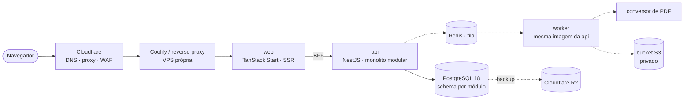

# Application Manager

Gerencie candidaturas, adapte o currículo para cada vaga e gere um PDF pronto para filtros ATS, tudo a partir de um currículo mestre único.

> **Status: em construção.** O design das fases 0 a 2 está confirmado. O walking skeleton (fase 0) já sobe a stack local com uma página de status; candidaturas e currículo vêm nas fases seguintes.

## Por que existe

Adaptar um currículo para cada vaga leva de 30 a 60 minutos, então na prática quase ninguém adapta, e um currículo genérico é o primeiro a cair num filtro ATS. Registrar candidaturas numa planilha também não diz quais tecnologias o mercado está pedindo para o seu nível.

O projeto tem dois objetivos de peso igual:

1. **Ferramenta real:** usada no dia a dia de uma busca por vagas.
2. **Estudo ponta a ponta:** produto, arquitetura, infraestrutura própria, CI/CD, observabilidade, segurança e IA, construídos com o mesmo cuidado de um sistema de produção.

## O que faz

| Fase | Entrega | Status |
|---|---|---|
| 0. Fundação | Monorepo, CI, stack local, deploy automático em VPS própria, acesso por convite | especificando |
| 1. Candidaturas | Vagas com skills normalizadas e nível, pipeline de status, linha do tempo do processo | desenhada |
| 2. Currículo | Currículo mestre com bullets marcados por skill, versão adaptada por vaga, PDF ATS imutável | desenhada |
| 3. IA | Extração de skills da vaga e adaptação assistida | roadmap |
| 4. Insights | Skills mais pedidas por nível e roadmap de estudo | roadmap |
| 5. Automação | Busca de vagas em fontes que permitem | roadmap |

A ideia central da fase 2: a versão do currículo para uma vaga é uma **cópia** do mestre, pré-ordenada pelas skills que a vaga pede e editável sem tocar no original. Ao gerar o PDF, ela é **congelada**, então você sempre sabe exatamente o que enviou para cada empresa. A adaptação seleciona, reordena e reescreve; nunca inventa experiência.

Detalhes em [docs/roadmap.md](docs/roadmap.md) e no [design confirmado](.design/application-manager.md).

## Arquitetura



Linhas tracejadas entram nas fases seguintes.

- **Monolito modular:** um módulo por contexto (`identity`, `skills`, `applications`, `resume`, `documents`...), cada um com o próprio schema no Postgres e sem joins entre eles. Extrair um módulo como serviço é um exercício planejado, não uma reescrita.
- **Front como BFF:** as server functions do TanStack Start só repassam autenticação e montam a página; regra de negócio vive no Nest.
- **Portável por construção:** tudo em container, configuração por variável de ambiente, armazenamento via API S3 e telemetria via OpenTelemetry. Trocar de VPS ou de nuvem é uma operação documentada.
- **Multiusuário desde a modelagem:** todo registro pertence a um usuário, mesmo com o cadastro fechado por convite.

## Stack

| Camada | Tecnologia |
|---|---|
| Frontend | TanStack Start, Router, Query, Form e Table · Tailwind CSS · Radix/shadcn como base de um design system próprio · Storybook |
| Backend | NestJS · Drizzle ORM · PostgreSQL 18 (chaves UUID v7 nativas) · BullMQ + Redis |
| Testes | Vitest (unit e integração com Testcontainers) · Playwright (E2E) · Storybook |
| Monorepo | pnpm workspaces e catalogs · Turborepo |
| Infra | Docker · GitHub Actions · GHCR · Coolify em VPS · Cloudflare (DNS, WAF, R2) |
| Observabilidade | Logs estruturados com correlation ID · OpenTelemetry · Grafana, Loki, Prometheus, Tempo · Uptime Kuma · Sentry |

## Como é desenvolvido

O repositório foi preparado para desenvolvimento com agentes de IA, com proteções verificadas por máquina em vez de dependentes de revisão:

- **Spec antes de código:** cada feature passa por discovery, especificação com critérios em notação EARS, plano de tarefas e execução com um commit por tarefa. Cada critério de aceite é ligado ao teste que o prova, e um verificador independente revisa o resultado.
- **Guard-rails no CI:** fronteiras entre módulos e features, proibição de estilos fora do design system, detecção de segredos no pre-commit e no CI, testes de unidade, integração e E2E.
- **Independente de ferramenta:** as instruções para agentes ficam em [AGENTS.md](AGENTS.md) e as skills em `.agents/skills/`, legíveis por Claude Code, Codex, Cursor e outros.
- **Uma branch por feature:** spec e tasks são escritas na `main` sem commitar; ao aprovar as tasks nasce a branch `feat/<feature>`, que leva plano e código, e chega à `main` por PR com o CI verde ([docs/workflow.md](docs/workflow.md)).

```
roadmap → discovery → spec → tarefas → execução + verificação → PR → main
```

## Estrutura

```
.design/              design confirmado (decisões, fatias, schema, contratos)
.specs/               specs, tarefas e provas de cada feature
.github/workflows/    CI (lint, tipos, testes unitários e de integração, segredos; E2E e imagens desligados até o fluxo da VPS)
docs/                 brief, diretrizes de engenharia, princípios de design, roadmap, workflow
scripts/              utilitários do repositório (scan de segredos)
.agents/skills/       skills usadas no fluxo (espelhadas em .claude/skills/)
apps/web/             TanStack Start (BFF + página de status)
apps/api/             NestJS (health, migrations, logs estruturados)
packages/contracts/   schemas e tipos da API
packages/ui/          design system + Storybook
packages/config/      ESLint, TypeScript e Prettier compartilhados
tooling/guardrails/   testes das regras do repositório (segredos, fronteiras, CI, comandos)
tests/e2e/            Playwright contra a stack do compose
```

## Rodando localmente

Pré-requisitos:

- Node.js 24 (a versão está em `.nvmrc`; com nvm, `nvm use`)
- pnpm 11 via corepack: `corepack enable` (a versão exata vem do `packageManager` do `package.json`)
- Docker com Docker Compose
- Bash (no Windows, Git Bash ou WSL) para os scripts
- Python 3.8+ para os scripts das skills de especificação

Instalar e subir a stack (web, api, migrations e PostgreSQL 18):

```bash
corepack enable
pnpm install          # também instala o git hook que barra segredos
cp .env.example .env  # só placeholders; ajuste portas ou senha se precisar
docker compose up --build
```

A página de status abre em `http://localhost:${WEB_PORT:-3000}` (3000 se você não mudou o `.env`) e mostra o estado do web, da api e do banco. A api responde em `http://localhost:${API_PORT:-3333}/health`.

### Comandos

Todos rodam na raiz e cobrem todos os workspaces:

| Comando | O que faz |
|---|---|
| `pnpm build` | Compila `contracts`, `api` e `web` |
| `pnpm lint` | ESLint em cada workspace e fronteiras entre módulos (dependency-cruiser) |
| `pnpm typecheck` | `tsc --noEmit` em cada workspace |
| `pnpm test` | Vitest de cada workspace, incluindo as stories do `packages/ui` em Chromium headless |
| `pnpm test:repo-rules` | Roda `lint`, `typecheck` e `test` reais numa cópia do repositório com uma violação plantada (~1 min; job próprio no CI) |
| `pnpm test:integration` | Testes da api contra PostgreSQL 18 iniciado pelo Testcontainers (precisa de Docker) |
| `pnpm test:e2e` | Constrói as imagens, sobe a stack do compose e roda o Playwright contra ela |
| `pnpm storybook:build` | Gera o Storybook estático do `packages/ui` |

Na primeira vez, o Playwright precisa do Chromium: `pnpm --filter @am/ui exec playwright install chromium`.

## Documentação

| Documento | Conteúdo |
|---|---|
| [docs/project-brief.md](docs/project-brief.md) | Contexto, problema, fases e decisões de produto |
| [docs/engineering-guidelines.md](docs/engineering-guidelines.md) | Arquitetura, testes, portabilidade, infra, observabilidade e segurança |
| [docs/design/principles.md](docs/design/principles.md) | Direção visual, arquétipos de página e proibições de UI |
| [docs/roadmap.md](docs/roadmap.md) | Agora, próximo, depois e ideias, com o que antecipa cada item |
| [docs/workflow.md](docs/workflow.md) | Como uma feature vai do roadmap à `main`, e o orçamento de tempo dos gates |
| [docs/guia-teste-manual.md](docs/guia-teste-manual.md) | Roteiro para testar manualmente o estado atual |
| [.design/application-manager.md](.design/application-manager.md) | Design confirmado das fases 0 a 2 |

## Créditos

As skills de discovery, PRD e desenvolvimento orientado a spec (`tlc-discover`, `tlc-prd`, `tlc-spec-driven`) são da [Tech Leads Club](https://github.com/tech-leads-club), e as skills `codenavi` e `nestjs-modular-monolith` são de [Felipe Rodrigues](https://github.com/felipfr), todas sob licença [CC BY 4.0](https://creativecommons.org/licenses/by/4.0/). Elas são redistribuídas sem alterações em `.agents/skills/` e `.claude/skills/`.

## Licença

Ainda não definida. Até lá, todos os direitos sobre o código deste repositório são reservados. As skills de terceiros seguem as licenças indicadas em Créditos.
